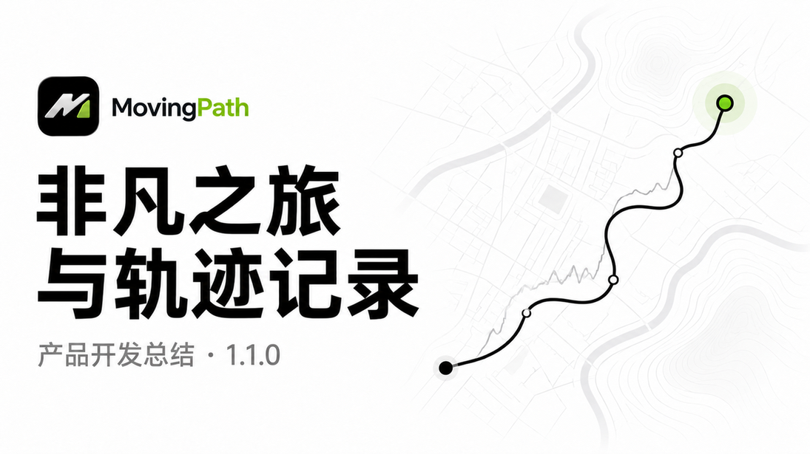

七月写 [Movinn 的第一篇开发总结](https://pjhubs.com/2026/07/12/movinn_0/)时，末尾留了一句话：「我还在克制给 Movinn 加上实时轨迹记录功能，但快有点克制不住了。」三个多月过去，在几趟旅行过程中越发觉得轨迹记录这件事能玩的东西更多，因此新版本中带来了全新的轨迹记录功能！并且 Movinn 也改名为 MovingPath！此外，还有「非凡之旅」、轨迹动图导出和实时活动显示，满满诚意，绝对超值。

## 非凡之旅

几天的旅行会留下多项运动，单项记录分散在列表里，整趟行程的范围和总里程还要另行汇总。「非凡之旅」用手动选中的运动组成旅程，统一展示地图、距离、运动时长和爬升，也可以单独命名。下面是这次济州岛的徒步记录，选中一项后，地图会显示对应路线和沿途照片。

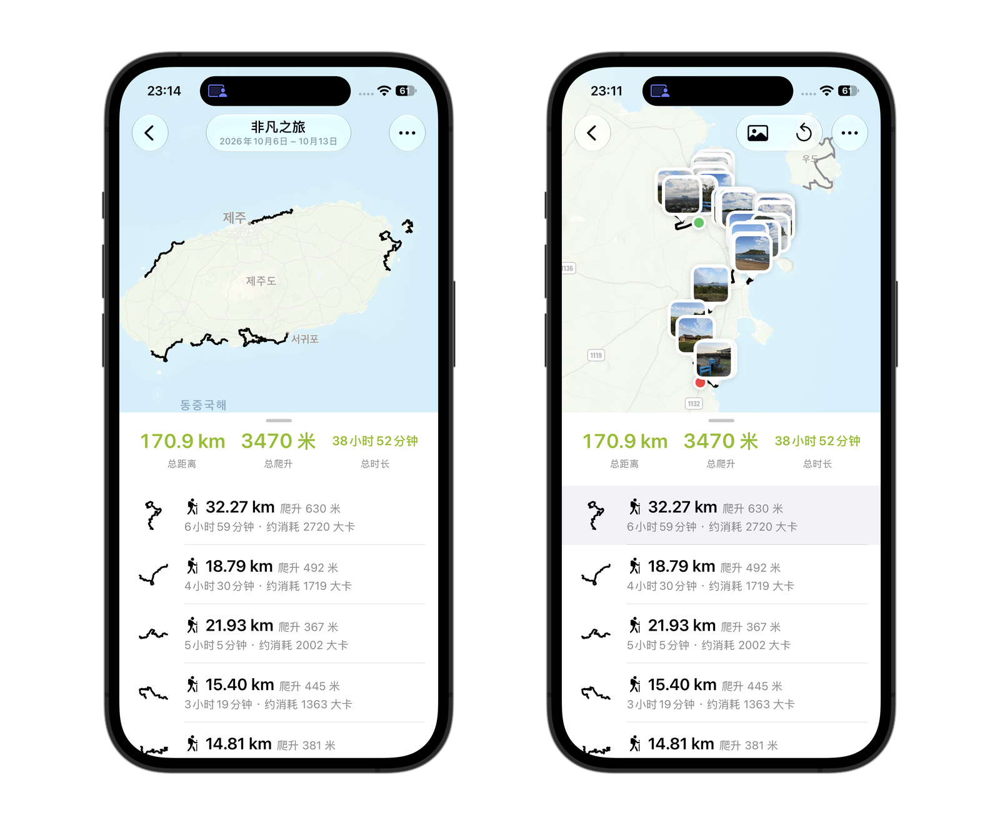

首页「…」里开启旅程，再从运动的长按菜单或详情菜单中加入。最初采用新运动自动加入，但接入数据源时可能一次导入数年历史，会混入大量无关记录，后来改为手动选择。每项运动保留自己的起终点和断段，相隔多天或相距很远的路线不连接。没有 GPS 的室内运动只参与统计；同一次运动更换来源时，转移成员关系，汇总只计一份。完成旅程时取齐成员数据，保存独立快照，成功后再清空当前旅程。历史旅程不随数据源变化，可以回看，也能导出带地图和汇总的方图。

## 轨迹记录

此前的 MovingPath 主要整理从健康和 Strava 导入的运动，现在也可以直接从首页开始记录。支持徒步、骑行、跑步、越野跑和步行，开始后类型固定，热量估算与平台同步都按选定的运动类型处理。开始和结束都采用滑动确认，减少户外操作时误触结束的机会。记录地图可以切换主题、回到当前位置，也可以加入以前的运动或路线簿里的路线，将参考路线和正在记录的轨迹放在同一张地图上。

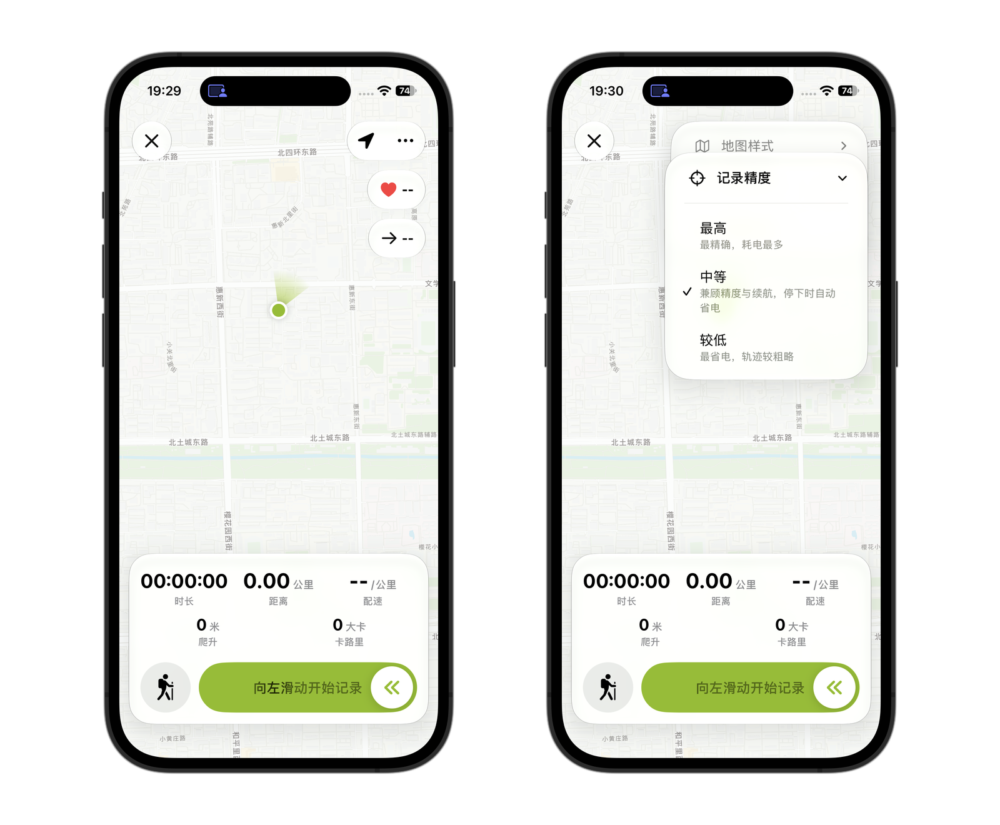

### 持续定位与后台记录

采集和页面使用不同的生命周期：运动开始后持续记录，地图只负责显示，关闭页面不会停止采集。持续定位交给 Core Location，调用 `startUpdatingLocation()` 后，由系统回调提供后续位置，无须用定时器反复发起定位。下面是中档定位的关键配置，按职责重新整理，省略了权限提示和错误展示，后面的代码图也采用这种写法。

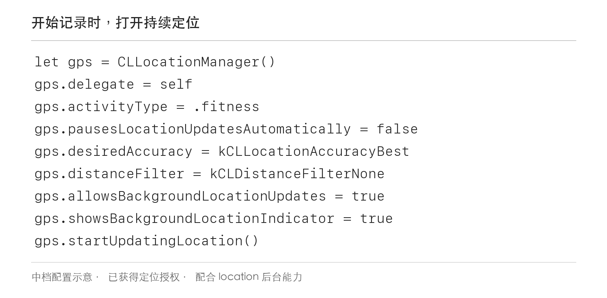

后台更新需要配置文件声明 `UIBackgroundModes: location` 和定位用途。取得使用期间定位权限，在前台开始记录，再开启后台更新和系统指示，才能继续接收后台位置，[Apple 的文档说明了这组配置的关系](https://developer.apple.com/documentation/corelocation/cllocationmanager/allowsbackgroundlocationupdates)。用户关闭「精确位置」时，申请临时精确位置权限；拒绝后提示精度不足可能使轨迹为空。

自动暂停设为 `false`，由记录器决定停留时如何降档、移动后如何恢复。结束运动时停止更新，并关闭后台定位能力。

### 轨迹筛选与平滑

定位有误差，人在原地不动，坐标也可能在附近偏移几米。如果每次都连接相邻位置并累加距离，静止时的漂移就会变成运动里程。除了经纬度，每份位置还需要时间、水平精度、速度、方向和海拔精度。经纬度以度表示，距离和精度用米，速度用米每秒；一次回调可能包含多个位置，分别按各自的时间处理。

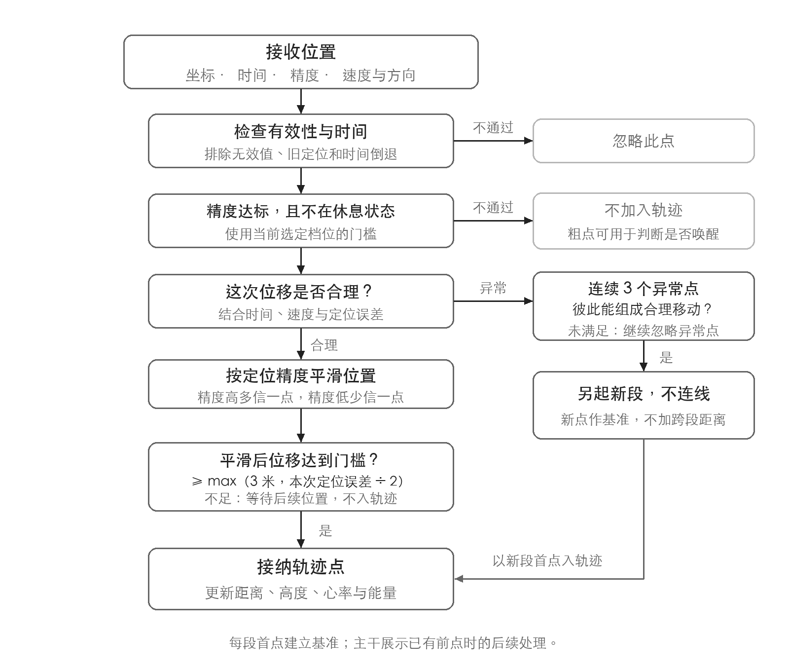

水平精度无效、早于运动开始时间超过十秒的缓存位置，以及时间倒退的点不参与记录。通过当前档位的水平精度门槛后，再根据两点时间差判断位移是否合理：

`允许位移 = 允许速度 × 两点时间差 + 本次水平误差`

有有效速度和速度精度时，允许速度取 `min(70, [max(本次速度, 上次速度) + 本次速度误差] × 1.5 + 3)`，单位米每秒；缺少这些测量时，用七十米每秒作为兜底上限。这是识别定位跳变的阈值，不是运动限速。

超出允许位移的点先忽略。如果连续三个异常点彼此能组成合理移动，就从新位置另起一段，避免此前的错误位置导致后续数据一直被拒绝。分散在不同方向的异常点不满足这个条件，新旧两段之间不连线，也不增加距离。

位置平滑需要兼顾抑制抖动和跟随转弯。我采用根据定位精度调整权重的卡尔曼滤波，先按上一刻的速度与方向预测位置，再由新测量修正；简单平均虽然也能减小抖动，却容易使转弯后的轨迹滞后。

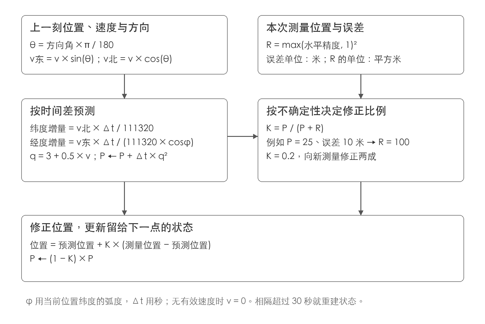

方向角以正北为零、顺时针增加，换成弧度后，东西与南北速度分别为 `v × sin(θ)` 和 `v × cos(θ)`。乘以时间差得到以米计的预测位移，再按每纬度约 111320 米、每经度约 `111320 × cos(纬度)` 米换回经纬度，余弦计算中的纬度也使用弧度。

图中的 `P` 表示预测不确定性，`R` 来自新定位的误差，两者按平方米比较，`K` 决定修正幅度。例如 `P=25`，本次定位误差十米，则 `R=100`，`K=25/(25+100)=0.2`，位置向新测量修正两成。速度越快，预测不确定性增长越快，给转弯留出调整空间；两次位置相隔超过三十秒，就重新初始化平滑状态。

正常连续点的平滑位移达到 `max(3 米, 本次水平误差的一半)` 才加入轨迹，新段的首点只建立基准。例如误差十米、位移两米，暂不累计。接纳后用 `CLLocation.distance(from:)` 累加距离，以距离除以时间差计算速度，再更新爬升、热量，并给轨迹点附上当时有效的心率。保存坐标保持 WGS-84，地图显示时再做展示转换。

### 精度与耗电

筛选发生在取得位置之后，只能改善记录结果。要减少定位本身的消耗，还需要调整向系统请求的精度和位置更新距离。我提供了三个档位，默认中档，也可以在记录中切换：

| 档位 | 向系统请求的精度 | 位置更新的距离要求 | 接受点的最大水平误差 |
| --- | --- | --- | --- |
| 最高 | `kCLLocationAccuracyBestForNavigation` | 不设距离过滤 | 30 米 |
| 中，默认 | `kCLLocationAccuracyBest` | 不设距离过滤 | 50 米 |
| 低 | `kCLLocationAccuracyNearestTenMeters` | 10 米 | 65 米 |

前两列分别对应 `desiredAccuracy` 和 `distanceFilter`，不设距离过滤使用 `kCLDistanceFilterNone`。请求精度决定系统尽量采用什么强度工作，接收门槛决定位置能否进入记录，两者都不是实际误差保证。更新频率由系统决定，距离过滤也不是定时器。档位会记住，切换后立即更新配置。

中低档还会在停留时降低强度。每三十秒检查一次，定时器留十秒容差，便于系统合并唤醒；约九十秒没有有效前进，运动传感器也没有报告移动，就临时改为百米级定位和三十米的距离过滤。

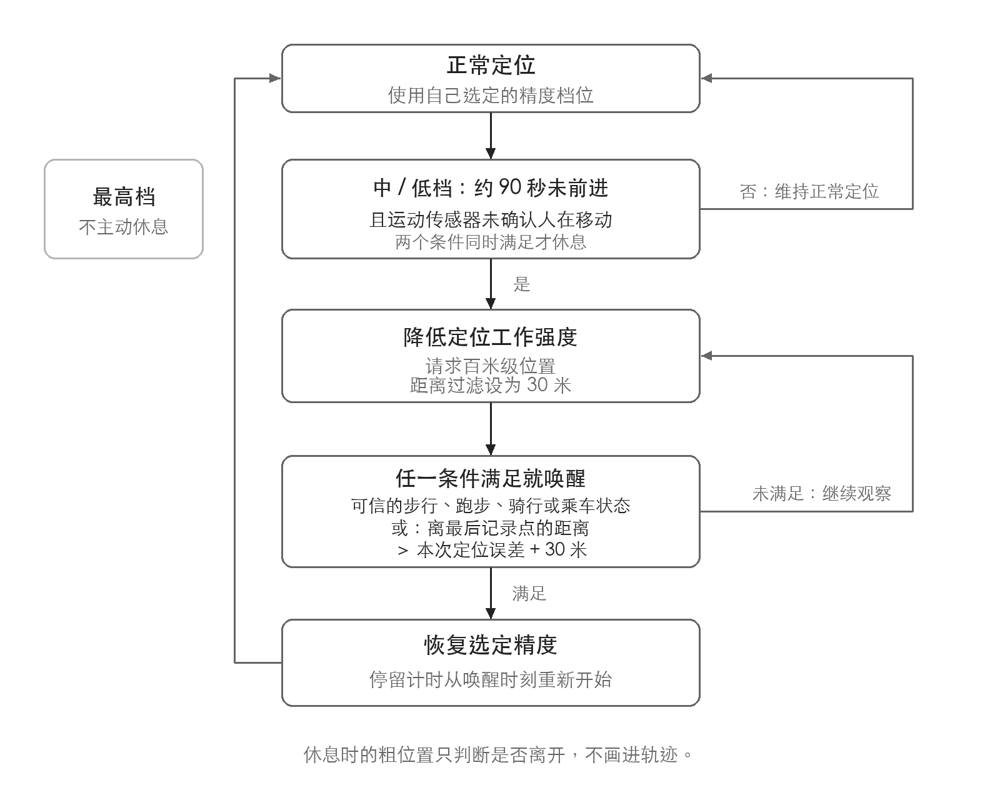

运动传感器报告走路、跑步、骑行或乘车，且置信度不是低时，恢复用户选择的档位。没有可用运动信息，也可以通过粗定位判断：与上次记录点的距离超过「本次水平误差加三十米」，说明已离开原地。休息状态下的粗位置只用于恢复定位强度，不进入轨迹；恢复时重置停留计时，避免立即再次降档。最高档不主动降档。当前没有手动暂停和继续，停留仍计入整场时长。

### 长时间记录

持续记录需要频繁保存，按整条路线重写会反复编码已有坐标。我把坐标和心率拆成两份 JSON Lines 日志，每行一份样本，只追加新增内容；另用一份较小的记录头保存运动状态，以及两份日志已经完整写入的条数和字节位置。

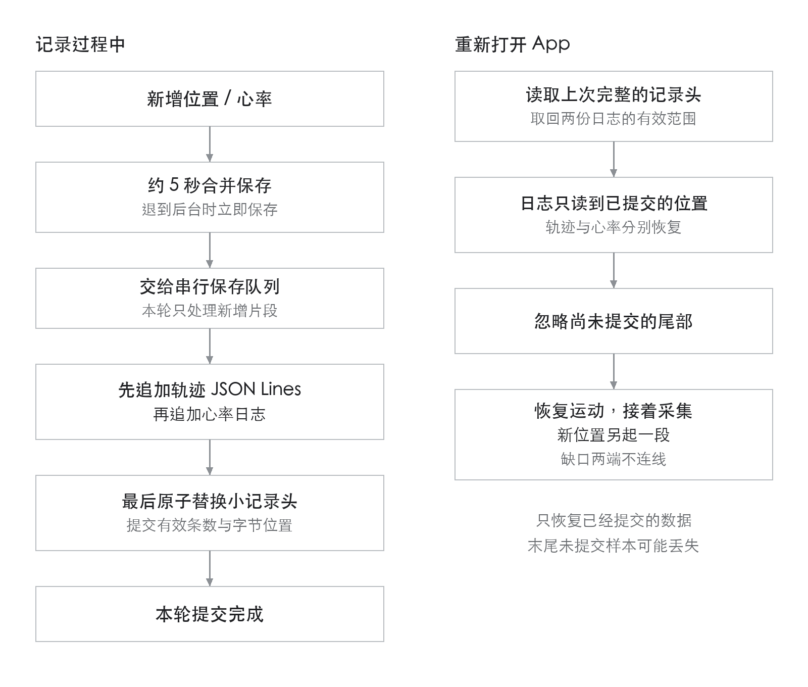

两份日志追加成功后，原子替换记录头，提交这一批数据。追加中途被打断，重新打开时只读取上一份完整记录头确认的范围，忽略后面尚未提交的数据。新数据约五秒合并保存一次，退出前台时立即安排保存；写入交给串行的低优先级队列，每轮只处理新增片段。

内存里的坐标数组也要减少重复复制。新增点之前，暂时移除会话对数组的那份持有，减少 Swift 写时复制整条数组的机会。地图则每约两百个点固定一段折线，只替换末尾仍在增长的部分：连续路线在连接处保留一个共同点，真实断段不保留。页面隐藏或 App 进入后台时停止画线，恢复显示后补上新增部分。离开记录页面会停掉页面秒表，指南针在页面隐藏或进入后台时也停止，定位采集继续。重启后恢复已提交的运动，后续位置另起一段。最后一批尚未提交的数据仍可能丢失，中断期间的路程不补画、不计入距离。

### 心率设备的连接与切换

胸带、臂带和部分手表可以通过 BLE 标准心率服务提供数据。接入这套协议，就不必按品牌分别维护 SDK；手表需要开启心率广播，只支持 ANT+ 的设备则无法通过这条蓝牙通道连接。

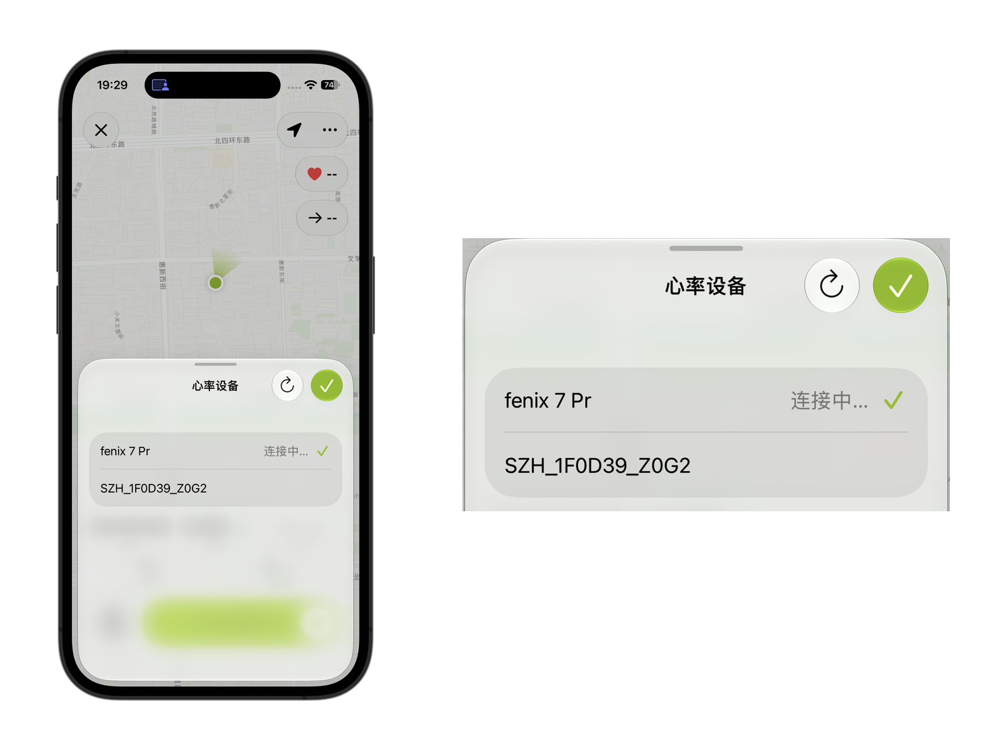

扫描和连接交给 `CBCentralManager`，回调在主队列处理，蓝牙状态进入 `.poweredOn` 后才开始。项目声明了蓝牙用途和 `bluetooth-central` 后台模式；没有选过设备时，不提前启动蓝牙。打开设备页后扫描约十秒，也可以手动刷新。

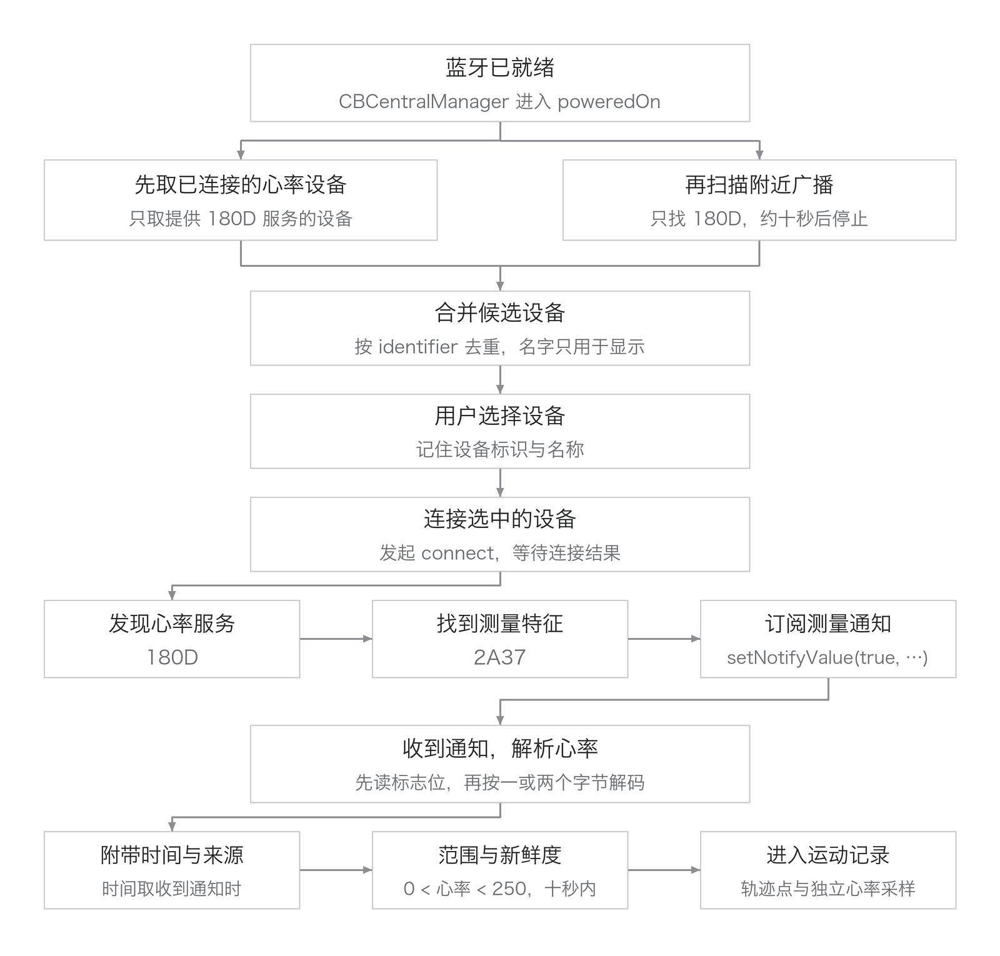

部分传感器连接手机后会停止广播，所以扫描前还要向 iOS 查询已连接的标准心率设备，再按系统标识合并两份结果。选中的标识和名称会保留，下次进入记录页或开始运动时，先按标识找回设备，找不到再扫描。名称仅用于展示，同名设备仍然分别处理。连接成功后，依次发现心率服务 `180D`、测量特征 `2A37`，再订阅通知。三步分别在对应的回调里完成，订阅后才能持续接收设备报告的心率。通知里的数据需要按[标准格式](https://www.bluetooth.com/wp-content/uploads/Files/Specification/HTML/HRS_v1.0/out/en/index-en.html)解码：第一个字节的最低位为零，心率占后面一个字节；为一，则占两个字节，低位在前。

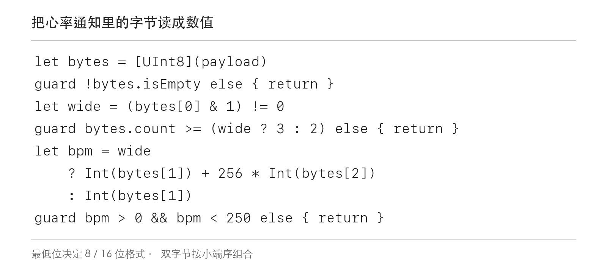

十六进制 `[00, 96]` 得到每分钟 150 次；`[01, B4, 00]` 按 `0xB4 + 0x00 × 256` 得到 180。长度不足的包会丢弃，当前只接受大于零、小于 250 的心率，未继续解析接触状态、RR 间期等可选字段。

切换蓝牙设备时，先保存新选择，再断开旧连接、清除本地连接引用，随后连接新设备。AirPods Pro 3、Powerbeats Pro 2 这类心率耳机则走 HealthKit：iOS 26 起，通过 iPhone 的 `HKWorkoutSession`、关联的实时数据采集器和 `HKLiveWorkoutDataSource` 接收系统样本，需要耳机正在使用并满足健康权限。

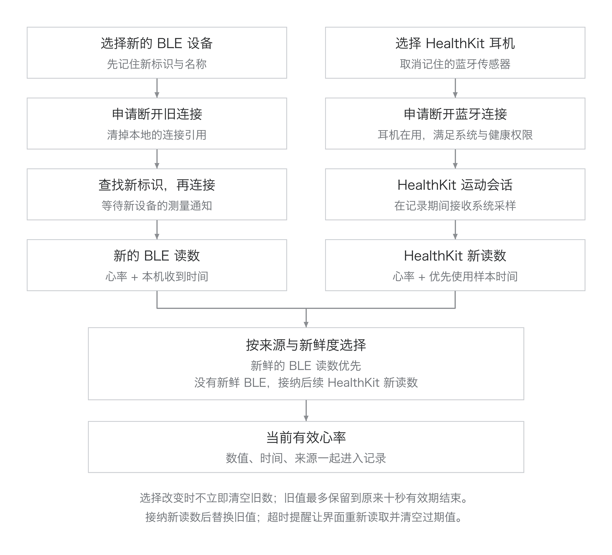

采集回调取最新心率，用 `HKUnit.count().unitDivided(by: .minute())` 换成每分钟次数，时间优先使用样本的结束时间。BLE 心率包不含绝对时间，记录的是本机收到通知的时间。这场 HealthKit 会话用于采集实时数据，结束时丢弃临时构建的运动；正式运动另外保存和同步，避免重复生成运动记录。

两路读数都保留「数值、时间、来源」。直接蓝牙读数在十秒内有效，此时不接纳 HealthKit 新样本；没有有效蓝牙读数时，再使用 HealthKit 送来的新样本。每次接纳读数会重新安排过期提醒，没有后续数据时，界面清除过期值。切换设备不会立即清掉旧数值，它仍可能显示到原来的十秒有效期结束；切到耳机后，尚未过期的蓝牙读数也会暂时阻止 HealthKit 新样本进入。有效心率另外存入独立序列，样本间隔至少五秒，轨迹点附带当时有效的读数。没有新增位置时，心率序列仍可继续更新。

### 爬升与坡度

高度误差会把平地上的小幅波动累积成爬升。记录时优先使用气压计，通过 `CMAltimeter` 的回调读取 `relativeAltitude.doubleValue`。这个值已经是 Core Motion 换算好的米数，[以第一份读数为零点](https://developer.apple.com/documentation/coremotion/cmaltitudedata/relativealtitude)，表示此后相对升降的高度。

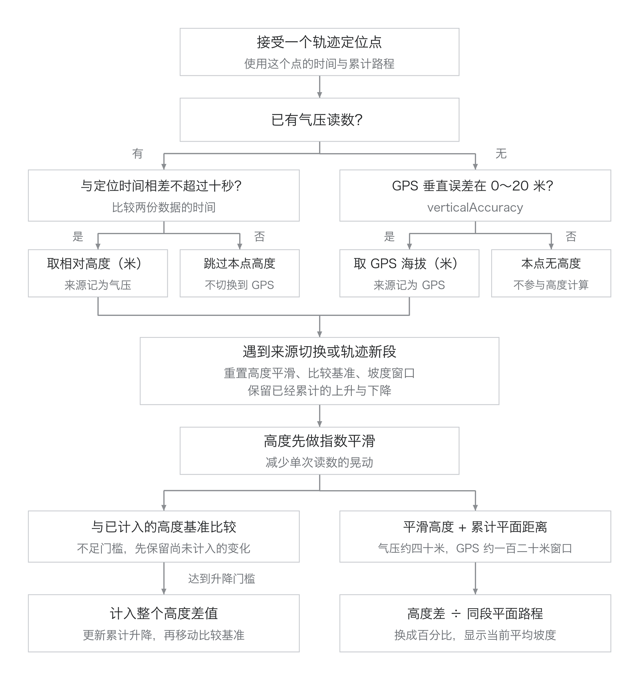

每个接纳的轨迹点匹配当时高度。已有气压读数但与位置时间相差超过十秒，就跳过本次高度；没有气压读数时，才考虑垂直误差在零到二十米之间的 GPS 海拔。两个来源的基准不同，气压相对高度三米不能与 GPS 海拔八十米直接相减。来源切换或路线另起一段时，重置平滑、比较基准和坡度窗口，只保留已经累计的升降。

高度先按 `新平滑值 = 旧平滑值 + α ×（新读数 − 旧平滑值）` 更新，再与上次计入升降的基准比较。气压变化较稳定，GPS 海拔噪声更大，分别采用以下参数：

| 高度来源 | 平滑系数 α | 计入升降门槛 | 坡度回看路程 | 至少走多远才显示坡度 |
| --- | --- | --- | --- | --- |
| 气压 | 0.6 | 1 米 | 约 40 米 | 20 米 |
| GPS | 0.25 | 4 米 | 约 120 米 | 60 米 |

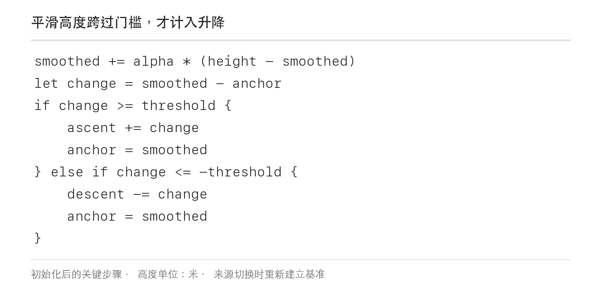

以 GPS 为例，基准在一百米，平滑高度到一百零一米时暂不计入；后来到一百零四点二米，就将完整的四点二米计入爬升，再把基准移过去。未达到门槛的变化继续累积，不与每个相邻点分别比较。坡度取最近一段路程的平滑高度差：`坡度（%）= 100 × 窗口内平滑高度差 ÷ 窗口内平面路程`。四十米路程升高两米，对应百分之五。窗口保留起点或更早的一个样本，实际跨度随采样间隔略有变化；走满半个窗口才显示，界面将结果四舍五入，限制在正负百分之九十九。

### 热量计算

HealthKit 实时运动会话覆盖整场记录，且已有有效活动能量时，优先读取累加值，用 `HKUnit.kilocalorie()` 转成千卡。没有这份测量，就按相邻接纳位置之间的时间段估算。

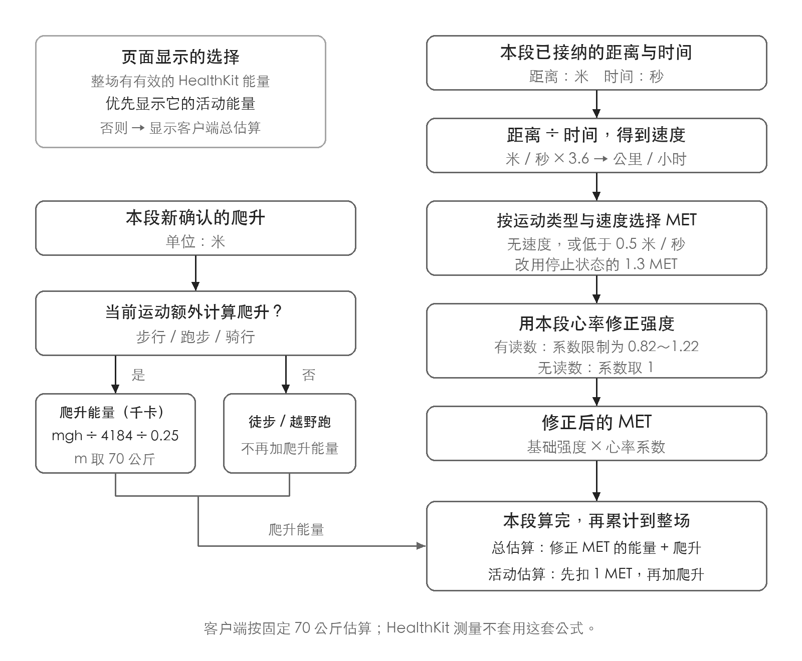

每段速度由平滑后的位移除以时间差得到，单位米每秒，乘 3.6 换成公里每小时后，按运动类型和速度选择基础 MET。MET 表示运动强度，表中速度从左往右匹配第一个满足的上限：

| 运动 | 速度上限，km/h | 对应基础 MET |
| --- | --- | --- |
| 骑行 | <16 / <19.2 / <22.4 / <25.6 / <30.6 / 更高 | 4 / 6.8 / 8 / 10 / 12 / 15.8 |
| 跑步 | <8 / <9.7 / <11.3 / <12.9 / <14.5 / 更高 | 8.3 / 9.8 / 11 / 11.8 / 12.8 / 14.5 |
| 步行 | <3.2 / <4.8 / <5.6 / 更高 | 2.5 / 3.3 / 4.3 / 5 |
| 徒步 | 移动时 | 6 |
| 越野跑 | 使用同速跑步档位 | 跑步值加 1 |

速度低于每秒 0.5 米或没有速度时，采用停止状态的 1.3 MET。心率取这一段已存采样的算术平均，没有才使用当前有效读数；没有心率则修正系数为一，有心率时按下式计算，并限制在 0.82 到 1.22：

`心率系数 = clamp(1 + [(心率 − 60) ÷ 130 − 0.55] × 0.45, 0.82, 1.22)`

`修正 MET = 基础 MET × 心率系数`

体重当前固定按七十公斤，将本段秒数换成分钟后，计算基础消耗：

`基础能量（千卡）= 修正 MET × 3.5 × 70 ÷ 200 ×（本段秒数 ÷ 60）`

步行、跑步和骑行还会加上本段新确认的爬升。用重力势能 `mgh` 计算机械功，焦耳除以 4184 换成千卡，再按 25% 效率估计代谢消耗：

`爬升能量（千卡）= 70 × 9.80665 × 新增爬升米数 ÷ 4184 ÷ 0.25`

徒步和越野跑的基础 MET 已为起伏地形留出余量，不额外叠加爬升，下降也不抵扣热量。总消耗使用完整的修正 MET，活动部分先扣除静息的 1 MET，即 `max(修正 MET − 1, 0)`，两者都加上适用的爬升消耗。一分钟骑行三百米、平均心率 150、新计入三米爬升，时速是十八公里，基础 MET 6.8，修正后约 7.235。基础消耗约 8.86 千卡，爬升约 1.97 千卡，总估算约 10.83 千卡；扣掉这一分钟的静息部分约 1.225 千卡，活动估算约 9.61 千卡。没有新位置时，页面将上次计入能量之后的时间按停止状态补算。

这些参数尚未按个人体重、年龄、静息心率和最大心率校准，25% 效率也是估算假设。页面目前存在口径差别：有 HealthKit 测量时显示活动能量，缺测时显示含静息部分的总估算；同步给 Apple 健康使用活动口径。

### 保存与同步

滑动结束后，先保存正式运动，成功才停止采集、清除草稿；写盘失败则继续记录，允许重试。有效点不足两个或距离不足二十米，会提示记录太短。

保存后可以手动或自动同步 Apple 健康、Strava，自动同步提前完成授权。健康先保存运动，再逐段附加路线；某段附加失败会记录错误，已保存的运动仍算同步成功，避免重试重复创建，目前没有单独补传失败路线的流程。Strava 先接收 GPX，等待异步处理生成活动，再补运动类型。

同步时保存外部副本的身份，之后从健康或 Strava 导入同一项运动，仍与本地记录对应，首页只保留一份。删除本地运动不会同时删除外部副本。心率也按来源限制同步：整场都来自直接蓝牙时，才写入 Apple 健康或上传 Strava 的 GPX；中间使用过 HealthKit 心率，这两条通道便不再附带心率，避免系统数据回流。基础记录可以直接使用，第三方心率连接、精度档位调整，以及 Apple 健康和 Strava 同步，目前属于 Pro 功能。

## 轨迹动图

之前分享页已经支持把轨迹和数据叠加到照片、Live Photo 上，这次补上地图背景的路线动画。选中地图背景后，底部可以开关「动图」。

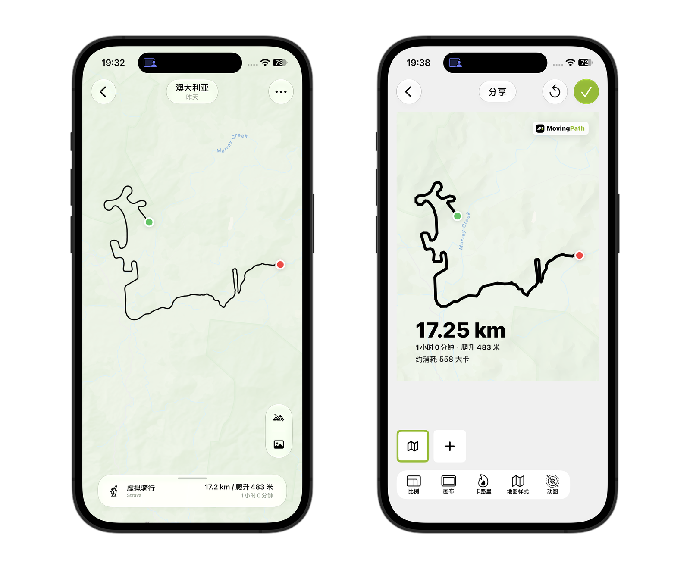

路线由起点逐渐展开到终点，距离、用时、爬升和热量随进度变化，结束后停留片刻展示完整结果。下图由一次实际导出的 Live Photo 转为 GIF，方便在文章里播放；App 保存到相册的仍然是 Live Photo。

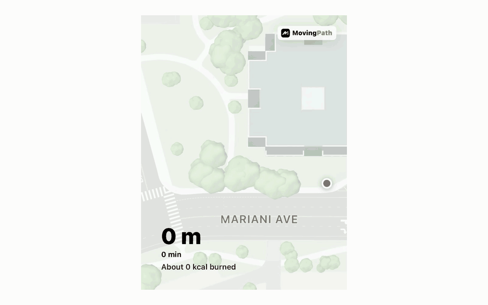

### 路线进度与画面合成

定位点的密度并不均匀，按点的序号推进，采样密集的路段就会播放得更慢。动画最多抽样两千个路线点，建立累计地理距离表，同时把经纬度投影为屏幕坐标。距离决定线头的位置，屏幕坐标负责绘制。

一条两公里的路线，进度到百分之四十，对应八百米。二分查找定位到累计距离七百六十、八百四十米的两个点，区间内的比例为 `(800−760)/(840−760)=0.5`，线头就在两个屏幕点的中间。其他位置同样按 `点 A + 比例 ×（点 B − 点 A）` 插值，已完成的线段完整绘制，当前段绘制到线头，终点标记随之移动。

用时和爬升分别建立累计表，在相同区间内插值，再除以各自末值，得到完成比例，乘回整场运动的总时长、总爬升。缺少有效时间或高度分布时，对应指标才退回按画线进度分配，热量沿用用时比例。显示里程仍采用原运动的总距离，抽样后计算的几何长度只用于定位线头。

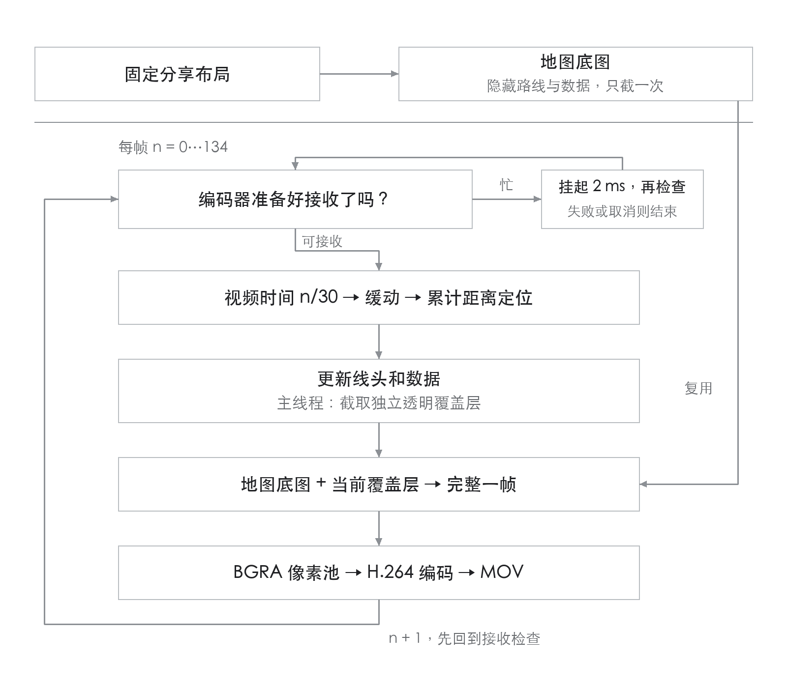

预览随屏幕刷新，导出则按帧号确定画面和时间。当前为 30 帧/秒，开头停留 0.3 秒，画线 3.2 秒，结束停留 1 秒，总长 4.5 秒，共 135 帧，编号 0～134。帧号为 `n` 时，视频时间是 `n/30`，画线进度按下面的关系计算：

`u = clamp((n/30 − 0.3)/3.2, 0, 1)`

`进度 = u² × (3−2u)`

这条曲线让画线先加速、再减速。帧号 57 对应 1.9 秒，扣除开头的 0.3 秒，画线已经进行了 1.6 秒，恰好完成一半。帧号 105 完成整条路线，此后保持完整画面。生成某一帧花了多久，不影响它写入视频的时间戳。

底图只准备一次。导出开始时隐藏路线、数据和品牌标记，取得干净底图；每帧更新覆盖内容，先截成独立透明图，再叠加到底图上。透明视图直接通过 `drawHierarchy` 绘入底图，可能覆盖已有像素，所以保留了这一步中间合成。导出期间，界面上覆盖一张快照，逐帧视图更新在快照下进行，避免预览里的数字随导出变化。

### 编码与 Live Photo 配对

合成画面以 1080 像素宽度输出，高度随画布比例计算并对齐偶数，使用 H.264 编码，写入 MOV。UIKit 视图更新和截图在主线程完成，再从可复用的 `CVPixelBuffer` 池取得 BGRA 缓冲区，锁定内存，用 `CGContext` 绘入画面，解锁后通过 `AVAssetWriterInputPixelBufferAdaptor` 按时间戳提交。

缓冲区的每行字节数读取 `CVPixelBufferGetBytesPerRow`，不能假定总是宽度乘四。位图采用小端、预乘 alpha，与 BGRA 布局对应；输入的 `expectsMediaDataInRealTime` 设为 `false`，逐帧导出的节奏由编码器接收状态控制。

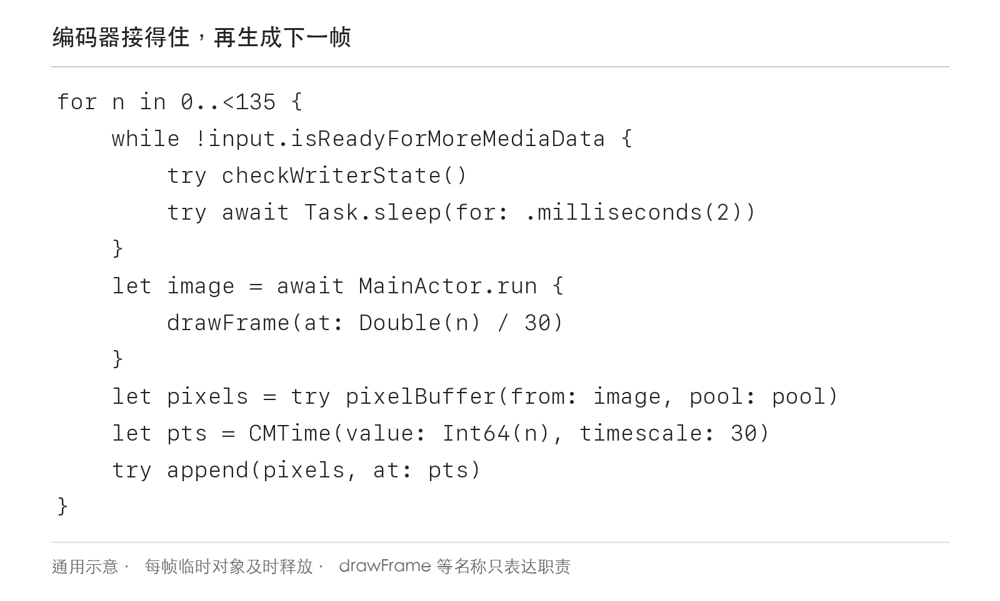

[编码器尚未准备好接收数据](https://developer.apple.com/documentation/avfoundation/avassetwriterinput/isreadyformoremediadata)时，异步等待两毫秒再检查；写入出错或取消就结束。等它准备好才生成下一帧，避免渲染持续领先于编码。以 1080×1350 的四通道原始像素计算，一帧约 5.8MB，135 帧接近 800MB，尚未包含其他临时图。这是按尺寸计算的占用，不是实测峰值。缓冲池复用、每帧的 `autoreleasepool` 和生成前的等待，共同减少内存积累。

提交全部帧后，标记输入结束，等待 `finishWriting`，确认视频写入完成，再补齐配对信息。完整路线的 JPEG 在导出开始时已经保存，两份资源共用一个新 UUID：JPEG 写入 Apple Maker 字典的 `17` 字段，MOV 写入 `com.apple.quicktime.content.identifier`。MOV 还需要一条定时元数据轨道，标明照片对应的视频时刻。

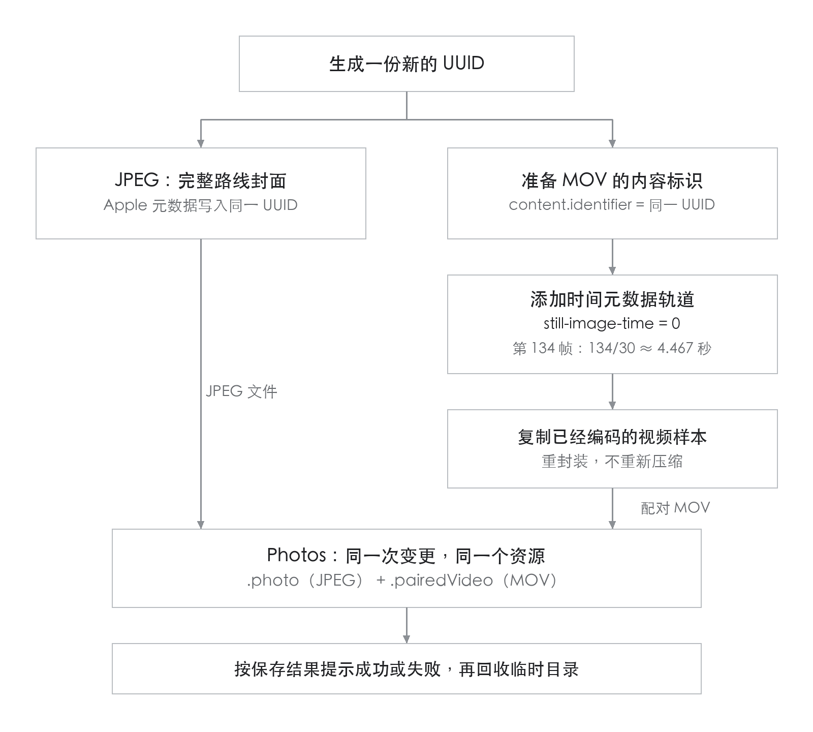

封面采用完整路线，对应帧号 134，时间为 `134/30 ≈ 4.467 秒`。4.5 秒是视频区间的结束位置，不能用它指向一张实际帧。`com.apple.quicktime.still-image-time` 的标记值为零，照片对应的时刻放在 `AVTimedMetadataGroup` 的范围起点，持续时间为 0.01 秒。补充元数据时读取已编码样本，以 `outputSettings: nil` 的输入复制到新 MOV，只重新封装，不再压缩视频。

取得相册添加权限后，在[同一次相册变更](https://developer.apple.com/documentation/avfoundation/capturing-and-saving-live-photos)中，把 JPEG 作为 `.photo`、MOV 作为 `.pairedVideo` 交给同一个资源创建请求。相册保存完成后提示成功，正常结束或出错返回都会回收临时目录，并恢复导出前的地图、模块和选中状态。

## 模拟器的 GPS

定位筛选、距离累计和地图跟随需要反复验证同一段移动过程，开发时用模拟器的系统定位模拟提供连续输入。位置仍然通过 Core Location 进入 App，后续筛选、平滑、距离累计和保存都走正式记录流程。固定位置用于检查定位与显示，连续移动才能检查轨迹和里程的变化。

`simctl` 支持在相邻经纬度之间按指定速度插值。下面把模拟器编号放在 `SIMULATOR_ID` 中，设定每秒三米、每秒更新一次：

```sh
xcrun simctl location "$SIMULATOR_ID" start \
  --speed=3 --interval=1 \
  37.33170,-122.03010 37.33170,-122.02810 37.33270,-122.02810
```

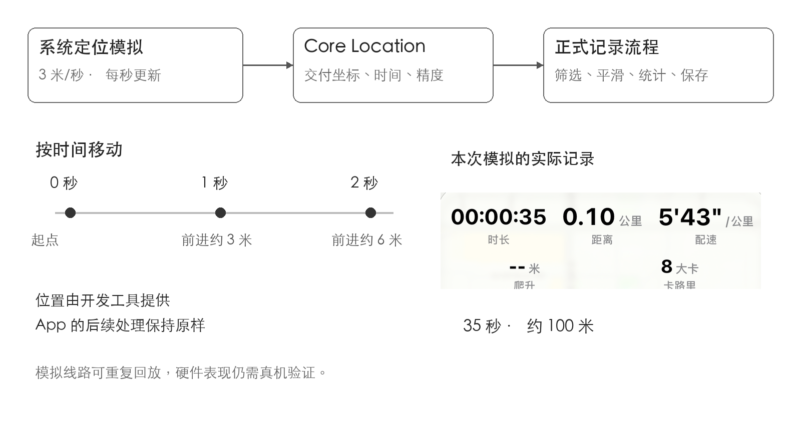

每秒三米相当于时速十点八公里，图中记录到第三十五秒，里程约一百米。模拟输入也要保持合理的时间与距离关系：一秒内跳过几公里，会触发前面的异常位移判断。同一路线可以重复回放，也可以分别构造停留、重新移动和位置跳变，检查对应分支。结束后用 `simctl location` 的 `clear` 清除模拟位置。模拟器覆盖的是软件处理流程；气压计、真实蓝牙设备、城市中的定位遮挡和长时间耗电，仍需在真机环境验证。

## 上岛和实时活动
MovingPath 是我第一款上岛的产品，从 iPhone 14 Pro 到现在，我终于可以找到了可以让自己产品上岛的场景了！

记录在后台继续时，锁屏和展开后的灵动岛显示时长、距离、配速和运动名称，有有效心率时一并展示；紧凑态保留运动图标和时长，最小态仅显示图标。点击活动回到记录页面，结束操作在 App 内完成。锁屏和展开态共用两行布局，下面是示例数据渲染的当前视图预览。

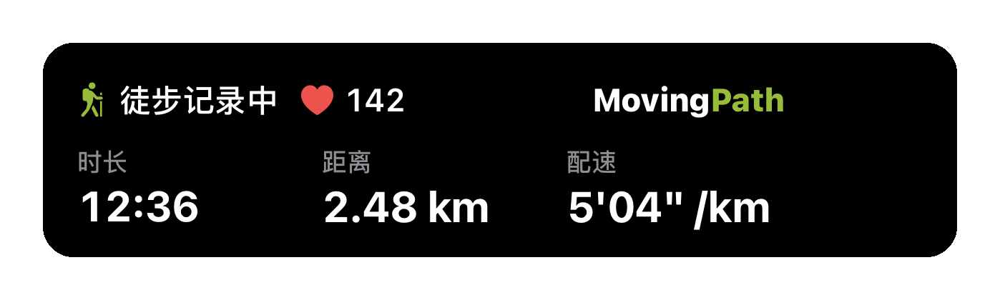

定位采集、距离计算和心率处理都已在主 App 中完成，实时活动只接收当前摘要。[Apple 的说明](https://developer.apple.com/documentation/activitykit/displaying-live-data-with-live-activities)也明确，实时活动本身不能接收定位更新，变化状态由 App 通过 ActivityKit 交给系统。

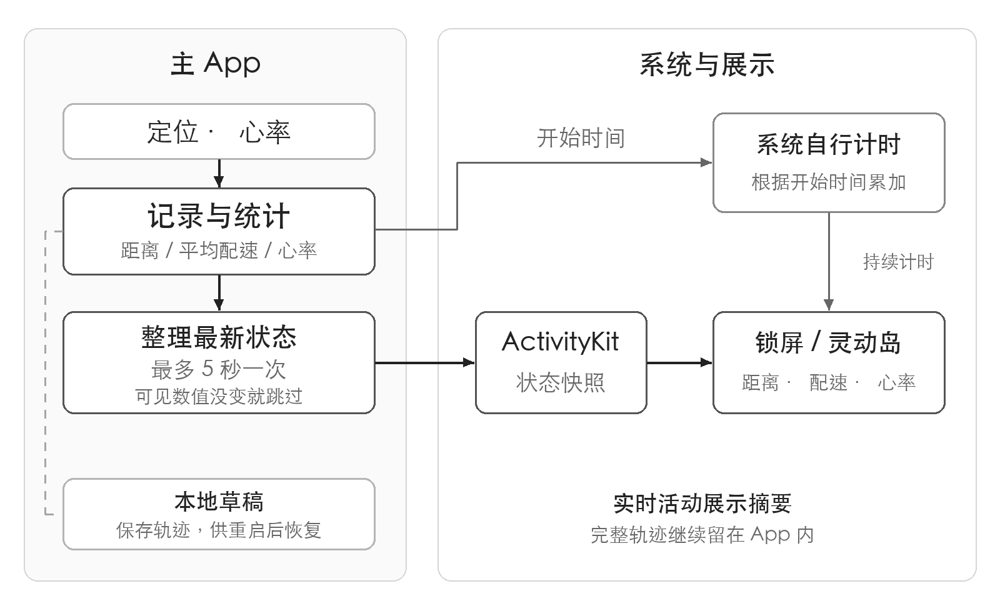

开始记录时，App 在前台创建实时活动，切换 App 或锁屏后由系统展示；后台采集依靠位置更新能力。计时不需要每秒同步。创建活动时提供运动开始时间，系统便可持续计算时长。例如十点开始记录，十点十二分收到新位置，App 更新距离和配速；下一秒的时长仍由系统依据同一个开始时间计算。

距离、配速和心率的变化合并到同一个待更新任务，两次提交至少间隔五秒，执行时读取最新状态。距离按十米、配速按秒、心率按整数四舍五入，与上次提交的结果相同就跳过。记录不足五十米时不显示平均配速，避免起步阶段的定位误差造成过大波动。完整轨迹保留在 App，ActivityKit 只传递这一份显示摘要。App 重启后先恢复本地运动，再按开始时间找到系统中对应的活动继续更新，结束其他旧活动。运动结束时取消待发更新，再结束活动。

## 跋
决定我要好好维护 MovingPath 的大前提是我对户外运动确实非常感兴趣，我喜欢拍照所以做了 PhotoPeaks，我喜欢旅行所以做了 PFollow，那么我喜欢骑车、徒步、越野跑等户外运动，也必然需要一个产品去承载我的所思所想，MovingPath 就是这个角色。

北京的冬天马上就来了，我还憋了一个大招没有放出来，之前我在北京的冬天都是开室内骑行台做的训练，我也认为喜欢骑车的人都应该有一台属于自己的骑行台，方便天气不好无法外出骑行时在家训练。说到这里你应该能猜得出来 MovingPath 下一个大招是啥了，期待吧！

此外，OutBase 的段老师貌似在跑了两三年后这个产品后最终还是降低了投入。依稀记得当年让北京各大骑行俱乐部定向邀请加入时的风风火火。我还找陌陌的小伙伴确认了下为什么陌陌要孵化出这个产品，当时和俱乐部的小伙伴分享了这些信息，我自己本身也并不看好这个方向的产品，尤其 OutBase 如此「明目张胆」的宣传要做「中国版的 Strava」，我一直觉得这种态度不太行。

但毕竟 OutBase 也是我们骑行圈里用爱发电好好做的产品，前期也一直在同步数据，观察它的发展，确实做的越来越好，甚至有一段时间我觉得基本上要成了，对 OutBase 大有改观，对段老师难以望其项背。目前算是阶段性结束的话，只能默默的祝段老师继续加油了！OutBase 是一款优秀的骑行产品。

这些事情也算是给 MovingPath 一些教训吧，甚至我自己更是做不了这些事情，只能从工具属性上在这些已有的生态里做加法，慢慢的找到一些缝隙去填补，服务好一些垂类用户即可，道阻且长！

目前 MovingPa 在中国大陆地区因为在等待 ICP 备案过程中，暂时无法在 app store 下载，其他地区 app store 均可正常搜索下载。