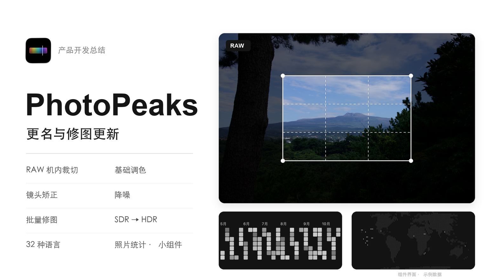

在[上一篇画册开发总结](https://pjhubs.com/2026/10/05/photop-app-4/)里，我还说 PhotoP 想做的大头事情基本做完了，接下来多花些精力在运营和宣发上。没过多久，又给它补了一轮修图功能，连名字都换了，现在叫 PhotoPeaks。最近几个版本主要在补平时修照片会遇到的问题：如何支持机内裁切显示；只想提一点阴影但画面怎么灰了；如何支持一键批量修图。镜头矫正、降噪、批量调色和 HDR 也接了进来，还有一个比较好玩的照片统计，可以看看自己到底在用什么器材、什么焦段，以及这些年都在哪些地方按过快门。

## PhotoPeaks
这次改名的起因，是在济州岛徒步时，小伙伴问我有没有给产品注册商标，还拿「一生足迹」遇到的侵权事件提醒了一下。其实更早就想过这事，但那会儿产品完全不挣钱，还得继续往里面搭钱，很多细节也就顾不上了。说是顾不上，也有懒得弄的成分，一直拖着。这回开始认真处理。先问了目前帮我记账的财务公司，他们也有商标注册业务，但看下来感觉流程性不太强。最后还是选了阿里云的商标注册服务，价格还便宜 40 元。产品名也确定换成 PhotoPeaks，后面就用这个名字继续做了。改完名字，又碰上了一段「证明我是我」的故事。

改名前，PhotoP 在中国大陆地区的 App Store 一直没被要求补充 ICP 备案号。今天早上发布新版本时，发现国区居然搜不到 App 了，心想难道真被抽中了？打开 App Store Connect，果然需要补充 ICP 备案。好在之前给 PFollow 做过一次，我的整套备案也都放在阿里云上，照着再走一遍并不麻烦。点新增备案，需要手机号验证，页面关联的却还是老手机号。那就先换手机号吧。

换手机号又需要真人校验，要拿认证阿里云时关联的支付宝或者淘宝做人脸核验。问题来了：阿里云账号是 2016 年认证的，用的还是我的曾用名，支付宝、淘宝，甚至闲鱼，都已经更新成现在的名字。还是同一个人，同一张脸，却过不了这套关联校验。打电话找阿里云人工客服，沟通了一轮，客服也处理不了，就帮我发了工单，交给售前工程师继续跟进。最终给出的办法是准备三样东西：写一份申请函，说明为什么更换认证人姓名；拍户口本个人页；再拍露出上半身、手持身份证正反面的照片。三样东西凑齐，才能证明我是我。

我反复解释，支付宝、淘宝和闲鱼都有入口更新认证信息，而且我并不是要把账号换给另外一个人，只是同一个人的姓名变了。现有身份信息能不能重新核对、刷新一下？不要让我再走一遍这种证明我是我的流程。对方态度也很好，但表示目前阿里云后台确实做不到类似的自动更新。后来我又提了一个风险：如果这个账号发生了某些高风险行为，你们留着十年前的认证姓名，到时候到底怎么核对我的身份？对方才表示会记录这类情况，反馈给其他同事优化系统。

## 32 种语言

最近也把多语言支持扩到了 32 个语言和地区版本。

这件事能很明显地看出这一年使用 AI 的变化。2025 年底还在自己新建字符串配置文件，让 AI 翻译，再一项项复制进去。后来开始让 AI 直接改配置文件，我只管把需要补的内容说清楚。现在基本不再操心文件具体怎么改了，直接告诉 AI 要加哪些语言、哪些地方需要调整，它自己去找文案、修改对应的字符串配置。以前是 AI 给我一段结果，我负责把结果搬进项目；现在连找位置、改文件这些工作也一起交出去了。

## RAW 机内裁切

相机里选的比例或数码裁切，有时只是记下一个取景框，RAW 里还留着完整的可用画面。导入时把框读出来，作为初始构图，显影的底图继续保留框外像素，之后才能向外扩框。标准 DNG 从 `CIRAWFilter.properties` 里读 `DefaultUserCrop`，四个数依次是上、左、下、右，都是 0～1 的比例，相对于系统已经处理过的默认画布。厂商格式要分别找自己的目录和字段，当前读取的是下面几组：

| 格式与入口 | 裁切字段 | 怎样确定坐标 |
| --- | --- | --- |
| [Sony ARW](https://exiftool.sourceforge.net/TagNames/EXIF.html)，TIFF/SubIFD | `SonyCropTopLeft`（0x74C7）、`SonyCropSize`（0x74C8），配 `DefaultCropOrigin`、`DefaultCropSize` | 前两个给取景起点和宽高，后两个给默认画布起点和宽高。 |
| [Canon CR2 / CR3](https://exiftool.sourceforge.net/TagNames/Canon.html#AspectInfo)，CR2 的 MakerNote、CR3 的 CMT3 元数据块 | `AspectInfo`（0x009A）、`SensorInfo`（0x00E0） | 从前者取裁切宽高与左、上偏移，后者给传感器和有效画面边界；先确定解码器输出哪块画布，再换坐标。有效区右、下边界包含最后一个像素，算宽高要加一。 |
| [Nikon NEF / NRW](https://exiftool.sourceforge.net/TagNames/Nikon.html)，MakerNote 内的 TIFF | `CropArea`（0x0045）、`CropHiSpeed`（0x001B） | 读取裁切矩形、图像区域模式与对应尺寸，再拿 RAW 像素目录的宽高核对；文件若只存了 DX 等区域，就不再套一次全传感器裁切。 |
| [Fujifilm RAF](https://exiftool.sourceforge.net/TagNames/FujiFilm.html)，RAF 自己的元数据目录 | `RawZoomActive`（0x0117）、`RawZoomTopLeft`（0x0118）、`RawZoomSize`（0x0119），配 `RawImageCroppedSize` | 先确认数码裁切开启；起点按 `(top, left)`、尺寸按 `(height, width)` 存储，要换成 `(x, y)` 和 `(width, height)`。完整传感器画布还要读 `RawImageFullSize`、`RawImageCropTopLeft`，补上有效区偏移。 |
| [Panasonic RAW / RW2、Leica RWL](https://exiftool.sourceforge.net/TagNames/PanasonicRaw.html)，IFD0 | `CropTop`、`CropLeft`、`CropBottom`、`CropRight`（0x002F～0x0032），配 `SensorWidth`、`SensorHeight` 和四个 `Sensor*Border` 字段 | 四边是传感器绝对坐标，右、下边界不包含末端像素；按实际输出的是有效区还是传感器画布，减去对应起点。 |

以 Sony 为例，`SonyCropTopLeft` 还带着传感器边缘的偏移，系统显影却已经去掉了默认黑边，所以必须先减掉 `DefaultCropOrigin`。`DefaultCropSize` 也得和解码器当前画布完全对上，才能使用 `SonyCropSize`。不能直接拿传感器坐标再裁一次，否则框的位置会偏，系统已经裁过的文件还可能被裁第二遍。

读出的矩形确认没有越界后，再按 EXIF 方向旋转或镜像，换成编辑器使用的比例坐标。字段缺失、画布尺寸对不上，就沿用系统给出的画面，不拿焦距或 JPEG 预览尺寸猜裁切。初始框只设置一次，用户清除以后，重新打开工程也不会替他套回去；RAW 本来没保存的框外像素无法恢复。

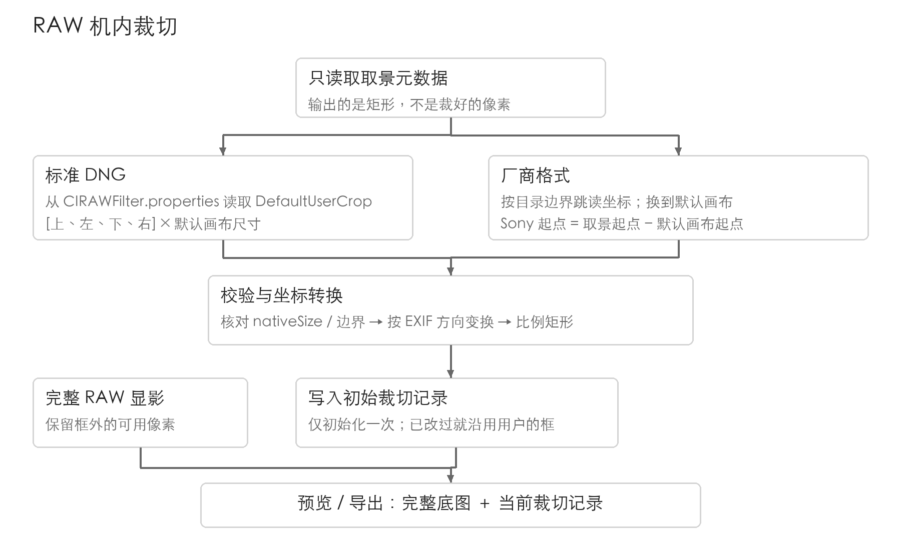

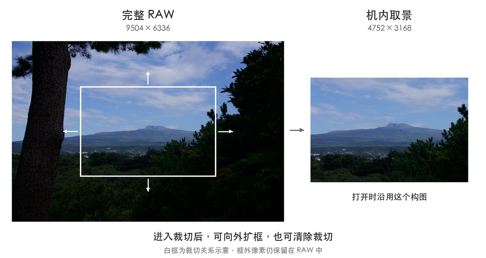

## 高光、阴影和黑白色阶

薄桑反馈，高光阴影和黑白色阶这几个滑杆用起来比较奇怪，只是加一些白色，整个画面的观感都变了，和 lr 差距太大。仔细对比了 Photomator 的逻辑后，确实有些奇怪，大概率是之前规整的那一次阴影调整把 Metal 计算规则搞乱了。

把每条滑杆单独拿出来，才能看清它到底改了哪些像素。下面先用灰色像素算，其他调节归零：把黑记为 0、白记为 1，介于两者之间的明暗值记作 Y。

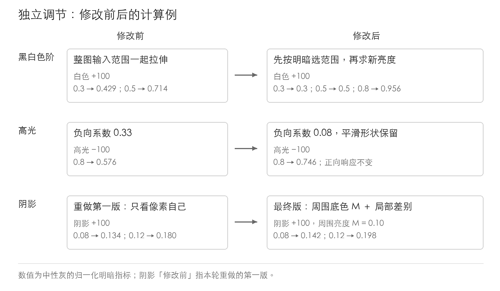

### 黑白色阶

加「白色」，想调的是画面最亮的一头，比如让白墙再亮一点；加「黑色」，则是把最暗的一头压实。中间亮度如果也大幅变化，前面调好的曝光就得再补一遍。旧实现直接把这两个滑杆接到输入范围的黑点、白点上。白色 +100，相当于把整个范围除以 0.7，中灰从 0.5 变成约 0.71；黑色 +100，则先给每个通道减 0.3，再除以 0.7，中灰降到约 0.29，低于 0.3 的部分直接变成纯黑。

现在先按 Y 决定像素参与多少：黑色只动暗端，白色只动亮端，离两头越远，作用越弱，中灰 Y=0.5 两边都不参与。下面的 b、w 分别是黑色、白色色阶的滑杆值除以 100，+100 在公式里就是 1。

```cpp
// 以前：所有通道一起拉伸。
oldRGB = clamp((rgb - 0.3*b) / (1.0 - 0.3*w - 0.3*b), 0.0, 1.0);
// 现在：分别计算暗端和亮端的变化。
dark = 1.0 - smoothstep(0.0, 0.5, Y);
light = smoothstep(0.5, 1.0, Y);
delta = b*(b > 0 ? -0.24 : -0.16)*dark + w*(w > 0 ? 0.24 : 0.16)*light;
target = clamp(Y + delta, 0.0, 1.0);
```

`smoothstep` 把不参与到完全参与之间接平。求出目标亮度后，变暗按新旧亮度比例缩放 RGB，变亮则缩小各通道到白色的距离，再恢复透明度。彩色照片也按 RGB 算出的 Y 选范围，蓝天不会仅仅因为蓝通道高，就被白色色阶选中。

### 高光

压高光时想把天空收暗一点，旧版却容易把亮处拉到中间亮度，天空显得发闷。把高光拉到 −100，Y=0.8 的像素会降到约 0.576。只想稍微压低一点，滑杆就只能在 0 附近小幅挪动。这段原来已经用平滑权重控制参与范围，越亮的像素参与越多，中间亮度只受很小的影响。这轮保留这个形状，把负向系数从 0.33 收到 0.08，同样的输入在 −100 时变为约 0.746。下面 h 是高光滑杆值除以 100，负数下压，正数提亮。

```cpp
weight = pow(smoothstep(0.25, 1.0, Y), 2);
recovery = 0.08;  // 修改前是0.33。
highlightDelta = h < 0 ? recovery*h*weight : 0.85*h*weight*(1.0-Y);
```

正向的 `(1−Y)` 沿用原来的处理：像素离白色还差多少，能增加的幅度就受这个距离限制，越接近白色，增加得越少。

### 阴影

提阴影是为了看清背光处。拿下面的桥洞来说，石头亮起来以后，石缝和表面的深浅还得能分开。旧版曲线主要照顾很深的暗处，稍亮一些的阴影已经接近不动，拖同一条滑杆，桥洞里不同明暗的部分就很难一起调顺。

这次重做的第一版仍然只对单个像素套曲线，亮度相同就给相同的调整，分不清它是一片阴影里的纹理，还是亮背景上的暗缝。部分暗部区间的深浅差别被挤小，提亮后反而像蒙了一层灰。后来额外生成一份模糊图，模糊尺度取照片短边的约 1%，用它取得周围亮度 M。小块纹理在模糊中被抹平，原来的 Y 减去 M，就是这个像素比附近亮或暗的差别 `detail`。`mask` 根据 M 决定参与范围，深黑和已经偏亮的区域少动。模糊图只参与计算，不直接盖到照片上；s 是阴影滑杆值除以 100。
```cpp
detail = Y - M;
mask = smoothstep(0.0, 0.06, M) * (1.0 - smoothstep(0.2, 0.55, M));
lifted = Y + s * mask * (0.07 + 0.4*detail);  // 这里只展开提亮方向。
```
0.07 抬起底色，0.4×detail 拉开同一片暗处里的细微差别。向下压时另算响应，单独这一项至少留下原亮度的 20%。高光与阴影都根据原来的 Y 求变化量，最后相加，避免先做的一项改变后面一项的判断范围。

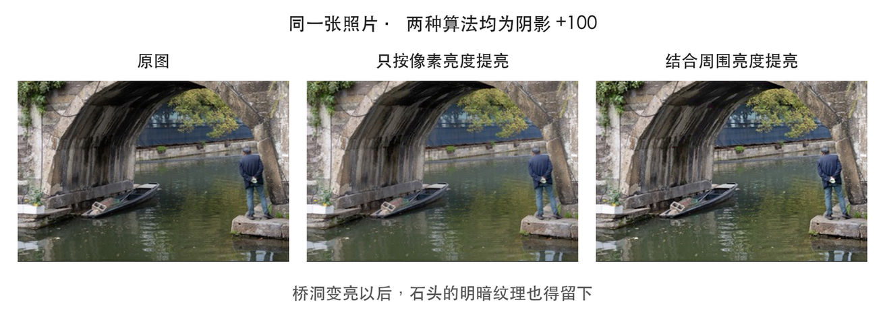

中间是重做的第一版，右边是加入周围亮度后的处理，都是阴影 +100。阴影为 0 时跳过模糊；分块导出按整图决定尺度，并多读外圈以免接缝。旧工程继续沿用保存时的算法。

## 镜头矫正

这次没有自己写径向畸变公式，也没有拟合镜头系数，接的是 [CIRAWFilter 提供的系统 RAW 镜头配置](https://developer.apple.com/documentation/coreimage/cirawfilter/islenscorrectionenabled)。能修正哪些问题由文件和系统决定，App 负责把它接进显影、编辑和导出。选择保留三态：`nil` 沿用原始默认，`true` 明确打开，`false` 明确关闭。已有蒙版、消除补丁或人脸坐标时限制切换，避免源图变形后，原来的局部编辑错位。

后台的关键调用只有这几行，真正出像素及回传后的处理放在时序图里：

```swift
guard let raw = CIRAWFilter(imageURL: url) else { return }
guard raw.isLensCorrectionSupported else { return }
let target = choice ?? raw.isLensCorrectionEnabled
raw.isLensCorrectionEnabled = target
let pendingImage = raw.outputImage
```

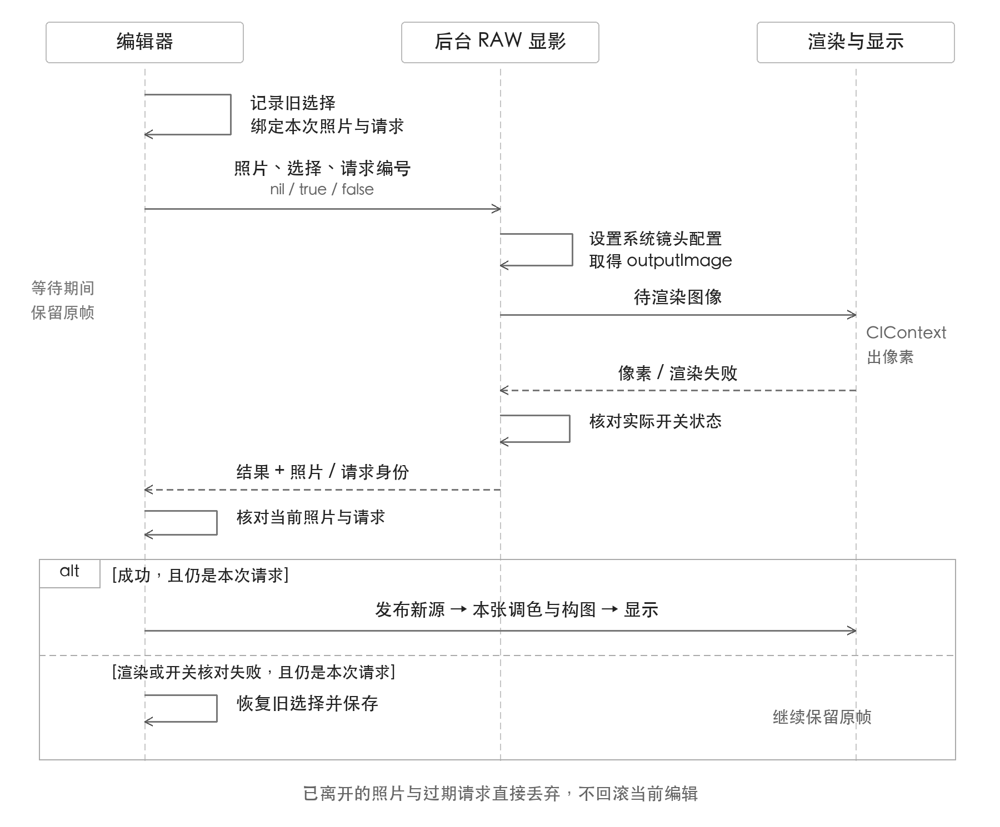

`outputImage` 还是待渲染图像，拿到它不等于完成。等待时保留原帧，失败后恢复旧选择；已经离开的照片、过期请求都不能改写当前编辑。成功替换的是源图，本张已有的调色与构图仍然要接着处理。

## 降噪

降噪想收掉暗处的彩色斑点，也得留下草叶和衣服纹路。这次接在已有显影后，每个像素参考 7×7 共 49 个位置，先算加权明暗 Y，再用 RGB−Y 留下偏色 C，各算一份估计。

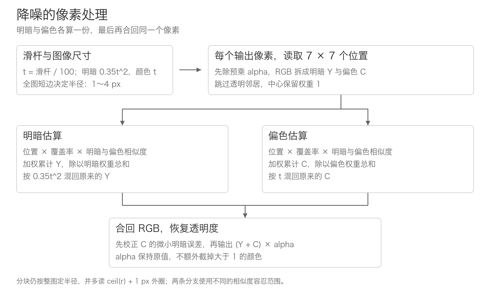

离得近、明暗和偏色也接近的点才多参与，跨过窗框等轮廓的点少参与；两份结果各除以权重总和，邻居多也不会越加越亮。下面只留核心关系：t 是滑杆÷100，p 合并距离和透明覆盖权重，dY 是明暗差，D 是偏色差的平方平均；四个 s 分别控制两条通道对明暗、偏色差的容忍范围，sum 包含权重为 1 的中心。

```python
wY = p * exp(-0.5*(dY/sY)**2 - 0.5*D/sCy**2)
wC = p * exp(-0.5*(dY/sYc)**2 - 0.5*D/sC**2)
Yhat = sum(wY*Y) / sum(wY)
Chat = sum(wC*C) / sum(wC)
Yout = mix(Ycenter, Yhat, 0.35*t*t)
Cout = mix(Ccenter, Chat, t)
Cout -= dot(Cout, vec3(0.2126, 0.7152, 0.0722))
RGBout = (Yout + Cout) * alpha
return vec4(RGBout, alpha)
```

滑杆 50 时，颜色混入 50%，明暗只混入 8.75%；图里这颗红斑收敛以后，明暗只改了约 0.002。

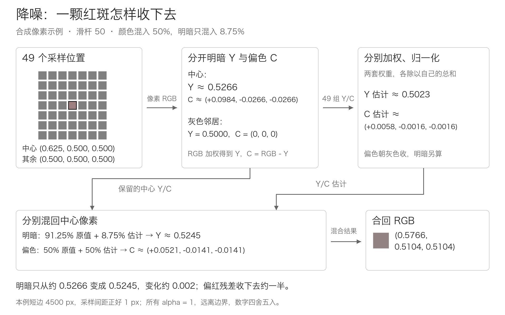

采样范围按整图短边÷1500，限制在 1～4 像素，网格间距为范围÷3；分块多读外圈，边缘延展采样。计算前除掉预乘透明度，跳过透明邻居，输出再乘回原透明度。

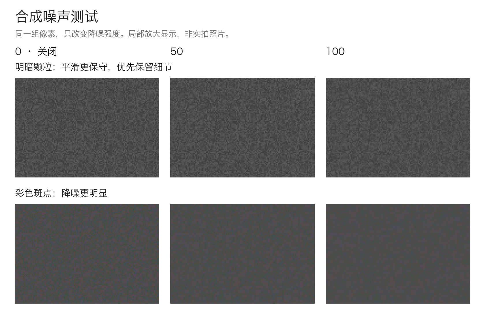

上图固定同一组合成噪声，只改强度。明暗处理保守，是因为细纹理和噪声可能只有几格像素的差别，力度大了仍会一起抹掉。

## 批量修图

批量这次做的是把当前调色值应用到工作区全部照片。确认后，先结束还没落定的滑杆手势，固定这一刻的参数，再逐张构造目标的新调色记录。曝光 +0.7 就复制 +0.7，曲线、白平衡、降噪等一起复制；每张自己的滤镜、HDR、镜头矫正选择，以及裁切、蒙版、修复和文字继续保留。

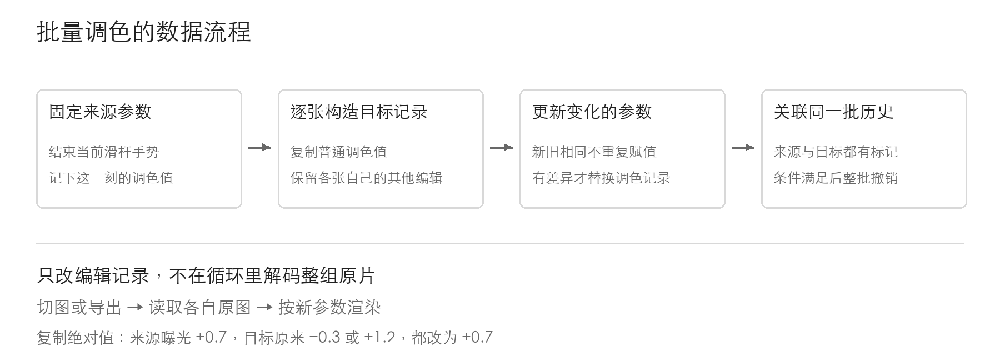

相同参数不重复赋值，整批有变化才生成一次操作。各张照片的历史里放入关联同一批次的标记，撤销时确认都已退回这个位置，再一起恢复之前的调色值，避免把批量之后新增的单张编辑盖掉。循环里改的是编辑记录，不解开整组原片；切到哪张、导出哪张，再按它自己的原图计算。复制参数也不会逐张重新做自动分析。

## 照片统计和小组件

照片统计看的是拍摄记录：器材、焦段、光圈、日期和地点。界面背后需要先把不同来源的数据整理成能计数的小记录，才能回答自己到底常用什么焦段，一年里哪些天拍过照。

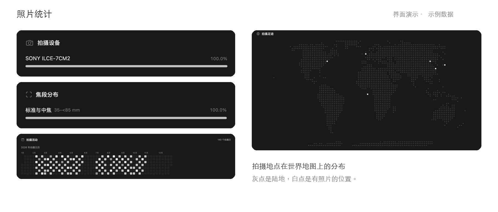

### 读取和合并

输入有两份，系统照片图库和工程里当前仍在使用的原片。图库先通过 PhotoKit 拿照片身份、日期和位置，这些不用解开高清像素。首批结果出来就能先画日历与足迹，器材信息另外排队读取，最多四个任务同时进行。取到本地原片地址后，再用 Image I/O 读取主图属性，提取相机、镜头、焦距、光圈。这条读取显式禁止网络下载。原片暂时只在 iCloud，拿不到器材信息，就先留下日期、位置，后面有条件再补，不为了画一张统计图把整库原片拉回来。HEIC 里也可能装着多张图，属性要从主图索引读，不能永远假定第 0 张就是拍摄照片。

来源合并靠确切身份。相册照片导入工程时记住系统给它的身份，再出现就归到同一张，不按文件名或者「看起来像同一张」去猜。合并后，日期和位置以 Photos 当前信息为准，工程原片只补缺少的器材字段。用户在 Photos 删除过位置，原片里即使还留着旧 GPS，也不能热心地补回来。之后才做字段整理。品牌名称里的明确别名统一，机型已经带品牌就不再拼一遍，前后空格去掉，焦距、光圈过滤无效数值。缺字段继续为空，不能拿文件修改时间冒充拍摄时间，也不能拿实际焦距假装成 35mm 等效焦距。图库按 Photos 当前日期和设备时区归日，独立工程原片则保留 EXIF 记录的拍摄当地日。

### 分组与增量计算

整理好的每张记录，分别给设备、镜头、焦段、光圈、日期和地点计数。焦段优先使用 35mm 等效值，24mm 进入广角，35mm 进入标准与中焦，85mm 进入长焦，各区间在边界处分开，不能同一张在两边都加一票。当前筛选结果里完全没有有效等效焦距，才退回实际焦距统计，不把两种数值混在一张分布里。

百分比分母也要固定。筛选后有 10 张照片，相机 A 占 6 张、B 占 2 张、两张没有机型，显示的就是 60% 和 20%。缺失项没有画出来，可见条形相加可能不到 100%，不能为了凑整，把分母悄悄改成那 8 张字段完整的照片。上面的界面用示例数据展示，这些口径在真实图库里也一样。

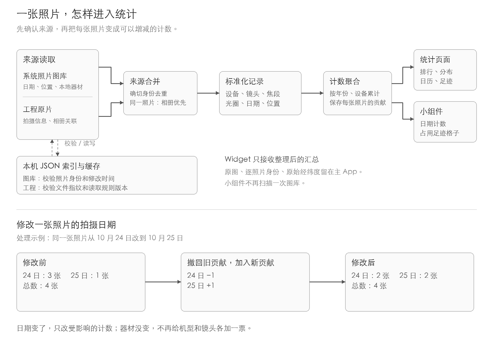

每张照片会记住自己已经给哪些分组加过数。新记录到了，先比较有没有变化；有变化就减掉旧贡献，再加上新贡献。比如 24 日有 3 张、25 日有 1 张，其中一张把拍摄日期由 24 日改到 25 日，计数就变成 2 和 2。总数仍然是 4，不需要从第一张重新读完整个图库。

一张有年份和设备信息的照片，会同时计入「全部」「对应年份」「对应设备」「对应年份加设备」四种筛选组合，切换筛选时直接取对应计数。连续到来的变化短暂合并再生成一份报告，日期没变就不重排日历，地点格子没变就不重算足迹。一次补回几张器材信息，也不必让整页所有图表从头计算。

跨启动复用的是本机 JSON 索引和缓存。工程原片核对文件身份、地址、大小、修改时间和读取规则版本，图库核对系统照片身份与修改信息，确认没变才复用之前读过的器材数据。文件被替换、Photos 通知内容变化或者权限范围收窄，都要让旧记录失效。重新打开时仍先核对当前权限，确认哪些照片还能统计。

### 足迹与小组件

足迹先把照片经纬度通过 Equal Earth 投影换成平面位置，再落进 120 列、58 行的固定网格。底图陆地提前按同一投影采样，约 9KB 数据随 App 放进去，灰色画陆地，有照片的格子画白点，不需要在线请求地图或者查询城市名。

一个格子里有 5 张照片，仍然只亮一个点；删到剩 1 张还亮，减到 0 才消失。格子计数和陆地底图分开，海上或小岛的照片也能落在底图灰点之外，不能为了贴住陆地，把拍摄位置硬挪到岸上。

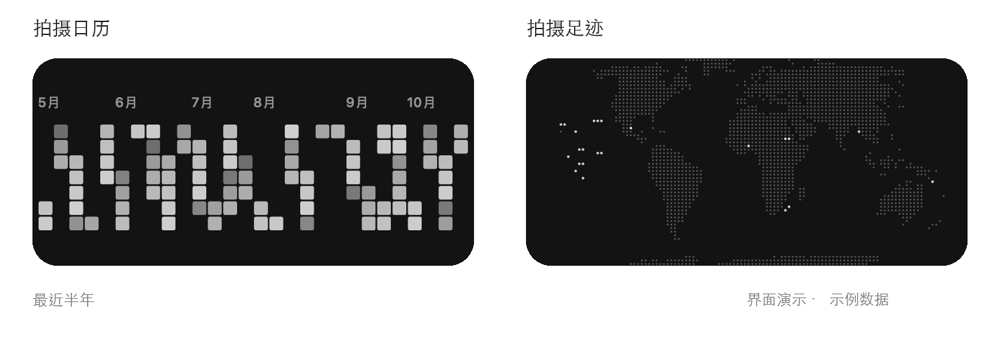

组件拿到的是进一步整理过的小文件：日期计数、占用的格子编号、时区和更新时间，不拿每张照片的原图、路径和原始经纬度，也不用重新扫一遍图库。格子仍然包含粗略地点信息，只是已经不能当成逐张照片的精确坐标来用。

日历显示最近六个月，先按真实日期放好星期行，再收起没有记录的空周。颜色深浅用对数关系映射，不然某一天拍了几百张，其他只拍几张的日子就全挤到一片暗色里。主 App 合并变化后写快照，再请求 WidgetKit 刷新，实际绘制仍由系统安排。

## SDR 转 HDR
现在大部分这两年出的相机都能机内合成 HDR 并导出 HDR 的照片了，但 PhotoPeaks 一直没有支持 HDR 照片的显示编辑和导出，最主要的原因是我自己的相机一直没有开启这个功能，并且我的拍摄场景前期都是街拍纪实为主，对 HDR 效果其实并不好。现在换为 iPhone 18 Pro 拍摄后，默认开启了 HDR 效果，自然支持 HDR 显示编辑和导出就要提上日程了。

手里只有一张普通的 SDR 照片时，原来曝光了多少、相机套过什么曲线，软件未必知道。HDR 屏幕虽然能把灯光、反光显示得比普通白色更亮，但把这张照片放上去，还得决定哪些地方继续变亮、亮到什么程度。这类转换通常叫「逆色调映射」。

白墙和灯泡在 SDR 里都可能变成同一个白色像素，只看 RGB，分不出谁原本应该更亮。云层如果已经剪成一整片白，里面的纹理也不在文件里了。想重新安排亮度，可以定规则；想补回这些纹理，就得引入额外的判断或预测。[明亮区域的分类与增强](https://resources.mpi-inf.mpg.de/hdr/drenh/paper.pdf)

### 转换路线

SDR 自动转换为 HDR 的常见思路大致可以按计算亮度时参考了什么来分：

| 路线 | 怎样得到 HDR | 要处理的问题 |
| --- | --- | --- |
| [全局曲线](https://graphics.unizar.es/papers/Masia_rTM_sAsia09.pdf) | 先转到线性光，再让整张图共用一套亮度扩展规则；曲线参数也可以根据整张照片的统计来定。 | 计算直接、结果容易控制，但同一张图里相同的 RGB 会得到相同结果，物体是什么、位于哪里都不参与判断。 |
| [局部适应与区域处理](https://www.inf.ufrgs.br/~oliveira/pubs_files/rTM-WRE/High-Quality_Reverse_Tone_Mapping_for_a_Wide_Range_of_Exposures-Pre-Print.pdf) | 根据周围明暗、亮区边界或区域分类，生成随位置变化的增强图，再分别扩展。 | 要处理边界过渡。增强图一旦跨过物体轮廓，旁边可能亮出一圈；扩展过强，也可能破坏原来的局部反差。 |
| [学习式重建](https://arxiv.org/html/1710.07480v1) | 从数据中学习，预测 HDR 像素或需要的增益；有些方法还会估计饱和区域的颜色和纹理。 | 需要匹配实际照片的数据。原图丢失的信息只能估计，大块剪白区域尤其难判断；结果和计算成本取决于具体方法。 |

也有研究直接[预测增益图](https://proceedings.iclr.cc/paper_files/paper/2025/hash/43d2b7fbee8431f7cef0d0afed51c691-Abstract-Conference.html)，同时估计整张图该有多亮、各处的局部反差怎样恢复。增益图在这里是预测目标，后面保存文件时也可以用它来连接 SDR 和 HDR 两种外观。

拉开亮度还会把原有的问题一起放大。8 位 JPEG 的相邻灰阶本来挨得很近，扩展以后，原本不显眼的色带、噪声和压缩痕迹都可能露出来。颜色也不能简单按红、绿、蓝各拉一条曲线，否则某个通道先碰到上限，灯光的色相就会跟着变。[噪声、色带与颜色处理](https://resources.mpi-inf.mpg.de/hdr/drenh/paper.pdf)

### PhotoPeaks 的亮部扩展

这次采用的是按固定规则逐像素扩展，每个像素按同一套明暗和颜色规则计算增益，一次 GPU 遍历完成。转换这一步不需要额外生成全图区域图，也没有接入学习式重建。编辑器要反复处理大照片，相同参数下结果稳定、预览和导出能复用同一套计算，是当前比较看重的取舍。开关按照片保存，默认关闭，用户觉得适合这张图时再开启。

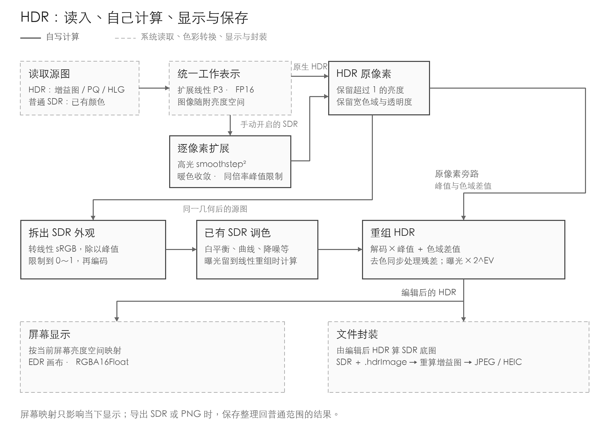

源文件本来就有 HDR 时，会读取它的增益图，或识别 PQ、HLG 这些[亮度编码](https://www.itu.int/rec/R-REC-BT.2100)，解出已有的 HDR 内容，跳过 SDR 扩展。PQ 对应绝对显示亮度，HLG 使用相对明暗关系，再由显示端映射。

HDR 工作图用扩展线性 P3、FP16，把 SDR 参考白记为 1，像素值可以超过 1。P3 管颜色范围，线性表示让倍率对应光量变化，浮点数负责容纳超出普通白色的值。

扩展从亮部逐渐开始：Y 是由 RGB 非负部分加权得到的线性 P3 亮度，H 取 4，表示这次扩展的目标亮度空间。m 是最大的正颜色通道，至少取 0.00001；w 是 0～1 的暖色权重，由红绿差、绿蓝差相对 m 的比例，经四段平滑窗口相乘得到。关键计算是下面几行：

```text
h = smoothstep(0.5, 1, Y)
extra = (H - 1) * h² * (1 - 0.4*w)
gain = min(1 + extra, max(1, H/m))
RGB = RGB * gain
```

Y 不超过 0.5 时，h 为 0，原样通过；进入亮部后再平滑增加，平方让刚进入这个范围的像素少受影响。RGB 乘同一个倍率，接近上限时也一起收住，避免逐通道截断改变颜色比例。计算前解开预乘透明度，结束后乘回。

暖色最多少加 40% 的新增增益，收的是扩展幅度。这仍然是一条颜色规则，相近颜色的木材、沙地也可能触发，不能据此判断画面里一定是肤色或灯光。

### 让现有调色接住 HDR

扩展后的数值，还得穿过后面的白平衡、曲线、降噪和滤镜。旧算法原本按 0～1 工作，一个值为 2 的通道提前被截成 1，后面就不知道它原来有多亮了；只把底图换成浮点数，解决不了这个问题。

目前保留一份经过相同几何处理的 HDR 源图，另外拆出普通范围内的外观，交给现有调色链。转到线性 sRGB 后，P 是至少为 1 的峰值倍率，b 是压进 0～1 的底色，r 留下普通 sRGB 放不下的色域差值。下图先不加任何编辑，检查这趟转换能否回到原值：

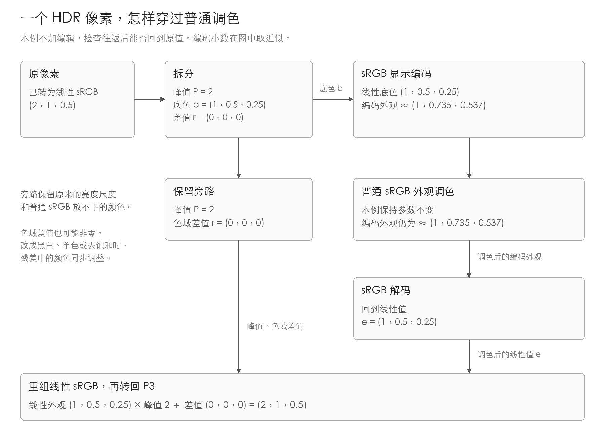

```text
q = toLinearSRGB(HDR)
P = max(1, maxChannel(q))
b = clamp(q/P, 0, 1)
r = q - b*P
e = decodeSRGB(adjust(encodeSRGB(b)))
result = toLinearP3(e*P + syncChroma(r, e))
result = result * 2^EV
```

如果用户改成黑白、单色或降低饱和度，旁路留下的差值也得同步处理，否则普通外观已经去色，恢复 HDR 时颜色又冒回来了。`syncChroma` 就负责这部分。曝光从普通外观的 `adjust` 中跳过，在线性重组后乘一次 `2^EV`；超白高光再按 1～2 的亮度区间平滑接入额外倍率。

两路图像也有内存成本。一份 2400 万像素的 RGBA16F 裸像素就约 190MB，还没算其他中间纹理。当前只缓存正在编辑这张照片的扩展底图，连续调整时复用，切换照片后释放。RAW 目前仍先经过 SDR 显影，再做这一步扩展。

### 显示和保存

照片还要带着 HDR 状态和亮度空间 headroom 穿过中间处理。比如把曝光往下拉，所有像素可能暂时都小于 1，但这张图仍然使用 HDR 工作空间，不能因此切回普通 sRGB。蒙版合成后，系统也可能拿不到准确的亮度空间，所以这里显式传递状态，并在曝光、高光变化后更新保守上界。

内容能有多亮，和屏幕此刻能显示多亮，要分别处理。屏幕亮度、硬件能力、电量等都会影响可用空间，显示前先按屏幕当前亮度空间做映射，再绘入 EDR 画布，环境变化后重新绘制。这份适配只影响屏幕上的预览，不覆盖工程中的 HDR 像素。[Apple 的 HDR 显示说明](https://developer.apple.com/videos/play/wwdc2023/10181/)

保存采用 [Adaptive HDR](https://developer.apple.com/videos/play/wwdc2024/10177/) 的「SDR 底图＋增益图」方式，在 JPEG、HEIC 中同时留下普通外观和到 HDR 的亮度变化。普通查看器读底图，支持这种格式的 HDR 查看器再结合增益图与屏幕能力显示。

增益图必须根据编辑结果重新生成。裁切、阴影、颜色改过以后，原文件里那份对应关系就不再适用。导出先从编辑后的 HDR 生成 SDR 底图，再通过 `.hdrImage` 把 HDR 图一起交给系统重新编码，并检查文件里确实带有增益图。选择 SDR 或 PNG 时，则输出映射回普通范围的版本。

## 跋
不知道是不是果子 app 审不过来了，iOS 现在的版本号整整超了 macOS 两个，后面要跳版才能对齐了。这一轮越做越能发现，修图工具有很多看起来很小、实际很影响手感的地方。一个滑杆能让画面变化只是开始，变化的范围对不对、会不会把纹理抹掉、导出以后还能不能保留，得拿照片反复看。薄桑一句体验奇怪，就把几个已经放在那里很久的基础调整又翻出来重做了一遍。

PhotoP 现在换成了 PhotoPeaks，我想好好做一个生产力工具，做一个符合自己品味的工具产品，之前是不确定这个产品能不能活，能不能撕开一些口子找到生存的空间，现在找到了，我想好好的做一次。

目前 PhotoPeaks 在中国大陆地区因为在等待 ICP 备案过程中，暂时无法在 app store 下载，其他地区 app store 均可正常搜索下载。