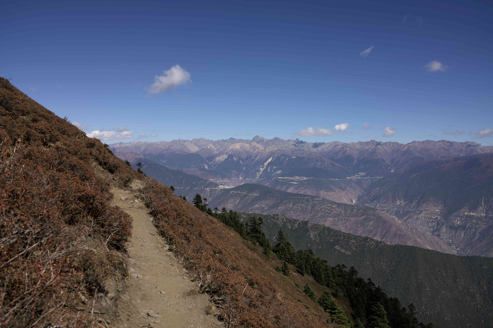

这是我第二次徒步旅行。从济州岛回来后一直念念不忘独自一人走在路上的感觉，总想去体验一番在山林之中穿行的感觉，但时值北方进入冬季，温度下降得厉害，就连每次下楼跑步都要做出很大努力才能成行，遂决定再次南下，去南方！看了一圈机票，发现北京往返丽江机票价格比较合适，丽江离虎跳峡和雨崩都不远，就是它了！

## 序
截止到目前为止，徒步和越野跑大概有个七百公里左右的经验，我依旧怀念去到大自然里的感觉，喜欢把自己置身到相对陌生但本质上还是安全的户外中。国庆节在济州岛一百多公里的徒步经历一直让我有种念念不忘的味道在，总觉得自己应该乘胜追击，再进行一次徒步旅行。再加上那会儿安排好了 11 月中下旬的旅行，这中间还有整整一个月的时间，开始寻找合适的徒步旅行目的地。

起初选择的是走香港的麦理浩径，通过越野跑的方式，分为三天或者四天跑完，做一个五六天的徒步旅行。也看了一些资料，甚至差点就要预定住宿了，没想到被「虎跳峡」和「雨崩」这两个更为出名的线路拦住了去路。

雨崩在疫情的时候才了解到了这条线，身边有小伙伴走过，体验下来说不错值得推荐走一趟。但因为交通路途过于折腾，之前作为一名上班族规律的生活不允许我做出这种跨度过长的选择。而虎跳峡作为「全球十大经典徒步路线」，之前也确实查过好多次，未能成行的原因和雨崩类似。固定的上下班时间好不容易有个节假日，很难劝说自己花费更多的时间来进行一场徒步旅行。

从北京想要到达徒步虎跳峡和雨崩的起点，最佳落地点是香格里拉，但没有直飞且价格略贵。如果能转移到离香格里拉不远处的丽江，那往返机票不光有了直飞，价格还下探到了有性价比的区间，加上燃油附加费仅需 1500 元。后来才发现绝大多数人如果想要把虎跳峡和雨崩一块走完的话，合理的形成安排也是落地丽江从香格里拉飞走。

写到这里，突然记起来了我居然还有一张年初买的海航 666 元随心飞好久没用了。这玩意儿得好好吐槽一波，首先它的票不是随时买的，，而是定时分阶段放，每次放票时我都没想好自己到底是去哪里，一旦错过放票时间但还处在这个放票的时间范围里，没有票就是没用票，我刚好碰巧了几次用上了。其次是时间非常阴间，不是大早上就是大晚上，比较适合精力旺盛人群，刚开始我还能适应，现在再飞这种红眼航班多了后身体的反应很真实。最后是要卡着各种条件，666 元只是基础费用，每次再选航班都要交 269 元的基础费用，至少飞四次才回本。除去春运、五一、暑假、十一和寒假，剩下的时间才是能选的，好不容易时间合适吧，地点不合适，不是没航班就是有航班时间对不上。整体感受下来很像是给海航凑上客率的，但好在还算回本了，国内基本上转得差不多了，以后再也不买了。

当然，朋友圈有个小伙伴买了「海航顺心卡」，这样就可以体验无与伦比的至尊出行了。前段时间看他几乎周末天天飞，都是往新疆西藏各种跑。先不说需要先花费 66666 元买基础费用每次还要再花 379 元买任意航次，重点在这精力比我旺盛多了，每个周末都这么玩，我最多执行过三周，三周之后我就马上疲倦了，肉体不累但精神上突然间就没了第一次这么干时的敏感度，仿佛各种感官都堵上了。

这次旅行的主要目的是「徒步」，最终走了总距离 129 公里，总爬升 6700 米，总时长 35 个半小时。基本上都是一大早出门到了下午才回房间，除去转场的日子平均下来每天 13km 多，基本上躺在床上一会儿就睡着了。因此只有第一天落地丽江后为了方便第二天古城南门赶大巴住了标间外，都是住青旅。价格有高有低。最便宜的是香格里拉的「丹舍青旅」，四人间 37.4 元，最贵的是上雨崩村的「徒步者之家」四人间 154 元，最意外的是从雨崩回香格里拉再住了丹舍青旅，选了二人间，但因为淡季，实际上只有我一个人入住，承包了一个独立房间两晚只要 113.4 元。

这次是我第一次感受到玩这种低成本旅行也是一种奇妙的乐趣，济州岛因为语言的关系和线路太多了，很难找到合适的队友，缺少人和人的交流沟通，「感觉」这个东西就很难出来。再结合前段时间从东南亚全程四五星级酒店体验，更是觉得所谓「穷游」只是穷在成本投入，体验感和丰富度一点没降，反而因为与人的接触机会变多了，导致大脑受到了与以往全然不同的刺激。

就是因为住青旅，我接触到了好多与众不同的人，有骑摩托一个人从广东出发的，有刚退伍两个月的，有请年假出来玩的，有像我一样散散心但在路上捡到了志同道合的小伙伴最终决定跟他一起去丽江上班的人，甚至还有好多老外专门来云南徒步走线，每天都在学新的中文单词，比如「厕所」这个词是最先学会的，一开始着急上厕所智能模拟蹲坑的放松问路，还找我们仔细确认了他们祖国的中文单词发音，我们就这么一路上有说有笑的聊着爬着。

我见到的大家都很放松，放松到我时常感觉自己才是紧绷着的那个人，但明明这种放松的方式应该是住更好品质酒店里的人表现出来的东西，我却在青旅这种看似低品质的环境下见到了形形色色、无所不能的人，这些体验让我对青旅这个特殊的环境产生了更多的认识，甚至是改头换面的认识。现在有种感觉青旅很容易一下子就把人带入「在旅行」那种感觉，特别是一路捡队友，捡到了「华南 F3」琼东西三人组合一起徒步，如此低概率的事情都能让我们碰上，有点命运的偶然了。

以至于我现在开始反思，旅行到了一定程度后，看过了大量的景色后，是不是还是会回到人本身。这个问题第一次思考，需要更丰富的体验才能得出答案，先期待一下未来的自己。那接下来就好好的和大家分享一波我这 11 天路上的所见所闻吧！

## 虎跳峡
去往虎跳峡的车我是从小红书上找的，一人 136 元的大巴车，从丽江古城南门接到后，转天下午在虎跳峡终点的天梯客栈集合送去香格里拉。这是一条非常成熟的路线，如果你不愿意做大巴，私家车也有拼车甚至包车。中途会在距离虎跳峡官方景区不远处的一个休息点分流，等待去往不同方向的车子二次上车。我的建议是，除了吃个早餐以及正常的补给外，休息点里的任何东西都不要购买。因为即将迎接你的是在两千米海拔上的「二十四道拐」，多带的任何一件物品都会让你多一份劳累。

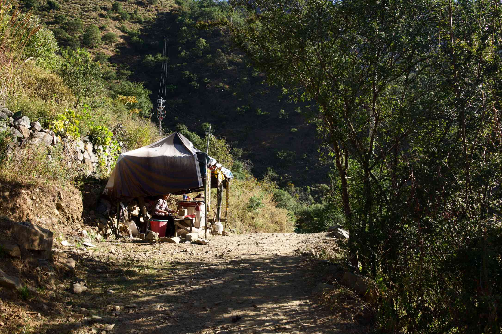

一开始我担心路上买不到吃喝，连同热水壶在内带了三瓶水和一罐八宝粥，还有卫龙和玉米肠。实际上一路间隔一段距离就有补给，虽然会贵一倍的价格，但就算是一瓶可乐卖你 10 元，难道不好过你山脚下自己背上山来得轻松吗？我越到后面越觉得自己就是个「小可爱」，明明钞能力就可以解决的问题非要自己累个半死，很容易导致旅行的状态丢失。

虎跳峡的徒步计划我打算走完全程，大概 20 公里左右，分为两天。之前有刷到过通过越野跑的方式一天干完，但我主要是第一次来，而且目的是旅行，只是通过徒步的方式达成这个目的，没必要这么卷自己，才决定的分为两天走完。第一天从纳西雅阁上二十四道拐，终点是中途客栈，第二天从中途客栈出发，到达天梯客栈结束。

### 纳西雅阁到中途客栈
虎跳峡从纳西雅阁出发时，从大巴车下来分流到了一辆面包车上，连同司机师傅七人到达了徒步的起点。但下车时并没有找到纳西雅阁本身，而是另外一家上马点，实际上都差不多，没必要必须到达纳西雅阁，往前走大概两百米就到了进山登记点。

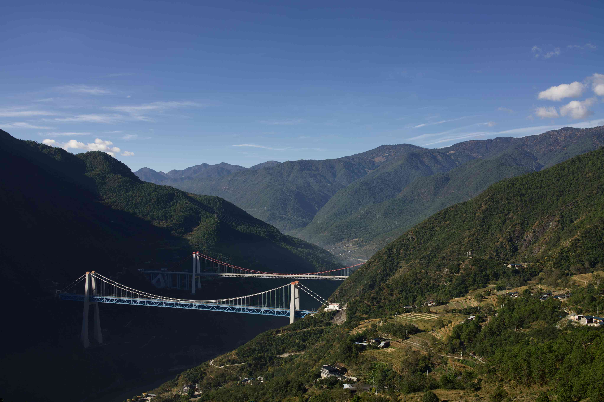

下车点还有一个「茶马古道二十四道拐国保碑」。茶马古道是第七批全国重点文保，但因为跨度太长分为了好几段，有两个源头一个是四川成都和重庆，另一个是云南普洱和昆明，汇集到西藏拉萨，最终出口甚至延伸到了南亚和东南亚。其中位于虎跳峡的二十四道拐段就和我这次的虎跳峡徒步路线重合。所谓「茶马古道」，一方面是古时军队对马的需求和西藏对茶的爱好，在 11 世纪时所形成的跨越青藏高原的贸易路线，并延续到 1950 年代为止，新中国通过基础建设的方式终结了茶马古道危险且落后的运输方式，现如今反而变成了旅游景点，想想也是一件十分有趣的事情。

在进山登记点写好名字和联系方式后就正式开始走虎跳峡了，起始海拔在 2200 米左右。实际路况和北京的西山和三峰徒步越野跑路况类似，基本上没有任何的难度，唯一难受的地方在于背包太重，海拔有点高。刚开始有点兴奋，走的比较快，走到「10 元观景台」附近时才缓过来，累得上气不接下气，从这里开始怀疑自己为什么要背这么重的包折磨自己。

不光是补给，就连衣服也带多了。一条冲锋衣、一条加绒内胆、两条薄绒户外裤、一条秋天长裤、两条运动内衣、两条长袖和一套短裤短袖睡衣，以及四套羊毛袜、一次性内裤和一个越野跑背包，甚至还有我的各种电子设备和充电器等等，把包塞得满满当当。将近 20 斤的重量压在身上，刚开始没适应时每次看到能够休息的地方都要把包卸下来休息。

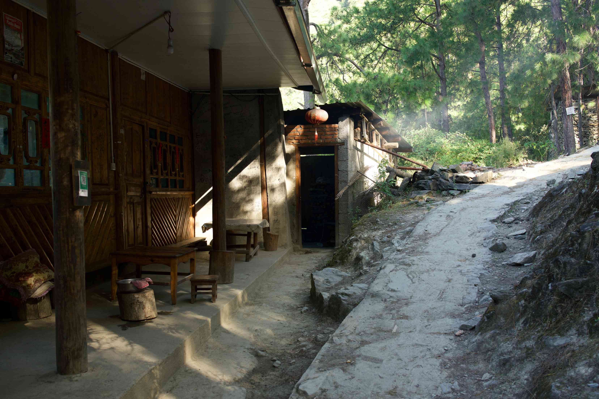

不过经过这次的经历后面就有经验了，下次再进行徒步旅行时直接把重量大头的相机给废弃掉。这次徒步旅行出门时我就十分纠结带不带相机，如果要带相机，好处是可以有更好的设备拍出自己喜欢的照片，也符合自己当初买这台机子的初衷，更有旅行的味道在。缺点也十分明显，连同电池和充电器在内多出了整整两斤的重量。从济州岛徒步旅行回来就萌生过直接把相机卖了的想法，但看到闲鱼上全新的机子都降了这么多，强行卖掉只会亏得底掉，也就作罢。争取下次再整理背包时可以缩减控制在 15 斤以内，轻量化出行才是王道。

过了「10 元观景台」后就很少出现垂直持续爬升的路段了，都是起伏路段，爬一会儿降一会儿，有时穿过竹林有时面朝大山，底下就是波涛汹涌的金沙江。在午饭时刻会到达茶马客栈附近，是此行第一个大的休息点，如果你想一天走完虎跳峡的精华路段，不用像我一样苦哈哈的多走六公里，可以早上大巴分流前和司机师傅沟通把你送到茶马客栈而不是纳西雅阁。

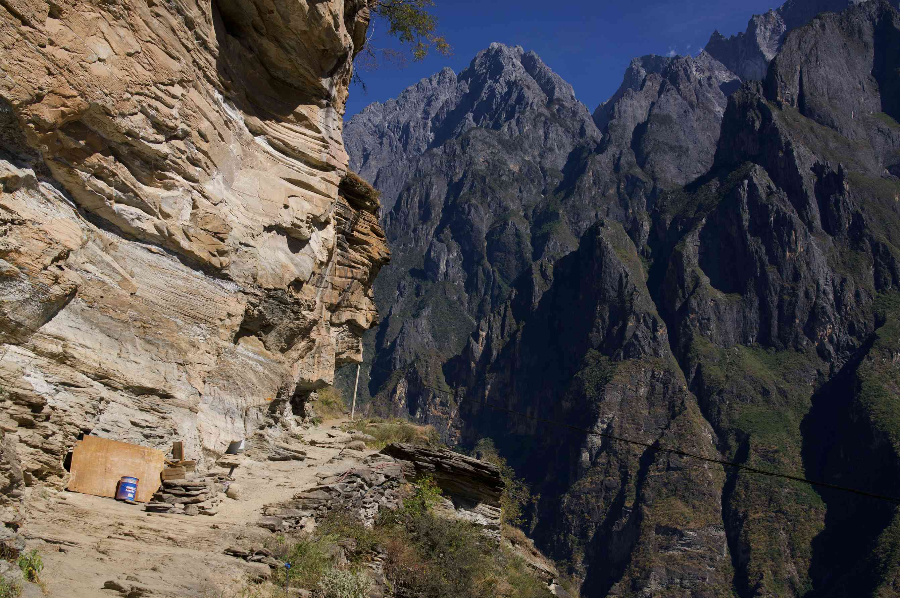

我在茶马客栈附近的一家咖啡馆休息了一段时间，喝了杯拿铁，吃了点路餐。从茶马客栈开始就可以一路伴随着「玉龙十三峰」徒步了，这种感觉非常震撼，右边是玉龙雪山，下面是金沙江，左边是哈巴雪山，我就自己走在峡谷之上。看着玉龙雪山这雄伟壮丽的岩壁，很难想象古时候这么一条悬崖峭壁之上的道路就可以支撑得起茶叶和马匹的货物交易了。同时也是从茶马客栈开始，剩下的路况变得无比良好，全程水泥路，再也不用走之前那样各种碎石乱石路，怪不得有人可以一天跑完，晚上还可以回丽江吃牦牛肉火锅。

这种走在大山深处峡谷里的感觉玩从未有过，故意走得很慢，故意走在各种人群之后，目的就是为了可以让自己独自一人好好的感受被大山包围的感觉。说来人类这个物种确实很奇怪，无数的人想走出困住自己一辈子的大山深处，而有些人，比如我，却始终惦记着何时才能再回到大山深处。

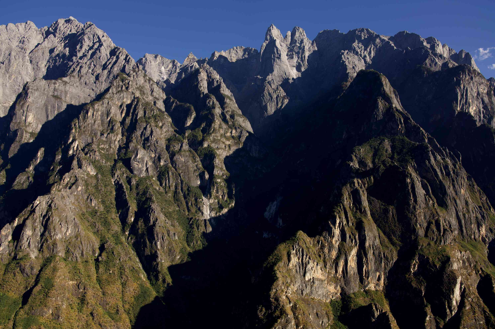

大概在下午 15 点左右就到达了中途客栈，也叫 half way。办理好入住后才发现我是当天第一个到达六人间的，理所应当的选择了靠近玉龙雪山落地窗的下铺。在这个位置拉开窗帘，落地窗外就是玉龙雪山，躺在床上就可以把十三峰全部收尽眼底，这样的配置一晚上只需要 59 元。

我整理好行李，洗漱一番后就去感受了一波「爽死你观景台」和「天下第一厕」。这个观景台确实是有些东西的，直面玉龙雪山的景色比在茶马客栈更震撼，坐在旁边的咖啡馆里，喝着饮料搭配着眼前的景色真是惬意。但我要重点推荐的是这个天下第一厕，虽然是露天的厕所，定期流动冲水，异味比其他的露天厕所小非常多，我在里面方便了几次，每次进来都用一种在享受的感觉，每次上厕所都十分通畅。

但缺点嘛，也是有的。中途客栈从 1988 年到现在也算是非常老牌且著名的青旅了，但床的质量太差了，上铺翻个身下铺连带着摇摇乐，我都清晰的能数出上铺一晚上到底翻了几次身。如果不是累到极致，还是正常住标间，略过中途客栈的青旅吧。到了晚上六人间居然都住满了，我原本以为淡季最多两三个人，厕所和洗浴在房间里，晚上和早上存在洗漱高峰期。体验了五六家青旅，感受最深的是厕所和洗浴一定不要在房间里，只要在房间里必然会存在异味和等待，一定会存在噪音。当然了，如果价格只要三四十元，床品过得去就十分难得啦！

挺多人来中途客栈的观景台打卡和喝咖啡，中途客栈也不仅仅只有青旅，还有普通的标间，住宿环境都比青旅要好，但那种更加适合大于一人的出行。里面吃喝一条龙，味道都还算不错，重点是环境确实棒，作为中转地休息一晚十分推荐。

### 中途客栈到天梯客栈 
转天被上铺下床的剧烈摇晃弄醒后，迎接我的虎跳峡徒步第二天。早餐我判断失误了，办理入住的时候前台说「晚饭现在就可以吃，但早餐是明天早上 7 点到 10 点」，这番话听下来我以为是包含早餐在内，心想着 59 元花得还挺值。实际上第二天起来后看到室友们都在「嘎吱嘎吱」的吃着各自带的路餐，才后知后觉并不包含早餐。

为了避免第一天带了太多补给导致背包太重，并且只需要小半天时间就可以下山了，我也开始吃自己的补给。把八宝粥和最后一根热狗肠当作早餐给吃了，不知道是胃口大开还是真的聊胜于无，吃完后肚子没啥感觉，上到观景台旁的咖啡厅再点了杯拿铁，坐在面朝玉龙雪山的位置上美美地喝了杯咖啡。

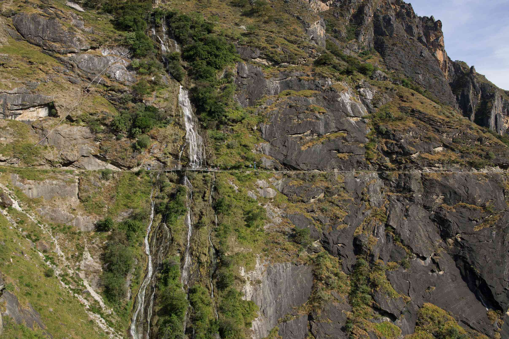

今天的路程不长，昨天已经走完一大半了，只要今天在下午 14 点前到达天梯客栈上大巴就完事。在继续享用天下第一厕时，收到了一个高中小伙伴的信息，他说从中途客栈出发的第二天行程比第一天更好看，会经过一个瀑布。我看到有瀑布就两眼放光，连忙收拾好行李出发了。近些年来的旅行我越发的不喜欢做特别细致的行程安排，特别是上午 9 点到 11 点去哪哪哪，几乎不再会出现了。

最主要的原因是严肃摄影后，每次手里拿着相机就感觉自己变了个人，地上的一个阴影一片树叶，或者是房檐上的一个瓦当，只要眼前的景搭配除了不错的画面，符合我当时的心态和意境的，我会慢慢的拍，不停的换角度的拍。在这种模式的锻炼下，已经早就没了着急忙慌的打卡心态，甚至一天只去一个地方，这个地方让我感觉到待着很舒服我也能待一天。所以我是从许久未联系的高中同学口中才得知前方不远处有瀑布，如获至宝。

从中途客栈出来后一路都是上好的水泥路，风景和前一天大体相同，基本上也都是伴随着玉龙雪山一路前行。知道拐了个弯，猛然间就听到了瀑布声，路况才开始的变为了沙石路。瀑布从山顶一直留到山脚下，最终汇入金沙江，搭配着旁边的黄绿色的植被和墨黑色的岩体，山水画的感觉出来了。10 月底的水量依旧很大，站在瀑布正下方能够感受到迎面而来的水雾湿润感，但在瀑布下面远没有在瀑布对面望过来看得震撼，有些东西确实是只能远观呐，靠得太近反而会失去原本吸引自己的特质。

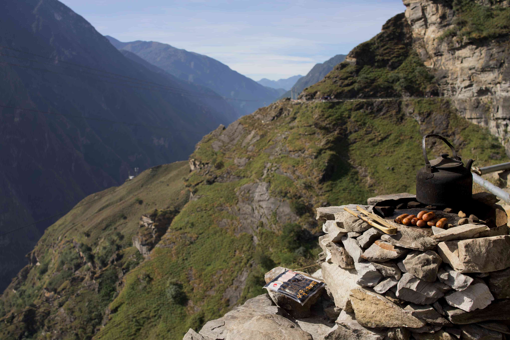

刚绕过瀑布一点，马上就看到了有三个大哥在卖烤肠，就在悬崖边拿石头堆了个简易铁板灶，烤肠就放在烤得炙热的铁板上滋滋冒油，香味就这么钻进了你的鼻腔。没忍住诱惑买了一根，心里已经做好了准备付款 10 元了，没想到只要 6 元！天地良心，早知道我买两根了。路过的几个香港来的小姐姐们看着我吃的这么香，也买了一根。

同时也是从见到瀑布开始虎跳峡第二天的路程整体开启了一路向下的趋势。这里的路况和北京香山和三峰更是类似，几乎可以说除了海拔之外一模一样，可以一路非常流畅的越野跑到终点。但这里遇到了一件特别要命的事情，到了其中一个观景台，可以回望金沙江大峡谷。此时的风很大，正好把一个同在观景台休息的韩国大爷帽子吹飞了，掉到了观景台护栏下的悬崖峭壁上。

刚开始我们都挺可惜的，看他们还笑嘻嘻的说了几句应该类似「可惜」的韩语，就在这个时候，我还在拿着相机拍照呢，突然听到身后一阵喧闹，回过头来才发现这韩国大爷居然翻过了护栏，直接就朝着悬崖峭壁晃晃悠悠的走去。有个好心的大哥还在一直说「太危险了，不要拿了」，但这个韩国大爷同行的小伙伴也没在意。好在最后拿到了被风吹跑的帽子安全回来了。我看到大爷安全上来后，赶紧走了，一路上都在后怕他是怎么有胆量为了一顶帽子毅然决然的走向旁边就是万丈深渊的峡谷。

下到终点的风景我一路上没怎么看，穿着新买的徒步鞋一路越野跑的方式下到了虎跳峡徒步路线的终点。终点是个国际青旅的门口，距离天提客栈还有差不多两公里的距离，我看到下面的风景更是美妙后，心里又产生了一个想法，下次再来直接再以越野跑的方式一天跑到终点，在终点住上一晚，好好的感受峡谷里的景色。

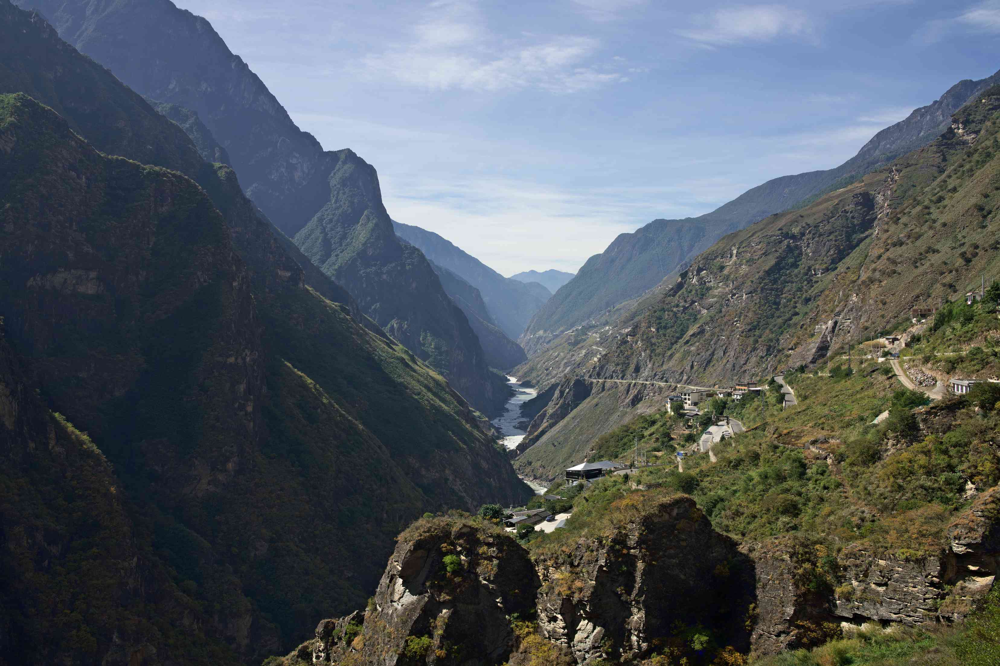

到达天梯客栈的时间正好上午 11 点半，距离下午 14 点的大巴车上车时间还有两个多小时，咨询拼车的客服后告知车票不退不换，最早的一班去往香格里拉的大巴车就是下午 14 点。我本来还在想办法找车想要更快的到达香格里拉，找着找着就先到了天提客栈，发现附近有个咖啡馆，咖啡馆上有个二楼可以不用消费随意入座。二楼的风景真是绝美，正对着「天界神川观景点」，金沙江宛如一把利刃劈开了哈巴雪山和玉龙雪山之间的大山，愣是划开了二者的分界线。

我就这样在这个观景台听着歌，晒着太阳，看着金沙江大峡谷的景色待到了饭点。听到了继五条人之后打动我心的乐队——供销社乐队，甚至坐在去往香格里拉的大巴上也是听着他们的歌，看着大巴车窗外的景色和海拔一点点发生变化，特别有旅行在路上的感觉。

## 香格里拉
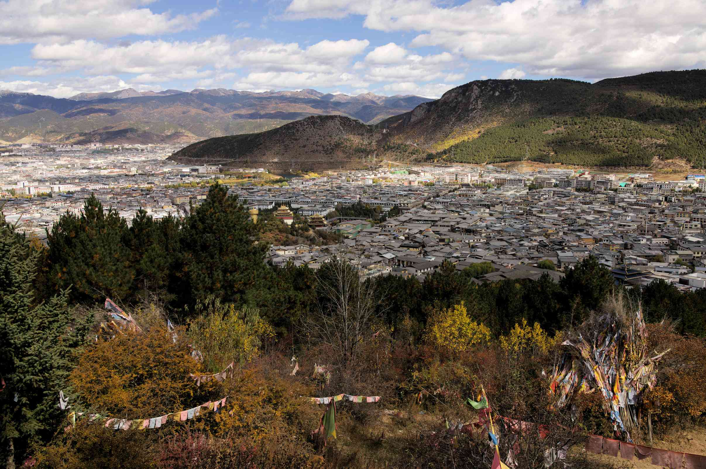

在下午 17 点左右到达了独克宗古城的东门。我在香格里拉住一晚休整下后，转天下午再去往飞来寺继续休整一晚，直到第四天才进雨崩村。独克宗古城是中国保存最好、最大的藏民居群，但在 14 年大火后基本上烧得差不多了，古城直到 16 年才重建好，虽然没有人员伤亡，但却把整个独克宗古城烧了整整三分之二啊！太可惜了。现在距离古城重建恢复完成正好过去 10 年，里面的环境好了很多，有很多有趣的小店，我觉得比之前去过的其他古城都好逛。

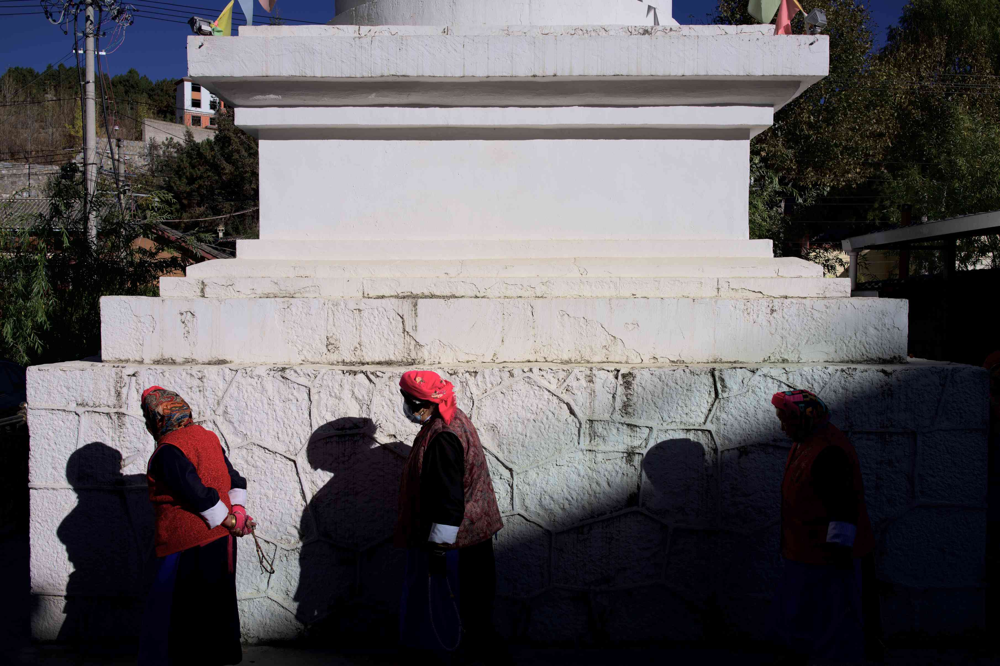

入住的是在古城北门附近的丹舍青旅，青旅大厅很有味道，中英双文的各种标语，老外浓度极高。原本预定的是两人间但因为去哪儿上选了选注后付，在商家侧只是收到了订单并不会留房，主打一个先到先得，但你要提前付款了那就没问题了，提前锁定了。和前台小哥沟通了一番才搞明白这其中的猫腻，第一次用去哪儿就挖出了个坑，我赶忙和小哥把后面再回香格里拉的两晚双人间住宿给先订上了。

这家青旅的环境我觉得没问题，有 5 元一次的洗衣，免费烘干，公共厕所在房间外，六人间里开着暖气大晚上的把我闷醒好几次。二层公共区域有一张台球桌，前台小哥经常一个人在这里打台球，我喝着热水看着他打了一会儿，就邀请我一起玩，有点蠢蠢欲动，但我的心态还是没放开，没有马上接受他的邀请，而是委婉的说待会洗好衣服了再来。

为了弥补这个遗憾，几天之后我再回来入住时，马上就跟他打了三局，水平比我好多了，三局都是他赢，最后一把我先行剩下一个黑八，没想到人家连续两杆进球，反超我了，非常有趣。打完后还跟他聊了几句关于青旅的情况，没想到我的旅行状态如此滞后，都要结束了才出来，这也算是个观察自己的机会吧，非常推荐你来住这家青旅，我个人认为更接地气一些。

反观在云南吃的吃喝就没那么打动我了，可能我就是对吃喝兴趣不大，如果没有女票或者小伙伴主导去哪吃饭，我是真的可以一直忽略自己对美食的诉求的。我找到了一家宣传是「人均 30 元吃饱」的牦牛肉干锅饭馆吃了一顿两人餐，有一壶酥油茶、四块青稞饼和一大盆牦牛肉干锅，真的是一大盆，这么些配置下来只需要 73 元，后面再回香格里拉时，我也来这再吃了一顿。

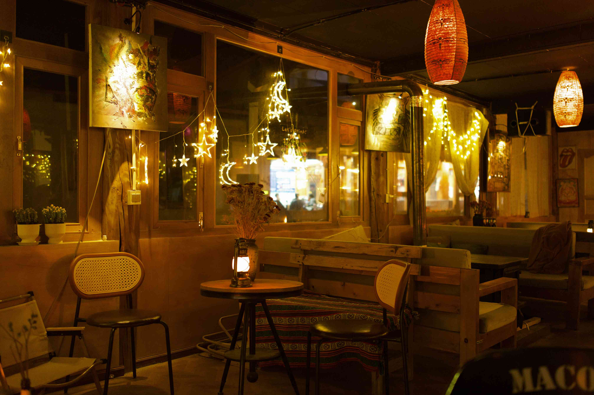

吃好晚饭后我没有去跳锅庄舞，反而选择去了一家名为「马孔多」的清吧听歌去了，这也给后面再来香格里拉留下了伏笔，同时这也是我为什么觉得在香格里拉待着的感觉会更舒服的原因。这家马孔多大概是晚上 20 点左右就开始唱歌了，一直都是一位头发稍长的小哥在自弹自唱，我觉得他很有气质，完美符合我对文艺青年的所有印象，中文和英文歌都能唱，而且整个酒吧的装饰氛围给人一种进来非常温馨的味道，不管是整个环境闻起来的真实味道还是视觉效果都很温馨。他们应该是烧了藏香，整个舞台很像是家里的客厅开辟出来的，背后是一面书墙，暖黄色的光打上去后，在香格里拉寒冷的夜里很温暖。

我点了一杯「月光之城」特调，口感不错，适合晚饭吃油了来一杯解解腻。但价格小贵，88 元一杯，但也算是变相的支付了环境和听歌的费用吧，我后面再来香格里拉时还来了一趟马孔多，也是点了月光之城，小哥也认出了我，问我是不是来过一次，我笑哈哈的说是，还想过来听听歌。对了，他们家点歌免费，就算不是他的熟悉范围，也会强行唱一唱试试，除非真的不会才会拒绝你。

至于独克宗古城里走两步就遇见打着「杨丽萍咖啡」的各种咖啡店，第一次来香格里拉的我没有试喝，过了几天再来后我就喝了，并且还在店里坐着喝了几种豆子，口感非常奇妙，远比速溶好喝多了。直接萌生了给小伙伴带咖啡豆的想法，买了一罐小圆豆，一罐蓝山，两盒白咖啡速溶，老板还送了一盒猫屎白咖啡速溶，最终的价格是六百三十多，包邮送到家。

## 雨崩前奏
第四天我特意买了下午的大巴票去飞来寺，目的就是为了利用上午的时间去看看「松赞林寺」。松赞林寺我第一次得知是在 Dandy 大哥发的照片里得知的，他当时应该是跟了一个摄影团，专门去拍松赞林寺僧侣师傅们绘制唐卡的过程，还是个著名的老外摄影师带团。关于唐卡的历史以及具体的绘制流程我的兴趣倒不大，但去看寺庙我的兴趣不小。倒不是说唐卡本身不吸引人，而是我还没到那个地步去关注细微的事物，我还是有种想关注一些更为宏大的物体和事件。

松赞林寺从古城北门一路北上就到了，只有一条路。我打算坐公交车去的，但稍微等了几分钟发现这公交车的频率太低了，打开滴滴看了眼，没想到只要七八块钱，果断打车前往。松赞林寺的门票 55 元，可选往返摆渡车和讲解，我个人建议时间充裕的话只买个门票就行了，差不多十几分钟的时间就可以走到拉姆央措观景台，顺时针逆时针都可以到达松赞林寺。

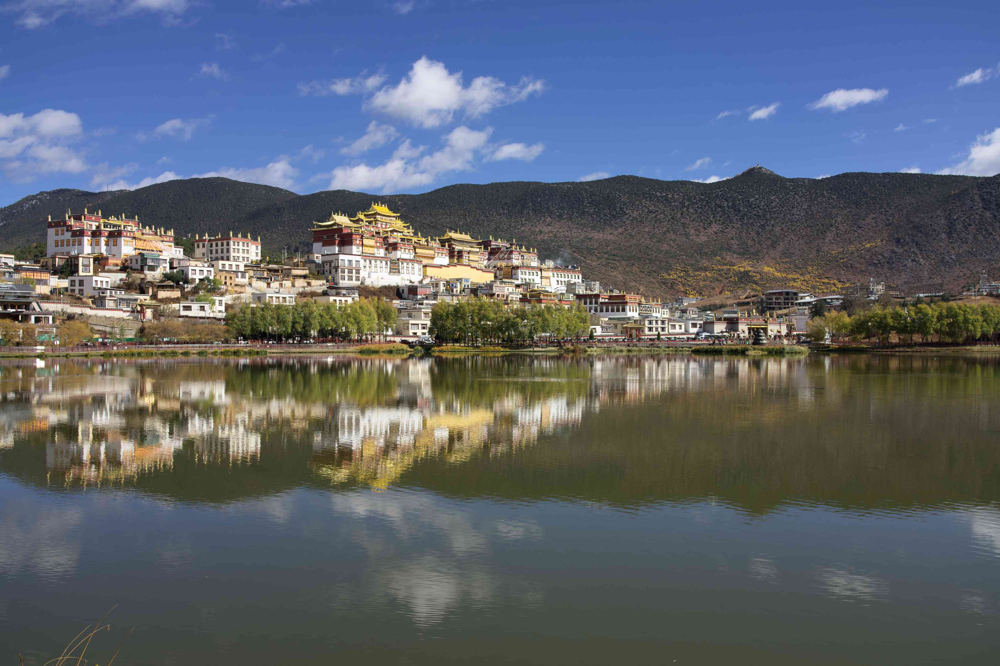
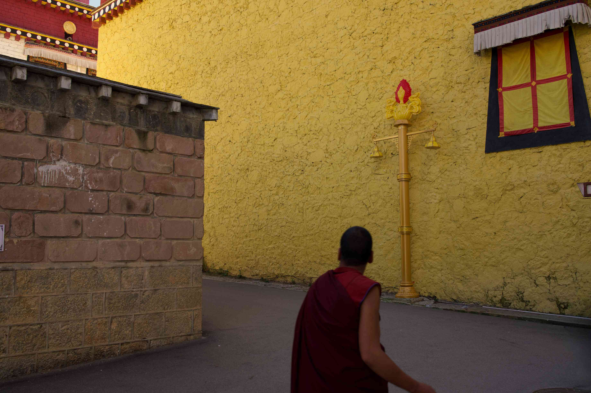

不得不说这湖面上的寺庙倒影是真好看啊，当天万里无云，湖面平静得像一面镜子，把这座被誉为「小布达拉宫」的松赞林寺全貌坐了一次完美的对称。松赞林寺本质上是个为了平叛动乱中起义的「新庙」，并不像其他寺庙那样有什么特殊的历史渊源，被称为小布达拉宫确实也是因为当时建造时仿造拉萨的布达拉宫样貌所建设。如果不是文革中遭到破坏，其寺庙建筑历史也有大大三百多年，令我感到意外的是，直到 1958 年才彻底废除了松赞林寺的农奴制，寺庙里的僧侣也才真正的下地干活参与农事，有种莫名的恍惚感。

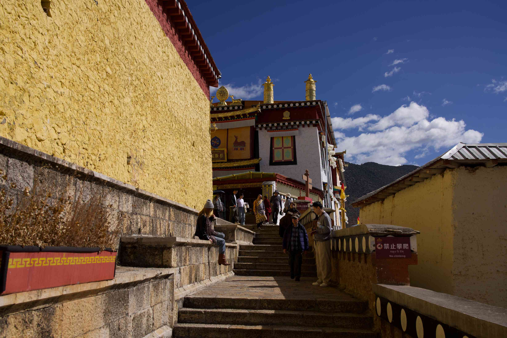
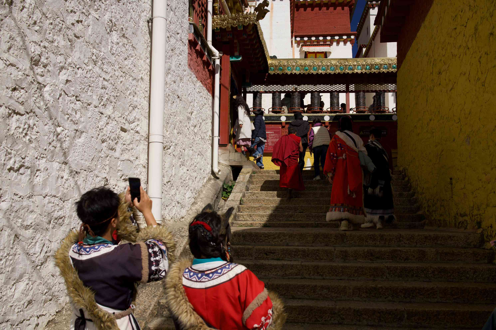

目前松赞林寺的主体建筑是 1984 年重新建造的，几个大殿都基本上恢复成了原本的样子，相关宗教活动和法事也都得到了恢复和保障，目前常驻僧侣有七百人左右。我把几个大殿都逛了一圈，除了主殿里五世达赖喇嘛巨大的佛像外，剩下的每个大殿香火都挺旺。前来参观的外国友人有来自泰国、马来西亚、菲律宾以及欧美白人等等，不确定是不是这个香格里拉的 tour 已经流程完备了，我自己逛下来觉得除了外面的拉姆央措景色实在是一绝外，但论寺庙本身历史文化和建筑风格都挺一般的。

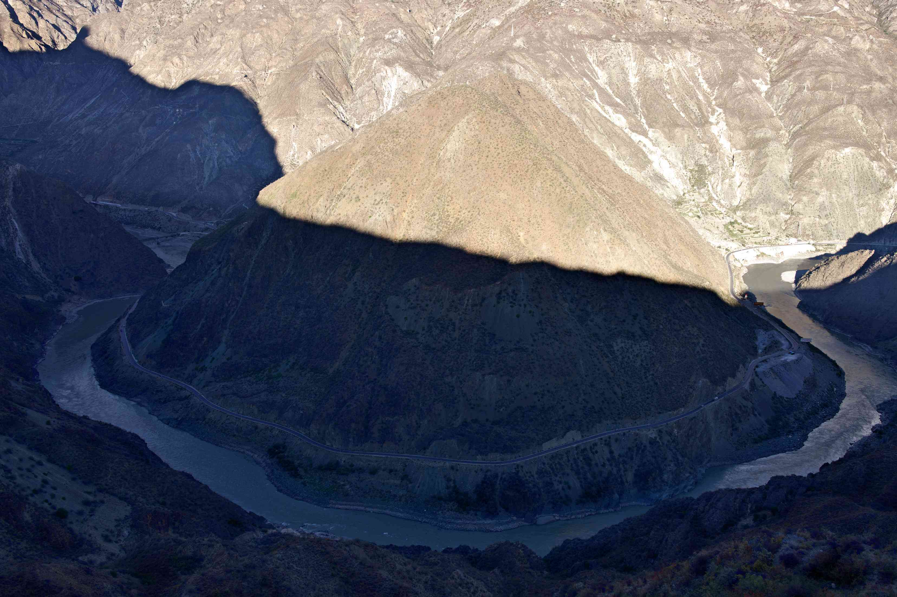
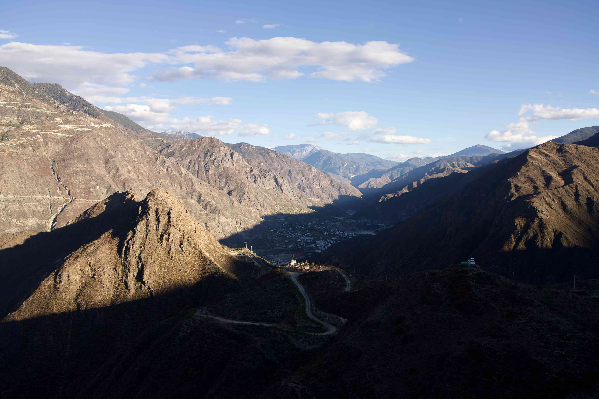

下午 15 点半左右我到了了香格里拉客运站，找到了那样载我前往飞来寺的大巴车。大巴车全部坐满，没有空位，且要求对号入座，如果你有幸买到了靠右窗户的座位，那恭喜你！迎接你的将是一路美丽的金沙江大峡谷。中间会在一个名为「金沙江大弯」的观景台中途休息上个厕所拍拍照。这个大弯非常震撼，只需站在观景台护栏边就感受到了扑面而来的压迫感，金沙江在你面前的大山被强行拐了个弯，虽然整体流向没有发生变化，但它就是被大山严严实实的挡了一下，拐了一个大弯。这个观景台本质也是 G214 国道上一个很大的休息点，有吃有喝，甚至还有纪念品商店。

在观景台待了 20 分钟左右就继续往徳钦县城的方向开去。在大概 18 点半的时候遭遇了大堵车，在修路只能单向通行，最终到达飞来寺已经是晚上八点过了。通知青旅来接我到办理好住宿，最终吃好晚饭 21 点也过了。我在飞来寺住的也是青旅，价格更便宜，八人间仅需 47 元，有车接送到飞来寺大巴站，楼下就有饭馆。

## 尼农进村
第五天青旅房间里的小伙伴几乎都起床去看了梅里雪山的日照金山，我本身对早起是比较抗拒的，再加上日照金山对我的吸引力不算大，且今天还要走十几公里爬一千米出头的爬升进雨崩村，也就算了，墨迹到 8 点才起床去吃早餐。大概在 8 点 50 左右青旅前台有车送到昨晚下车的大巴点，很快就找到了去往雨崩村的大巴车。

进雨崩村有两种方式。第一种是这两年开始从西当温泉坐官方运营的大巴车西当进村，第二种方式是到尼农村徒步进村，两种方式都需要买票，第一种方式的官方大巴车需要 168 元一人，已经是钞能力下最便宜的进村方式了。我当然选择走尼农线进村了，大巴车把几个从尼农进村的人放在了「格阁家饭店」，徒步入口就在饭店的侧门。

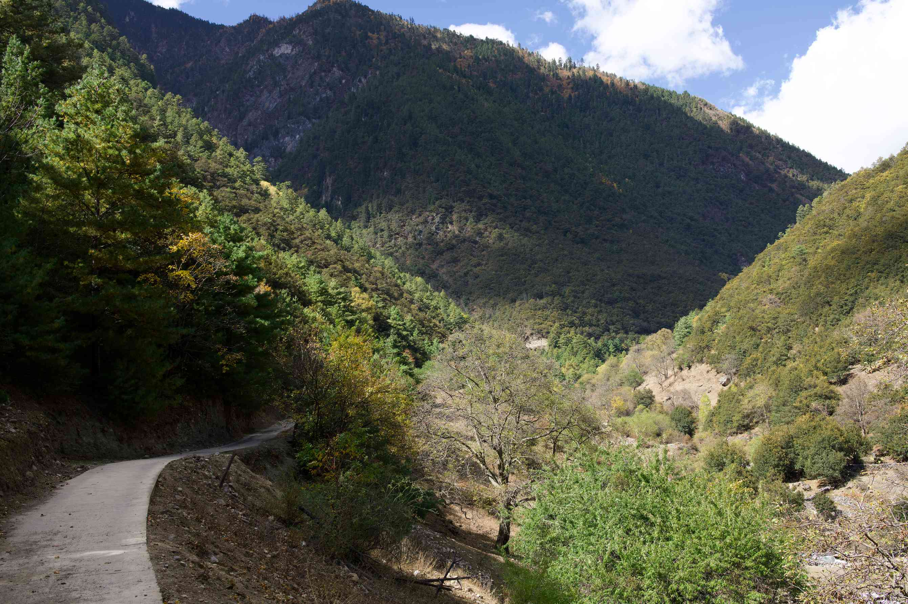

刚开就迎来一段坡度在 20% 左右的大陡坡，我在爬坡的途中遇到了昨晚在飞来寺青旅的同一个房间的两个重装露营的小伙伴。他俩来自广东，还是大三的学生，小小的身板背着大大的包，刚开始比我走的快多了，惊为天人。过了这段陡坡后才来到售票点，需要签署一个免责声明和购买门票，从这里才算是真正的进入尼农线进入雨崩。尼农线从售票点开始有一段 4 公里的水泥水平路段，伴随着从雨崩村里流出来的冰川融水，一直贴着尼农峡谷前进。

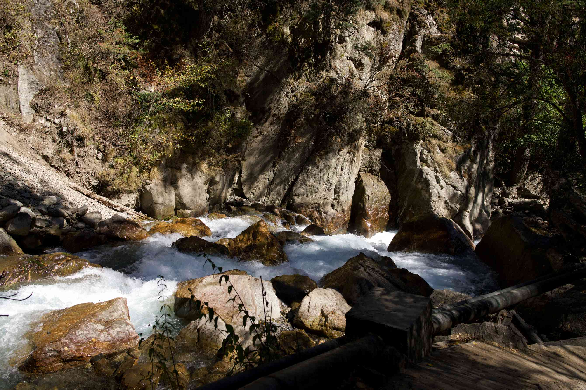

从售票点开始往里走时大概是上午 10 点左右，一路上可以看到很多人都在步伐快速的移动中，个人猜测有不少人是要赶 11 点半的大巴车去往香格里拉的。有好几个人跟我打照面时说了加油，一开始我还不太好意思，后来打的照面次数多了我居然开始主动和出村的人说起了加油，真是不知道到底谁才需要真正的加油呢。

大概一个小时左右走到了 1 号休息点，这里有一个大的超市，啥都有，甚至还有冰棍儿。但当天不巧，正好碰上没开门，但出村的那天遇见开门了，好大的一个补给点。风景也不错，坐在小亭子里望着来时的路，尼农峡谷在阳光上显得异常的壮丽，底下的溪流源源不断的冲刷着峡谷里的地貌。

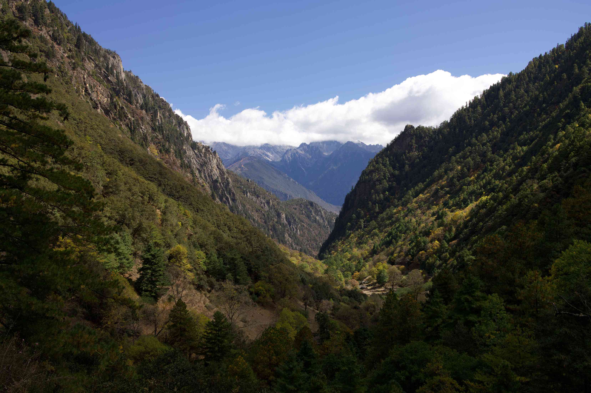

从 1 号休息点往后就是尼农线最大的挑战开始了！持续不断的上坡，让你从海拔不到 2000 米的地方，一路爬升，直到 3200 米左右的下雨崩村。如果你像我一样还背着快十七八斤的包，这一路会让你非常酸爽非常痛苦，尤其是还看着使用钞能力坐着摩托车来来往往的徒步者们，更是羡慕极了。因为一直在爬坡，原本在脚下的溪流会随着你爬坡的脚步一点一点的来到你的身边，最近的时候你只需要往河道方向走 5 步路就可以碰到来自冰川融雪冻手的溪水了

尼农进村这条线我还挺喜欢的，走着走着经常就变成了自己一个人，听着鸟叫和溪水的声音肚子一人安安静静地走着，偶尔碰上几位更早出发的驴友，和大家寒暄几句，如果速度一致就凑齐一起走，聊几句。大概也是从这个时候开始，和几位路上碰见的驴友一起走了一段，大家在一起有一搭没一搭的聊着，我才有了那种旅行在路上的感觉，在虎跳峡都没这种感觉，只有在这里才激发出来。

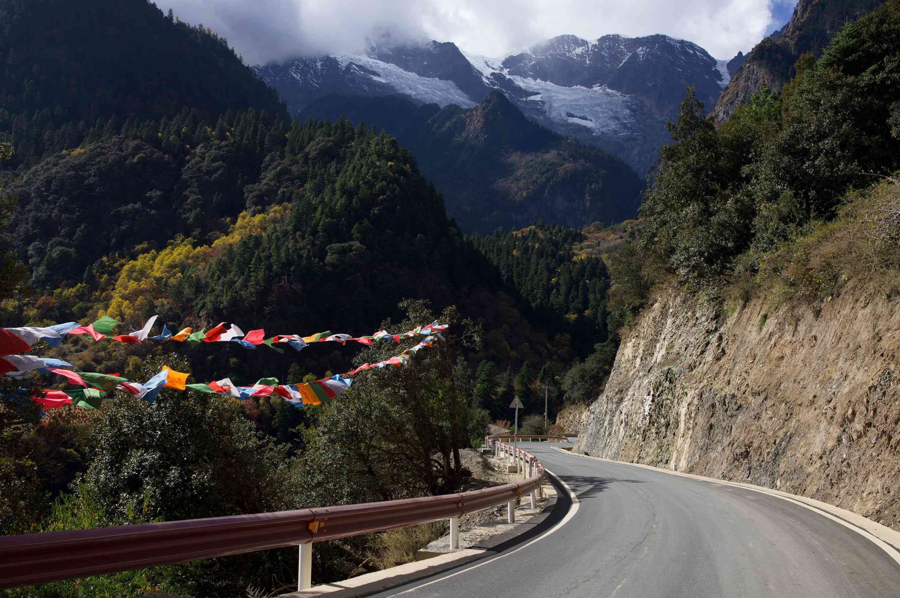

大概走了四个小时半小时左右，就来到了下雨崩村的入口，转过一个弯抬头，马上就看到了引入眼帘的神女峰和五冠峰，正无比清晰的迎接我的到来。中心湖倒映着两座雪山的倒影，搭配着左前方不远处金黄色的寺庙和经幡，还有一阵阵泥罐车呼啸而过扬起的阵阵尘土，刚到下雨崩还没缓过神来就先吃了一嘴的土。

整个雨崩村今年来正在大搞基建，目之所及的范围里到 27 年五一节时将会新增至少 20 家酒店，价格希望能再压低一些。我在上下雨崩村分别各住了两晚青旅，上雨崩是「徒步者之家」四人间 150 元左右一晚，下雨崩是十人间的梅里云端 110 元出头一晚。唯一觉得还算值的是上雨崩的徒步者之家，公共区域观景台的景色非常绝美，直面雪山和冰川吃饭，晚上还有篝火歌会，对旅途中的各种想象坐在篝火前都彻底落地了。

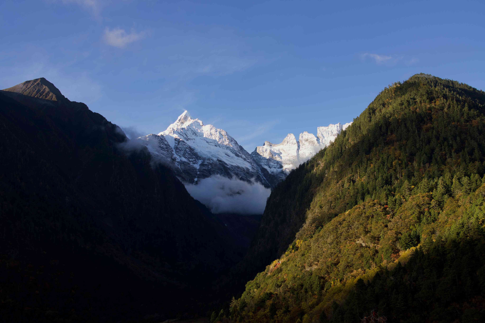

反而下雨崩的梅里云端青旅环境比较差，厕所在房间里，开门就是异味，每到晚上更是难以入鼻，我严重怀疑下水没弄好，屎尿一多就熏得不行，更要命的是只有早上才有一次清洁，十人共用一个厕所，用过的所有废纸都会堆积在垃圾桶里，直到它溢出到地板上，最终会把垃圾桶所在的那个角落填满废纸。最后一天晚上我实在是受不了，这马桶我除了小便以外，拉屎我都不敢坐上去，环境异常的差。但就在十人间的隔壁，他们家的大床房和双标居然要 580 元一晚，听到这个价格时我差点惊掉下巴。幸亏前面感受到了好的青旅，要不然如果一开始我住的青旅就是这个环境估计再也不会碰了。

进入下雨崩后，我在面朝中心湖和雪山的「格桑云浪」餐厅坐了一会儿，拍了些照片。在上厕所回来的途中发现有小哥在吃店里的盖饭，我就问了一嘴味道咋样香不香，小哥说「好吃，快点」后我也来了一份红烧牛腩饭，果然是味道极好！后来走线只有经过下雨崩一定会来吃这家店的牛腩饭，只是每次来人都很多，应该是招牌打出来了。有点像吉野家的风格，但味道和分量上比吉野家都强太多了，重点是价格只要 45 元，在山沟沟里在徒步了一天后能有如此美味的牛腩饭，实乃人生一大幸事。

## 冰湖尼色
在上雨崩的徒步者之家就着篝火的炭火味儿睡了一晚后，磨磨唧唧的 8 点半才出发走冰湖线。早餐花了 28 元吃了一晚米线，吃完了没啥感觉，又花了 28 元买了杯拿铁和 15 元的奥利奥，这才心满意足的出发。徒步者之家青旅的位置在上下雨崩之间，不算严格意义的上雨崩村范围内，还需要先走到上雨崩后才能到达冰湖入口。走冰湖线的人是真的多，密密麻麻的，不知道还以为去哪个公园散步呢。

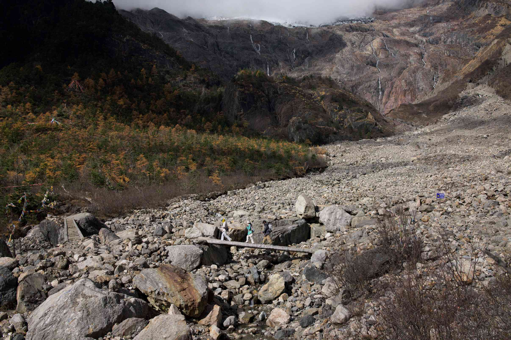
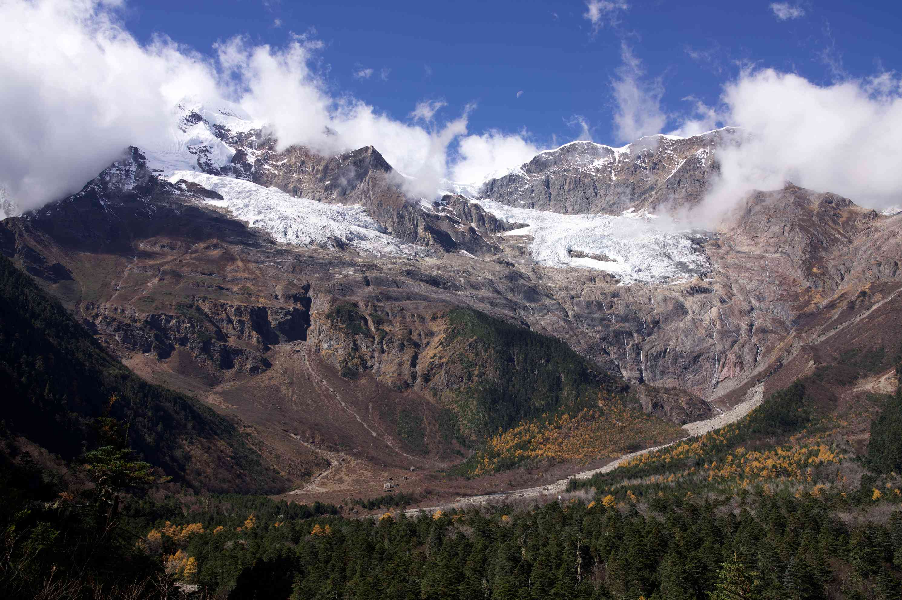

冰湖路线总长 7 公里左右，往返 14 公里，但我这次连带「尼色线」也一块走了，最终总里程来到了 22 公里左右，总爬升在 1300 米左右，强度挺高的。冰湖主要是前期刚进去不久就开始在 3200 米海拔的地方硬拔四百米爬升，相当累人，到了笑农垭口后才算是缓了一些。从冰湖入口开始一直到冰湖观景点都可以坐骡子，分为三段，共计只要 455 元，个人认为价格还是非常实惠的，这个钞能力可以发挥一下。

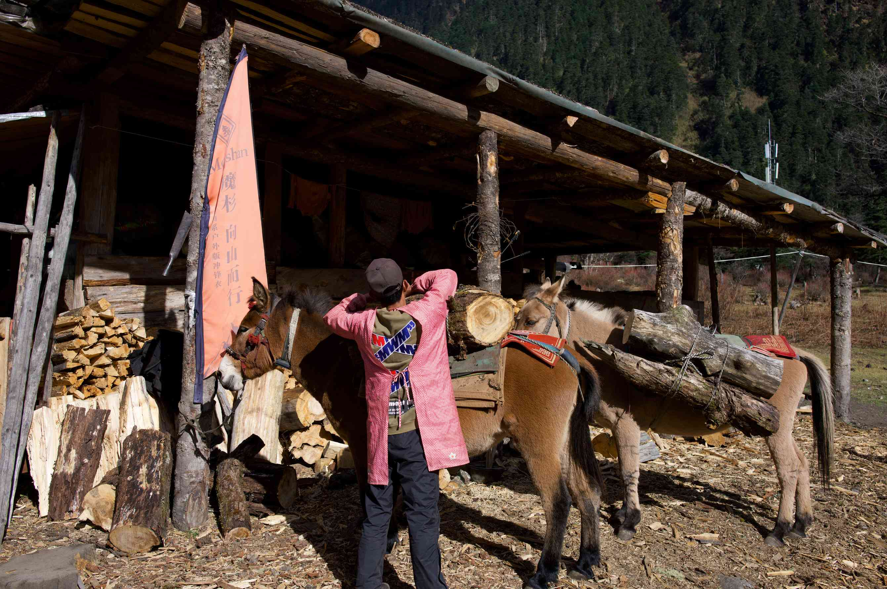

中间比较大的休息点是笑农大本营，有咖啡泡面等各种补给，也可以坐骡子，周边景色还算可以，是个大草坪，休息的地方也比较多，如果不着急的话，可以好好在大本营喝杯咖啡或者酥油茶休息休息。

冰湖本身的景色还可以，一定要下到湖边绕湖一圈，去到更北面的瀑布下玩玩水，在湖边找个地方大概休息休息吃个路餐，感受下海拔 3800 米的湖泊。从冰湖返程大概是中午 12 点左右，时间完全来得及再去一趟尼色线瞅瞅，我马上加快步伐去往尼色线的入口。返程路上绝大多数都是下坡，我当天是越野跑装备的配置，虽然穿着的是徒步鞋，但也能流畅的一路小跑下山。迎面碰见了很多还在苦哈哈爬坡的人，都在问我前面怎么样，还有多久等等，我都逐一回复并强调一定要下到湖边看看，去瀑布下面拍拍照。

我个人喜欢尼色线多于冰湖线，主要原因是冰湖线宣传得过于火爆，预期拉高后现场实际一看也就那么回事，徒步过程最好就是不抱任何预期，包括旅行本身也是，大概知道自己的方向在哪即可，对途中发生的任何事情都不抱预期，最差情况能接受就可以上路出发了。尼色线一进去就是漫天的森林大树包围着你，绿茸茸的青苔和倒地腐烂的枝干营造出了一种绿野仙踪的错觉。周围只有你一个人脚踩在泥土和松针上嘎吱嘎吱的声音，怪不得网上会有人说尼色线要小心有熊，确实很像有黑熊生活的条件。

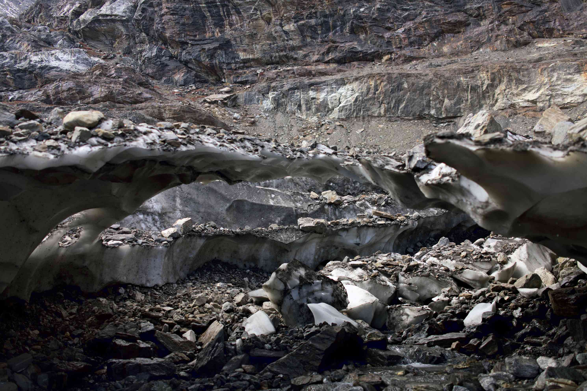
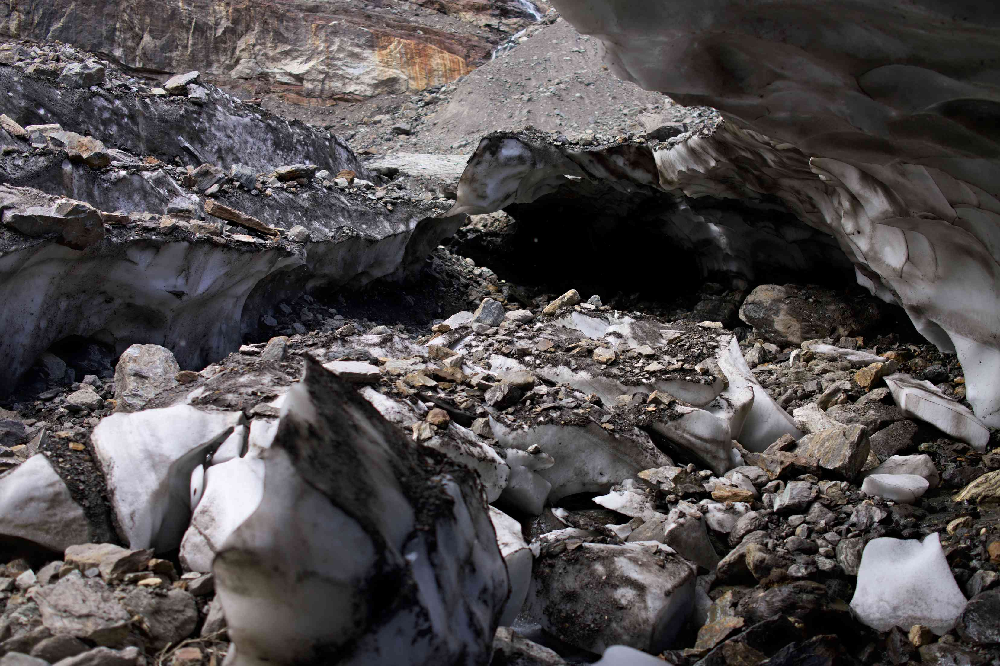

过了中途的一个木房子休息点后，尼色线就走出了森林段，迎来了它的第二段碎石路。这段路反而不好走，走到后面才意识到应该直接贴着河道一路往上就完事了，不用那么费劲的左切一下右切一下的找路标。尼色线的终点是一片冰洞，这是我第一次见到这种自然景观，也是第一次触摸到真正的冰川，虽然没有那么干净透亮，但在形态各异的各种冰块下跳来跳去也是十分有趣。特别是这里有个巨大巨深的冰洞，一眼望不到头，里面黑乎乎的一片，只有源源不断从里面流出来的冰川水。

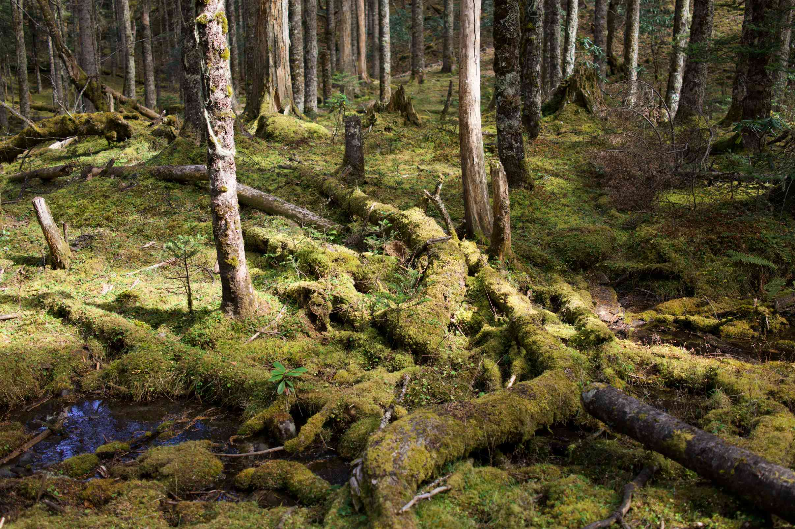
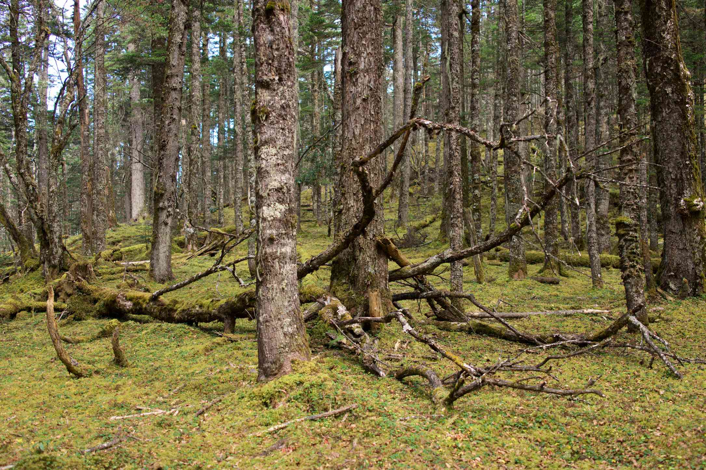

我因为没有带灯且独自一人，只往里走了大概四五米，一个人站在洞前，耳边还有各种莫名的冰块融化发出的噼里啪啦的声音，其实挺害怕的，后来我跟想走这条线的每一个人都说了找个伴带上灯，往洞里走去看看里面到底是咋样的。我找的尼色线轨迹没有到冰冻期这个地方，在冰洞前就停止了，这个地方我实际走下来还是有些危险性在的，脚底下的石头不稳，也不确定到底才的是冰上还是真的石头，最好找个伴，一个人的话超过下午 14 点就不要再进去了。

尼色线在到达小木屋前都很适合亲子路线，身边都是绿茸茸的氛围，找个稍微大的草地，坐在树桩上，晒晒太阳很惬意的。小木屋之后的路线就比较硬核了，海拔在 3800 米左右，风大，天气变化也快，如果没有冰洞或者走完一整条线的想法，可以没必要往里面走。

## 神瀑
神瀑线是雨崩村唯一的官方路线，全程铺好了水泥路直达神瀑脚下，同时其它的几条线路在入口几乎摆满了「未开发路线」的标识符，还有一条更为神秘的虫草线已经彻底关闭了，私自进入会被罚款，只流传在当地村民的口中。神瀑简单归简单，但全程来回也有 13 公里，还是挺长的。全程确实也有骡子可以坐，但针对这条线我个人就不推荐了，没啥必要，作为雨崩村里相对简单的一条线，拿来当调剂即可。

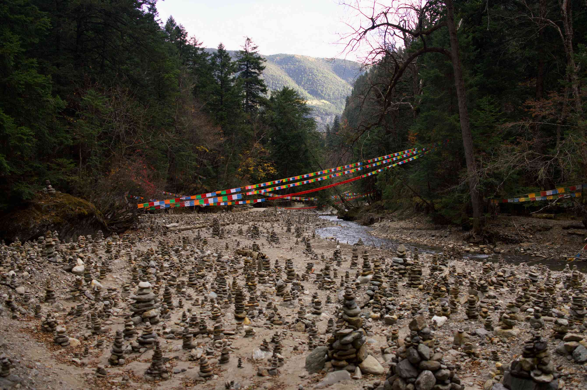

进去不久会看到一片河滩上摆满了玛尼堆，密密麻麻的很震撼，目测下来怎么也得有大大小小的几百个。同行的小伙伴对入乡随俗很赞同，早在其它的地方就已经堆过玛尼堆了，但我对这方面的事情还是有所保留，不同的文化和习俗尽量不实操，可以尽可能多的去了解，但不要把任何的事物叠加在自己的身上，包括祝福、祈祷和各种形式上，因为我始终觉得我们不了解清楚的事情还是不要随意实施比较好。

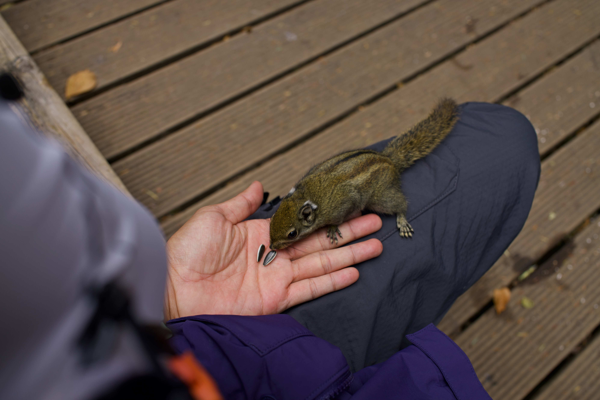
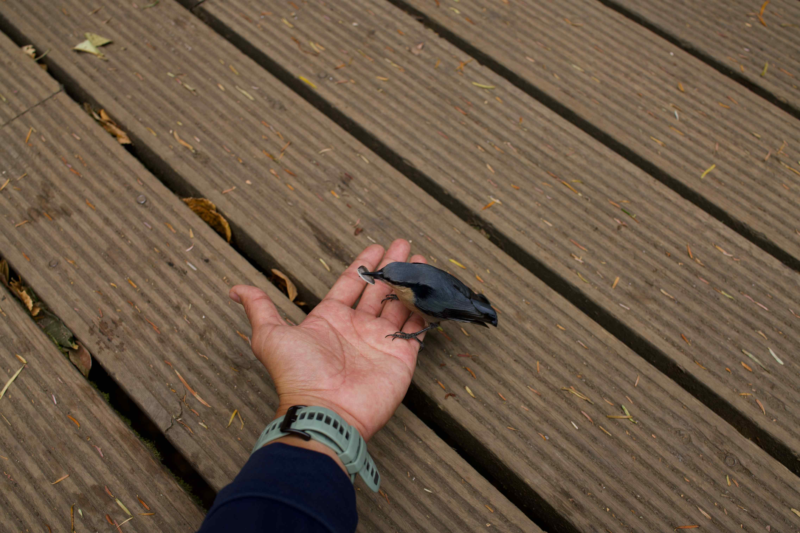

过了这个河滩会遇到两个休息点，休息点附近有非常多的小松鼠和小鸟。小松鼠和小鸟都不怕人，甚至还会爬到你的手上、肩膀上、腿上，找你拿吃的。这个时候呢，你就可以带一些坚果或者是瓜子。小松鼠看到你拿出来东西以后，它们就会飞扑到你的身上，去吃你的瓜子、你的坚果。小鸟呢，它比小松鼠稍微怕一点人，但是也会蹦蹦跳跳地来到你的脚边。你只需要张开手，在你的手上放上几粒瓜子，小鸟它就会跳到你的手边，用它的小嘴叼起一颗瓜子，然后再飞走。这一切真的太有爱了，人与自然和谐共处在此刻体现得淋漓尽致。尤其是小松鼠，它那个冰凉的小爪握在你的手上的时候，趴在你的脚上，真的是心都化了。

接着往里走会看到越来越多的经幡挂在道路的两旁。我们一开始并不了解这其中的一些缘由，直接穿过了好几个经幡走了捷径。后来我们看到了几个告示牌，说不要踩踏经幡，而是跨越。仔细想了一下刚才也没有踩到，都是跨越或者是翻越。大家一定要记好了这个习俗，要不然就可能会做错一些事儿。

越往上走，道路两旁的经幡越密集，好像是一条神圣之路指引着我们前进的道路方向，保佑着我们到达神瀑底下。刚开始经幡它只是挂在道路两旁，再往后走会发现经幡开始斜着挂、从上往下挂，甚至会故意地遮挡你的去路。你得用手去拨开这些经幡，好像是走在经幡丛林里，慢慢地给你一种拨云见日的感觉，去感受朝圣的氛围。

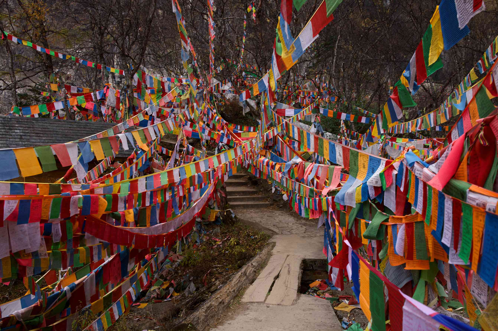

尤其是走到神瀑底下时，如果你正好有机会看到有人自己带了经幡，他们会在经幡的尾部绑上一块石头，然后用力往前方一扔，一条划过天边经幡就从你的头顶上飞越，那个画面真的特别漂亮特别美。我相信所有人看到经幡划过天边时内心都会有一些触动，不管你是否有信仰，不管是宗教信仰还是其他什么信仰，在那一时刻都会感到内心的一种富足感。

我们走进神瀑，当时的水不算大，但还是能够感受到稀稀拉拉的一些神瀑水滴落在头上。我们绕了一圈，在里面拍了照，感受了神瀑的水拍打在身上的冰凉感。有人说，如果你在神瀑底下感受到的水是冰凉的，那么说明你和神瀑缘分还不够足。如果说你走了一圈出来以后感觉到了解脱，感觉到了一种解放的感觉，那么说明神瀑已经带走了你身上不好的东西，你因此而获得了重生。说实话我感受到是超凉，可能我的虔诚度不够，信仰还不够坚定。

我们还看到了有人在神瀑顶上撒隆达。但我们又看到旁边立了一个牌子，就是建议大家可以带经帆过来挂，但不要去撒隆达，因为隆达是不可降解的，但还是看到有人在撒，我也不知道具体什么情况。当时并没有买到隆达也没有买到经帆，是下山之后在小卖部里才看到了有卖隆达，十块钱一份。大家如果去神瀑的话，可以尝试着去问一下，如果能带隆达上去撒的话，还是撒一个，拍拍照，挺漂亮的。

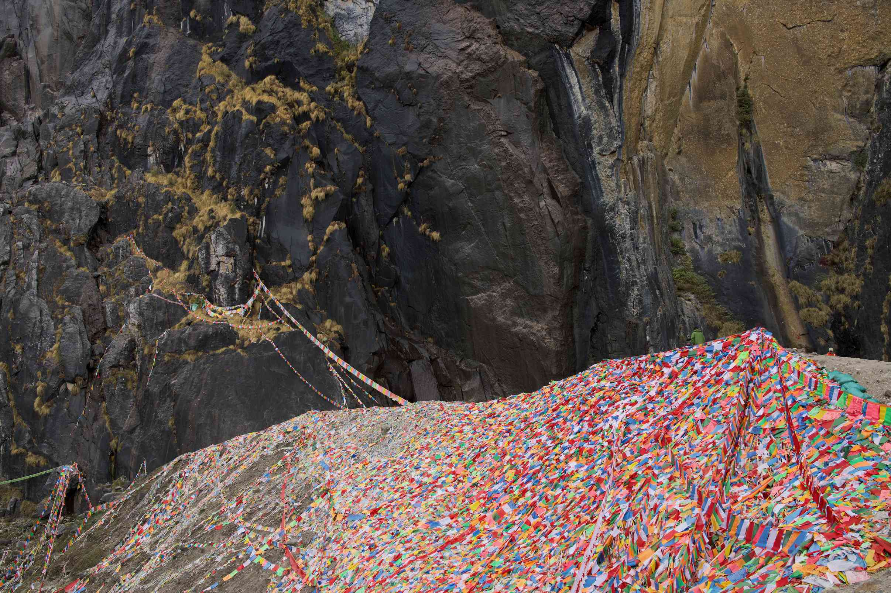

从神瀑返程的途中，我们发现了莲花生大师禅修洞，往那个方向走了一下，发现了有另外一个景点，或者叫只有当地人才会去到的一个地方——中阴洞。之前在做攻略的时候，小红书上有人看到了去钻这个洞。当时三个人一起走到这里时发现这个洞欣喜若狂，以为真的找到了这个洞。三个人都爬了上去，其中一个小伙伴包括我在内，两个人都确认了这个洞根本钻不过去。三个人又撤回来重新去看攻略，经过一番仔细求证以后发现就是这个洞。我们才决定脱掉衣服，穿最简单的衣物上去，一定要把这个洞给钻下来。

钻这个洞的时候最好是不要带手机，很容易磕到手机屏幕，最好是带一个灯，有两个人作伴，一个人的话还是不要去，真的很担心会被卡在里面。大家都说钻这个洞很像是在妈妈的子宫里重新走了一遭。我自己体验下来稍微有一点点感觉吧，但完全有那种重生的味道的话，还是差一些。它有点像探洞冒险里的钻洞的感觉，这个洞可能就比较平民，稍微有一些需要手脚并用的地方，慢慢挪腾才能够钻出来。我觉得还挺有意思的，大家去神瀑的话可以留意一下，找一两个小伙伴跟你一起凑个三四个人，大家都互相钻一下。这个洞其实对体格体型还挺有要求的，如果你过胖过壮，也钻不过去，体重 70 公斤以下的人应该都没问题。

最后我们走下来时，遇到了好几个正在走上去的小姐姐，她们都问「你们下来的时候看到有肖战走上去吗？」，我当时还懵了一下「谁？」她们说，「肖战啊，肖战刚才上去了，你们没看到吗？」我仔细回忆了一下，除非他是坐骡子上去的，在我们钻洞的时候擦肩而过，要不然不可能。后来还有人在问我们说有看到肖战吗？我就说，找我们干嘛？惹了大家一阵哈哈笑。

## 神湖
神湖线是整个雨崩村最难的路线。它难不是说路况不好，也不是说海拔特别高。它的难指的是刚开始就开始爬坡，从海拔三千三百米的地方一直爬，爬到四千两百多米。总之就是在第一个能够休息的地方，有吃有喝，有篝火烤着的地方，总共要爬一千米。神湖的路况其实挺好的，都是在森林里走，如果说是在平原的话，这条路其实跟北京的三峰刚开始的那段爬升其实挺像的，但它唯一的难点就在于海拔太高了，三千多米一直爬，爬到后面快四千米，真的超累。

总共四个休息点，第一和第二个休息点都是很简单的板凳以及上马点，第三个和第四个休息点是小木屋，但三和四两个休息点都是一个老板。一般情况下在淡季他只会开四号休息点，就是海拔比较高的那个休息点。老板会在那里做进山检查，每个人要登记自己的信息，还要交十块钱的清洁费。在四号休息点小木屋，你可以烤火，买补给，和老板给你亲自打的酥油茶。

从四号休息点的小木屋开始将会走一公里左右的平路，然后就迎来了最后一段的爬升，爬完就看到神湖了。神湖作为雨崩村四条线当中最高的景点，海拔在 4400 米左右。如果你想去走神湖 Plus，在天气好的时候往神湖右边上去。当时我们有好多人走了神湖左边，左边虽然也能够上去，但它不能看到整片的雪山，只能看到雪山尖尖一点点，而且那条路况到了尾部特别陡峭，都是山积碎石，很危险。

好多人都是早上七点钟甚至五六点钟爬的神湖线。他们早早地就到了神湖，专门留了时间去做神湖 Plus。还有一些人是请了向导，让向导带他们走神湖 Plus这条线。我自己感受下来，雨崩的四条线都不需要向导。如果说你真的很担心自己的安全，我觉得唯一需要请向导的就是神湖 Plus，需要有个人教你怎么走线，但也不算是特别危险的那种。

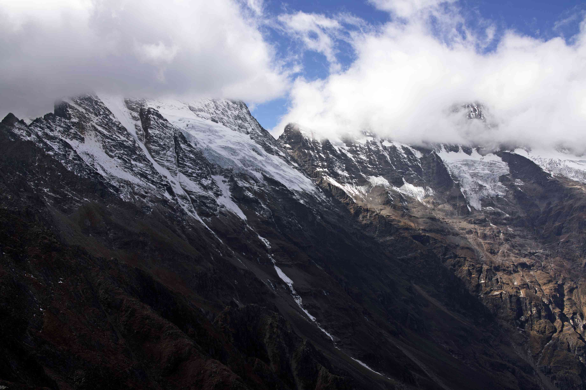

确实会有一些碎石板路，如果你选路选得不好的话可能会比较紧张。但如果你一点出发，慢慢走，是没什么问题的。向导应该都不便宜，怎么也得五六百块钱。雨崩的四条线路况这么清晰的情况下，在雨崩村做向导里面真的有赚头吗？我是要打一个问号的。

我当天的衣物穿着比较简单，没有戴手套，所以到了神湖 plus 顶上的时候，只待了差不多十五分钟不到就下来了，是真的冷，风景也确实不错，但如果晴天的话更好。当天也算是晴天了，但神女峰和五冠峰都有一层云雾围绕着，看不到完整的面貌。

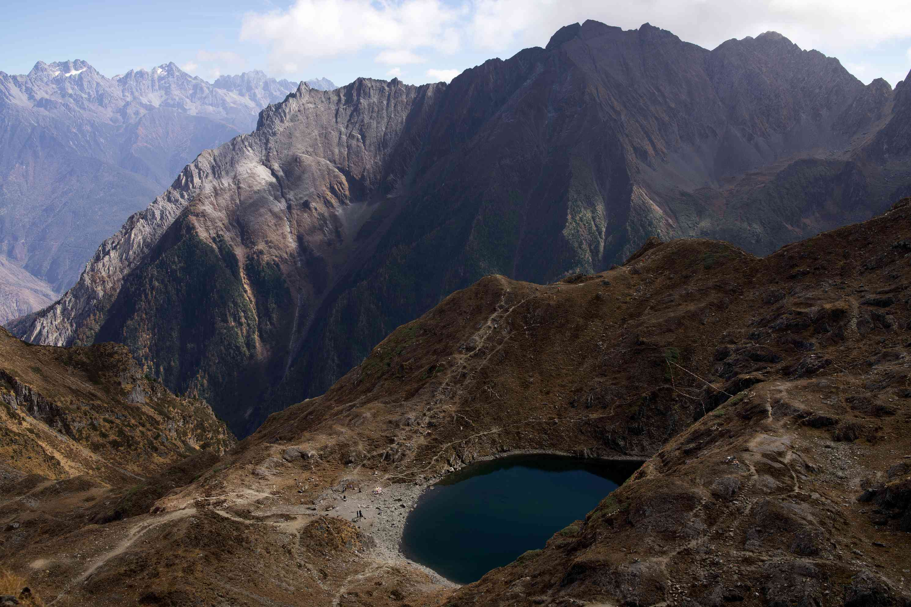
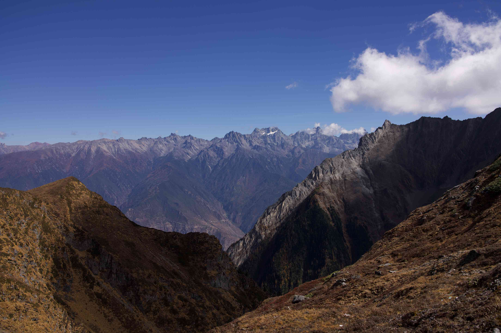

走神湖线时我和另外一个青旅遇见的小伙伴搭伴一起走，刚开始走一公里的时候我就把他甩开了。上山时我在四号休息点等了他快一小时，后来越等越冷，就先去爬神湖 Plus 了。下山时我在小木屋里也等了一个多小时，我觉得既然约定好搭伴一起走，有必要把人家等下山，上山没必要等。当时等到他下山以后是三点多，如果再晚一点我可能就先下去了。徒步这个运动找一个合适的小伙伴还挺难的，以后我可能也不会再去找人一起走了，比较影响自己的节奏。最后我下山的时候也没有等他，用越野跑的方式先到格桑云浪餐厅吃了牛腩饭，边吃边等他。

虽然说了神湖线这么多看上去是负面的内容，但神湖线是雨崩村里面四条线风景最好，路线变化最丰富，最有人情味儿，最能够感受到所谓的高原徒步的路线。很推荐大家来进雨崩徒步时，有能力有条件都走一遍神湖线，尽量早一点出发，慢慢走。它最高海拔是 4700 米，很少有如此完备的设施能够支撑我们在 4700 米海拔的地方去徒步。很多 4700 米的地方没有什么人烟，相对会危险一些，神湖线是比较成熟且人员众多，相对有保障性的一条线。

## 尼农出村
我总共在雨崩村住了四个晚上，待了五天，最后一天还是选择从尼农出村。出去的时间稍微晚了一点，八点半才出发，走到格阁家饭店将近十一点左右。再慢一点的话，很有可能会赶不上十一点半的大巴，所以大家最好还是八点钟出门吧。出村的路上没什么风景，唯一好些的地方是在一号休息点，小卖部开门了，大家可以在一号小卖部那里好好地休息一下。如果你出发得比较早的话，那里的风景真的是整个尼农线最好的了。

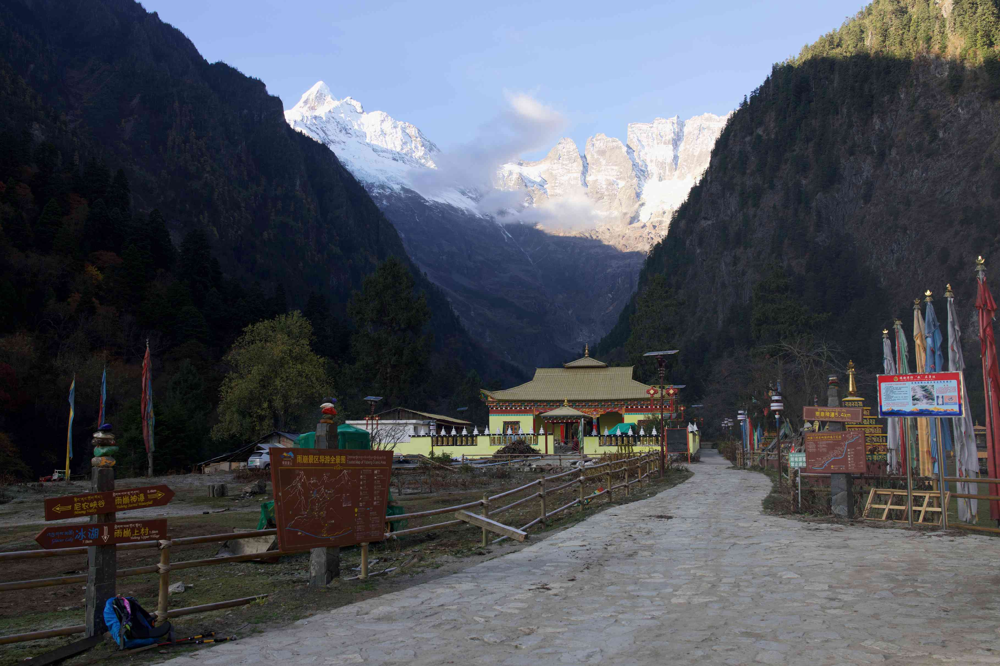
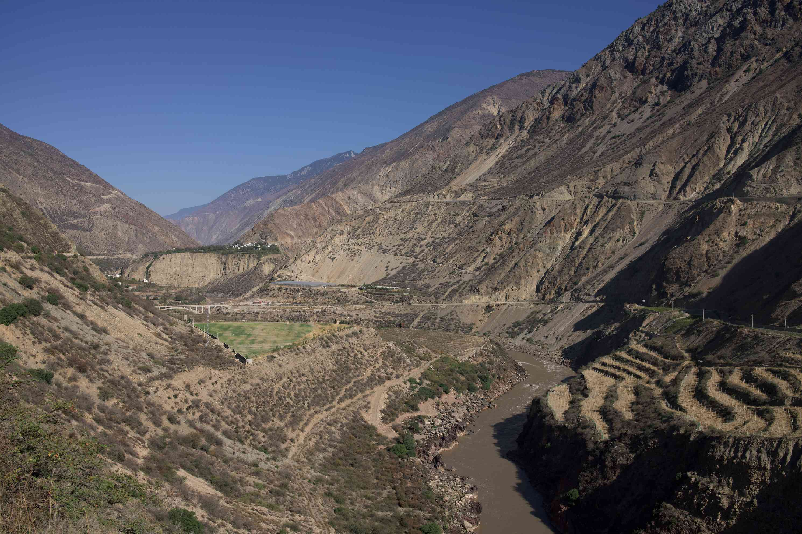

大巴不会准时的 11 点半出现在饭店门前，而是大概 11 点 40 左右才姗姗来迟。坐上大巴就是四个小时回香格里拉的路程了，中间会在德钦县城停一下。中途会在一个距离香格里拉还有三十多公里的加油站让大家上一个厕所。我比较推荐早上 11 点半这班大巴去香格里拉，下午的大巴时间回到香格里拉更久了，而且路上还得重新走一遍堵车的路线，是比较难受的。

前面也有说到，从雨崩村回香格里拉住的还是丹舍青旅。这次我因为提前和前台小哥勾兑好了我的二人间预订，很顺利地就住到了只有我一个人的二人间。环境很好很舒服，价格两晚的话就 110 元左右。第二次到香格里拉我的心态放平了很多，更多的是一种感受在地文化的心态。我晚上决定了一定要去到锅庄舞的现场，因为上一次去错了地方，以及再去一趟马孔多酒吧，再去听一听我非常喜欢的文艺青年小哥。

天一黑，四方街上就有当地村民带领大家去跳锅庄舞了。我尝试学了几招，还是很难融进去，主要是没有踩对它的节奏，再加上我带了相机不方便。人越聚越多，游客和当地人都很喜欢跳锅庄舞。四方街周边的商铺二楼有很多免费的观景台，大家如果想看到锅庄舞全景，可以留意一下哪个观景台上人最多，跟着人流走就行。

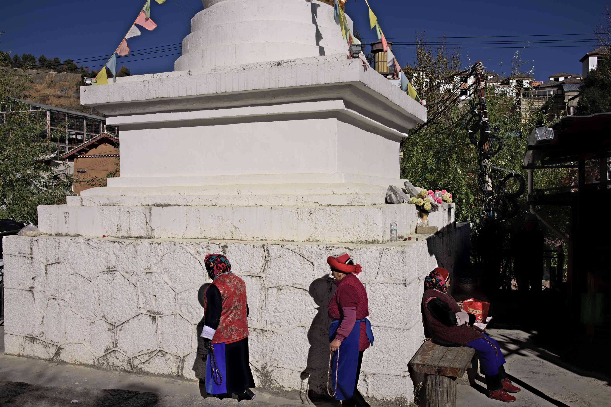

独克宗古城里有很多有意思的文艺小店，我逛了四五家，买了一个冰箱贴。至于藏香，家里主要是养了小猫咪，小猫咪对这些特殊气味比较敏感，我还挺喜欢闻藏香的味道的。独克宗古城里的酒吧都是清吧且民谣居多，缺少很多丽江那种活力四射的酒吧。正因如此，古城里很有阳朔早期以及丽江更早期的味道在。我不知道下次再去独克宗古城还能否感受到这些氛围。我总觉得放一个大喇叭播一些 DJ，搞一些花手，这些东西实在是不太行。虽然我不否认人民大众的文化需求是多样的，但听多了以后，总觉得这些东西不对劲。

我还买了咖啡当伴手礼，因为身边小伙伴有非常爱喝咖啡的。我最近也在慢慢地去切换咖啡饮用模式为豆子。想尝试每天早上起来留出半个小时的时间让自己去磨豆，去慢慢地给自己冲一杯咖啡。我觉得让自己慢下来以后，比较好的一点就是可以磨掉自己的一些戾气，磨掉自己的一些棱角。让自己接受慢下来的生活，不用每天两眼一睁就想着说今天要去做多少事儿，去完成多少目标。这些东西是对的，但人嘛，总得要去感受一下不同的生活方式，要通过不同的生活方式去找到自己不同的状态，要不然怎么会有所谓的人生百态呢？

## 先锋书店
转天，我原本打算是在香格里拉报一个徒步团，去到另外一个海拔同样在 4600 米左右的徒步路线。后来想了一下，没必要让自己这么累，体验这么单一，所以我又去查了一下香格里拉市区以及周边还有什么好玩的地方，「香格里拉先锋书店」就这么冒出来了。先锋书店它既不在市区，也不在郊区，而是在二十多公里外的一个小村庄里。它是三栋老藏房改造具备了书店、文创店和咖啡店的综合片区。

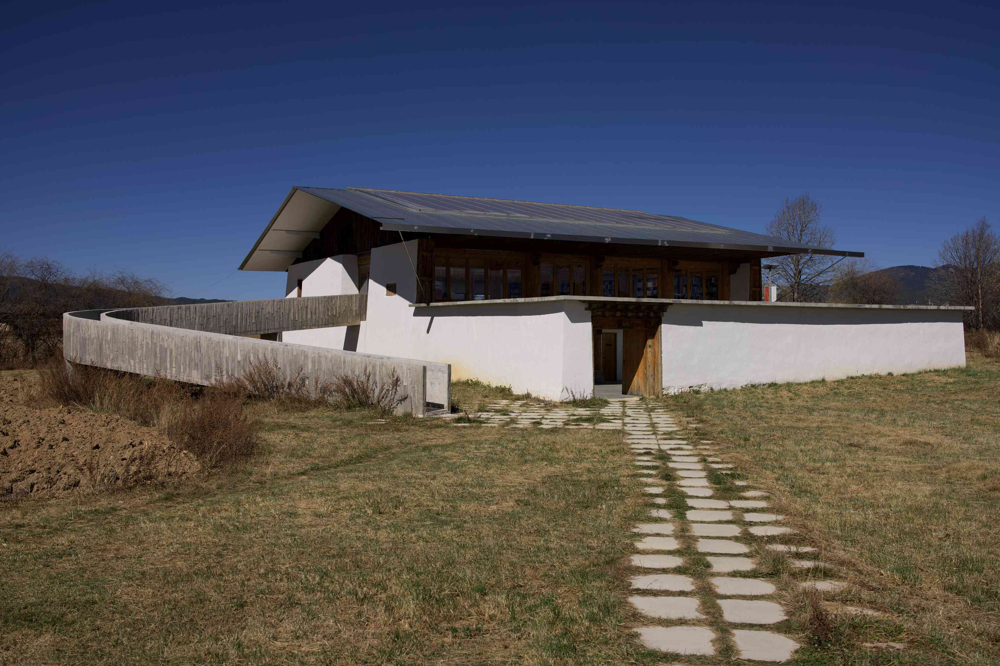
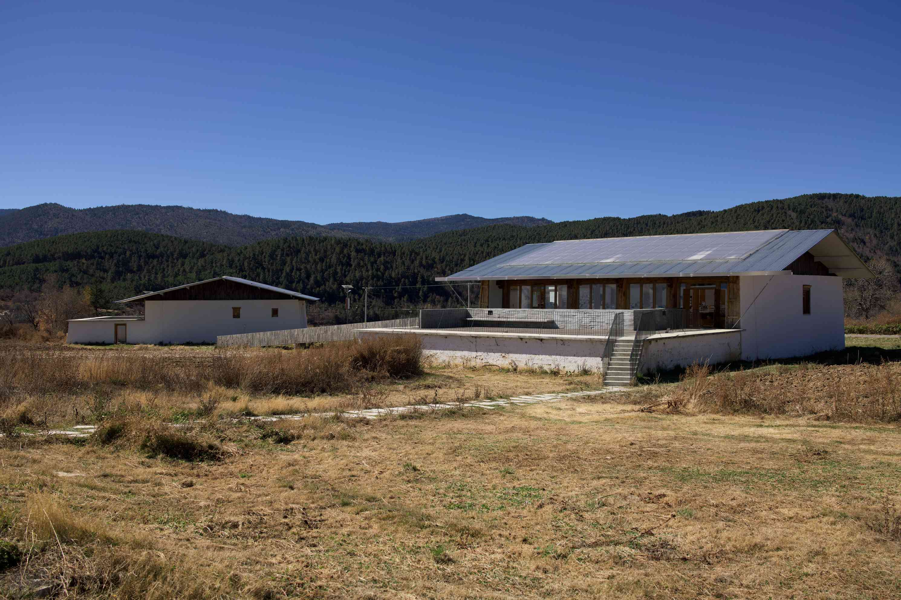

去到先锋书店的方式有三种，官方小红书账号上说有公交车和小巴车可以到。原本打算就是用这个方式去到那里的，但尝试联系了一下官方的小红书，直到现在他们还没回我。有人说可以包车，还有人说可以租电动车去。包车对我来说太不值当了，因为就一个人。后来咬咬牙，在如此冷烈的天气里选择了租电动车。先是在 Miniso 买了一副手套，在古城北门的一个电动车租赁店花了五十块钱租了一辆续航 150 公里，冬天大概只有 100 公里的电动车。自己一个人从古城北门开了二十多公里，到了村庄里的先锋书店。

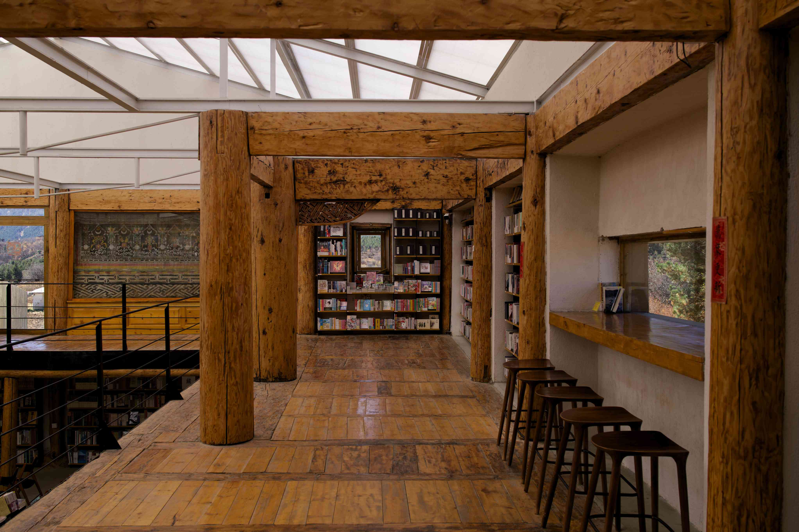

先锋书店当天可能都不到十个顾客，很难想象这家书店要靠什么样的方式才能够盈利，才能够养活里面大概五个人左右的店员，还有房租和水电，我原价买了一本书支持了书店。文创店里我看上了藏文书签，但我喜欢的纹饰没货了，只有偏白族的两套文饰书签。还有一个纹路都是藏文的斜跨包，我也很喜欢，价格也不算贵，只要七十多块钱。咬咬牙转了好几圈还是没买，还是没买，如无必要物增实体嘛。

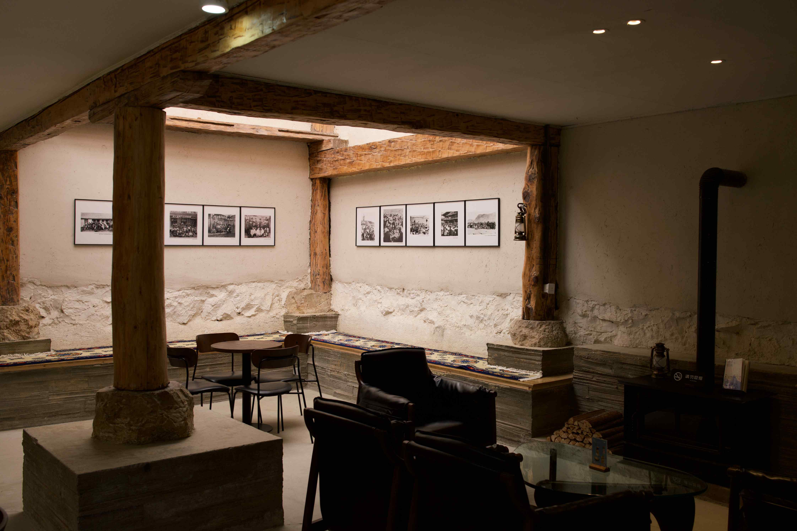
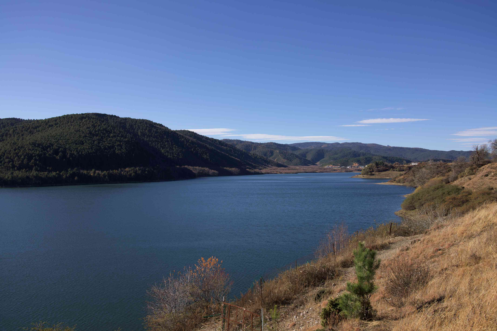

我对先锋书店最喜欢的地方就是咖啡馆了。先不说咖啡馆的内部装修如何，它外部的一个连廊直接连到了小中甸水库。水库风景非常的漂亮，虽然是秋天，外面的山坡上都是黄色的景象，但是黄色配蓝色的湖面，还有天空中透彻无云的蓝天，蓝黄蓝三明治夹心的配色很漂亮。我坐在山坡上读着刚刚买的书，晒着太阳，吹着微风，听着鸟叫，这一切都太惬意了。我甚至还尝试躺在山坡上睡觉，但阳光过于强烈，只眯了几分钟就起来了。

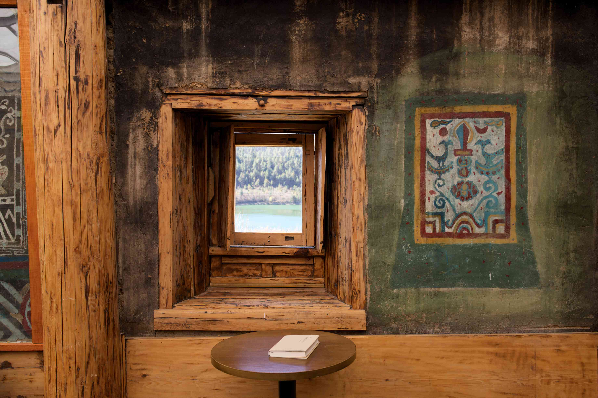

之前说了是因为老藏房嘛，所以咖啡馆墙壁的内饰上还有留有很多壁画，先锋书店都把完整的壁画都给裱起来了，这些壁画纹路都非常的漂亮。咖啡馆整体都是木质结构，因为藏民信佛，所以很多木纹装饰都偏向佛教，一进入到咖啡馆里就能够感受到浓浓的藏传佛教的味道。屋顶是透光的，不需要暖气，也能够在屋子里感受到暖暖的阳光。我在咖啡馆里点了一份下午茶套餐，总共 62 块钱，青稞拿铁配一块巧克力蛋糕。其实偏贵的，但我一想到这是离香格里拉市区二十多公里外的一个小村庄，还能够提供午茶已经很不错了，再搭配它周边的环境，那就还行吧。

## 拉市海
我这趟行程总共是十一天。最后一天是在丽江机场晚上九点半左右的飞机，所以我打算早一点到丽江，找一个地方逛一逛。丽江古城在三四年前来的时候，基本上已经逛了差不多了。我知道丽江古城非常的漂亮，尤其到了晚上，简直就是全国独一无二的地方。但因为古城逛多了，已经有点不太想再去感受那个氛围了，在找有没有一些类似于先锋书店这种地方。

发现了拉市海这个地方，但拉市海之前我也来过，还是下飞机后在丽江的第一站。那会是在拉市海骑马走了一段茶马古道，体验还行吧，但看不到拉市海本身只能远观看到一点水。这次再查资料我看到大家都推荐去拉市海附近的打渔村，那里有几家非常不错的咖啡馆，决定就去拉市海好好地感受一下丽江的另一面。

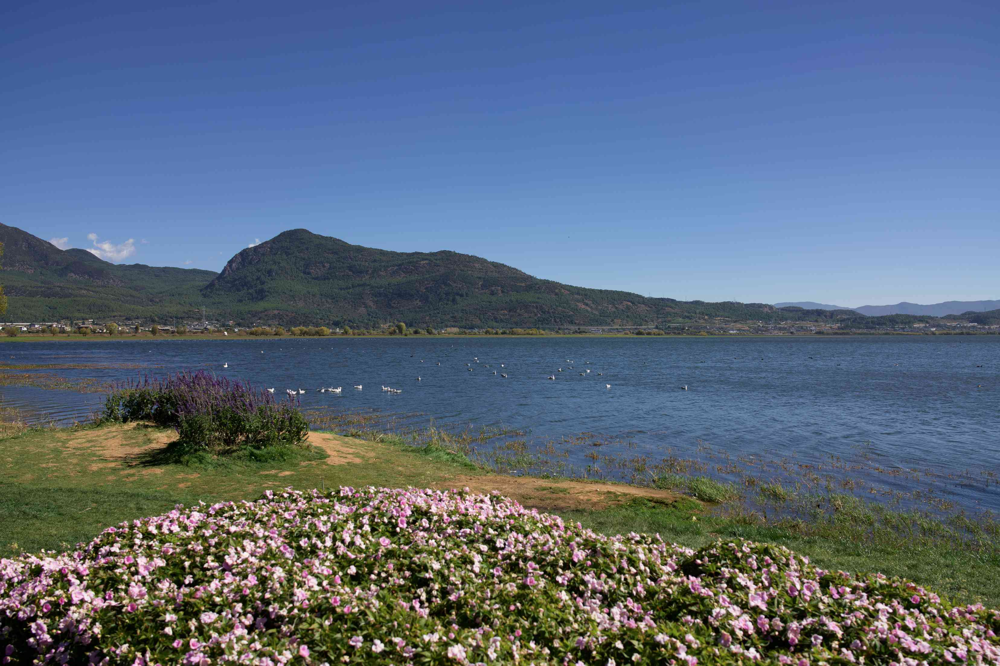
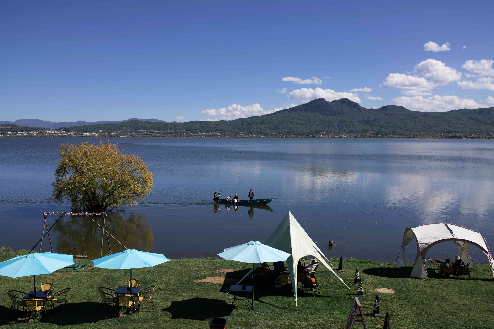

打渔村最近这两年才招商引资弄起来，好几家民宿、饭馆和咖啡厅都在建设中。打渔村这个地方我观察了一下，基本上都是当地的人过来逛，像我这样的游客很少。这里面有几家比较龙头的咖啡馆，其实环境比较好的也就那几家。我选了人不太多的一家吃了个午饭，点了一杯拿铁，一盘薯条和鸡翅。吃完以后不太舒服，太油了，疯狂喝水。在这家咖啡馆的二楼望着拉市海，看了一会儿书。

大概下午四点多我打车去到了丽江古城，担心晚上这地方不好打车，距离古城不算远但也有段距离。丽江古城这次白天逛发现跟三四年前来的时候已经不太一样了。之前来的时候几乎全古城都是旅拍店，都是各种摄影师跟在游客身后拍照，对于游客来说体验不太好。这次去反而多了很多有意思的小店，让你可以进去逛，发现不同感觉和氛围的小店。

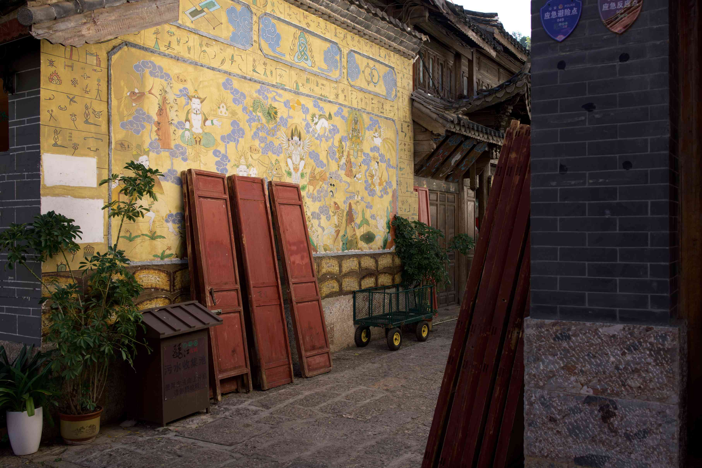

之所以决定要来丽江古城再逛一下，本质原因其实是因为我在香格里拉先锋书店买了那本书看完了。距离晚上登机还有差不多四五个小时，我想再买一本书去看。我对后半段的旅行体验已经没有什么东西想去感受了，就想好好地看一些书，增加自己在路上的感觉。说白了就是我的肉体粮食已经吃饱了，我的精神食粮还需要补充。

大概是在晚上六点半的时候去到了古城南门，找到了去往机场的上车点，花了二十块钱坐上了大巴车。之后就一直在机场看书，等待上飞机，飞机非常准时，一分不差地起飞，离开了丽江。

## 跋
这趟是我的第二次徒步旅行，越来越喜欢这种独自一个人走在路上的感觉。之前是喜欢一个人在路上的感觉，这一次变成了走在路上的感觉。还规划了两条十二月份的徒步旅行路线，但不知道能不能成行，距离十二月还有一段时间。旅行可能一开始给你预期留下的东西并不是你最后得到的东西，我到了最后居然最舍不得并不是哪里的雪山或者景色，而是路上遇到的小伙伴，我们一起走过的线，聊过的天，吐槽过的事。

中间有人问过我要不要一起去爬雪山，下意识地就给拒绝了。因为我喜欢的并不是攀登高峰的感觉，而是走在路上的感觉。我暂时还没有感受到爬雪山是快乐的，我也不想去感受。我现在想更多去体验和感受大家都感受过的东西，说白了就是还没有到那个阶段。现在这个阶段更想是一个人走在路上。虎跳峡和雨崩给我感觉香格里拉甚至是整个云南国际化浓度太高了。我也不知道老外怎么就对这一片土地这么向往，明明他们可以去其他省份体验更加丰富多彩的中国文化，却选择来云南进行徒步户外，确实很小众。

我现在反而对那些具体的某个景点兴趣在降低，但是对较为深入的，不管是通过走，还是跟更多的人产生连接和交流的这种旅行方式兴趣越来越高。甚至我觉得旅行，它除了形式上和旅游不同以外，更多的可能是和在地文化的连接。去到更多的地方，它并不能解决什么问题，它也不应该去解决问题，纯粹就是一个互相校验的过程。你的认知在得到了一定成长之后，来到了承载这个认知和孵化这个认知的地方，你去做了一个确认，哦，原来这些东西它就在那里，这些东西它确实就是这样子的。它会不停地去拟合你的认知曲线。

可能我们人对旅行赋予了太多的意义，而忘记了它本来的意义。往前翻别说几百年了，你就往前翻一百年，甚至两百年，旅行这个东西它都是很奢侈或者是很小众，很难得的一种体验。我不知道旅行这个东西它背后到底是一场骗局还是一种消费的新手段。但只能说我所感受到的旅行，它不是那种说我比你去到了更多的地方，所以我比你厉害，不是的，根本不是这样的。

而是说你去到了更多的地方，所以你的脑子容错的概率就更多。你知道了不同的地方的人是怎么生活的，好的生活方式和品质大概率是千篇一律的。但是忘记掉这些好的生活品质条件的枷锁，你去看到不同时期、不同地区、不同的人是如何生活的，他们是靠什么样的文化方式去支持着他们一代又一代的繁衍，这个事情本身是件很有趣的，或者说我们人本身就是想去对比和了解在这个星球上不同区域的同种族的人，同为人类他们是怎么生活的。

后面我还想再体验一两次这种徒步旅行，度假式旅行就交给和家人出行吧，让我们在全世界相遇！